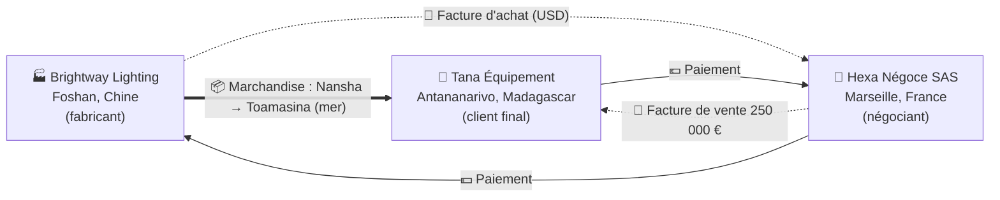
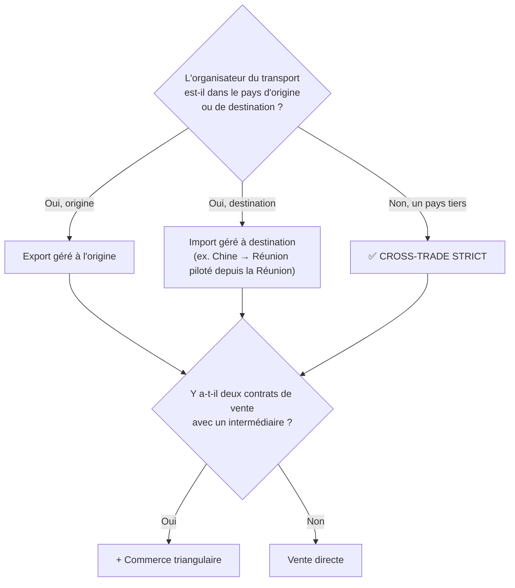
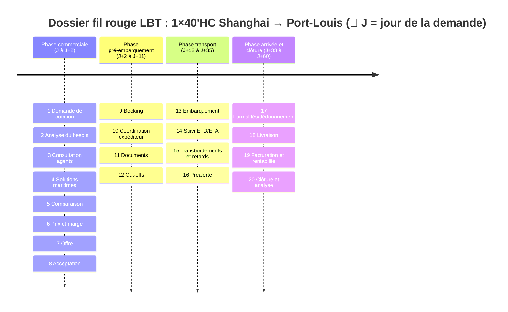
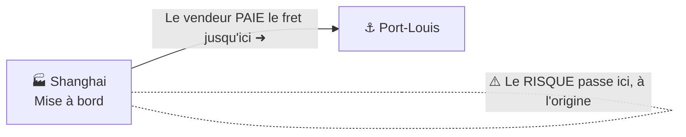
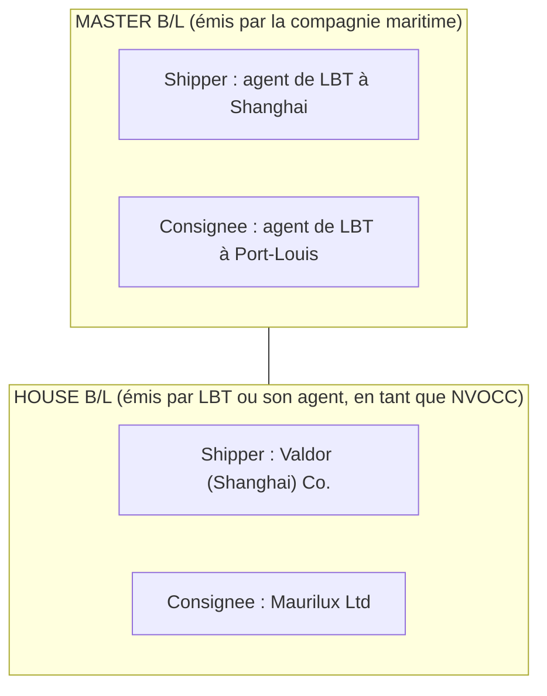
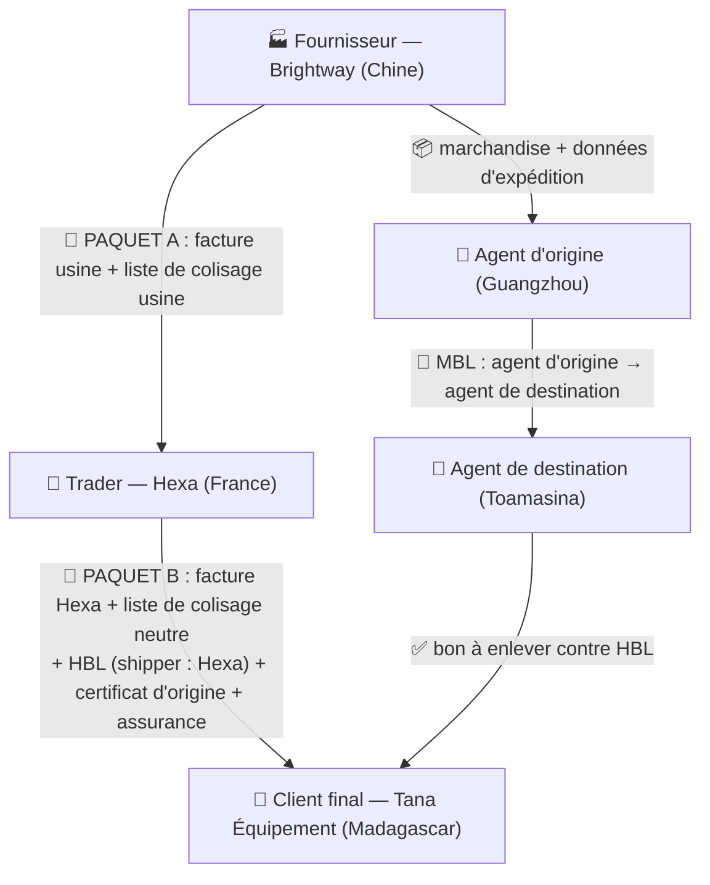

# LIVRABLE A — COURS COMPLET (Partie 1 : Modules 1 à 5 bis)

# 🚢 « UN CONTENEUR, TROIS PAYS, UNE SEULE OPÉRATION »
## Masterclass Cross-Trade International — Comprendre, organiser, sécuriser et développer les opérations maritimes entre l'Asie, l'océan Indien et le monde

> **Avertissement pédagogique.** Toutes les entreprises, personnes, navires, numéros de documents, tarifs et montants de ce cours sont **fictifs** et construits à des fins pédagogiques. Toute ressemblance avec une entreprise réelle est fortuite. Les tarifs ne reflètent pas le marché à une date donnée. Les règles juridiques citées sont identifiées comme telles, avec leur source et leur date de vérification dans le Livrable G. Code couleur utilisé dans tout le cours :
>
> - ✅ **Fait vérifié** : règle ou fait sourcé (voir Livrable G).
> - 🧪 **Hypothèse / donnée pédagogique** : chiffre ou situation inventés pour l'exercice.
> - ⚖️ **Obligation légale** vs 🤝 **Pratique commerciale** : on les distingue systématiquement.

---

## 🎯 Objectifs pédagogiques

À la fin de la Masterclass, l'étudiant sera capable de :

| # | Objectif | Niveau (Bloom) | Vérifié par |
|---|----------|----------------|-------------|
| 1 | **Définir** et **distinguer** Cross-Trade strict, commerce triangulaire, importation classique, transit international et coordination d'expéditions | Comprendre | QCM 1-4, Vrai/Faux |
| 2 | **Cartographier** les trois flux (physique, documentaire, financier) d'une opération réelle | Analyser | Exercice pratique 1 |
| 3 | **Dérouler** les 20 étapes d'un dossier maritime FCL de la cotation à la clôture | Appliquer | Simulation 1 |
| 4 | **Choisir** un Incoterm® 2020 adapté et en expliquer les conséquences (frais, risques, assurance) | Évaluer | Exercice pratique 2 |
| 5 | **Lire et contrôler** un B/L, une facture et une liste de colisage ; repérer les incohérences | Analyser | Exercice pratique 3 |
| 6 | **Construire** une cotation chiffrée 40'HC et calculer marge brute, taux de marge et taux de marque | Appliquer | Exercice pratique 4 |
| 7 | **Gérer** une situation de crise (retard, roll-over, B/L erroné, D&D) et rédiger la communication | Créer | Simulations 2 et 3 |
| 8 | **Identifier** les points de conformité (origine, valeur, sanctions, ICS2, statut fiscal de La Réunion) | Évaluer | Étude de cas finale |
| 9 | **Proposer** un modèle de développement Cross-Trade rentable pour un transitaire réunionnais | Créer | Étude de cas finale |
| 10 | **Adopter** le point de vue du client, du fournisseur, du trader et du transitaire, et **organiser** la confidentialité avec un agent local | Analyser | Jeu de rôle 5B.5, exercice 6 |

---

## ⏱️ Déroulé de la séance (2 h 30 à 3 h, modulable)

| Séquence | Contenu | Durée | Format court (2 h) |
|----------|---------|-------|--------------------|
| Ouverture | Scénario « 250 000 € qui ne passent jamais par la France » | 10 min | 8 min |
| M1 | Cross-Trade vs triangulaire vs import | 15 min | 12 min |
| M2 | Acteurs et trois flux | 12 min | 8 min |
| M3 | Les 20 étapes d'un dossier | 25 min | 15 min |
| ☕ Pause | — | 10 min | 5 min |
| M4 | Incoterms® 2020 | 15 min | 10 min |
| M5 | Documents (B/L, Switch B/L…) | 15 min | 10 min |
| M5 bis | Quatre points de vue (client, fournisseur, trader, transitaire) et agent local | 15 min | 8 min |
| M6 | Cotation et rentabilité | 20 min | 15 min |
| M7 | Simulation de crise | 20 min | 12 min |
| M8 | Douane, fiscalité, conformité | 12 min | 8 min |
| M9-M10 | Stratégie, digitalisation, IA | 13 min | 7 min |
| Clôture | Synthèse + quiz éclair | 8 min | 5 min |

Le **fil rouge** de toute la séance est un dossier fictif ouvert au premier jour du cours par le transitaire fictif **Lagon Bleu Transit (LBT)**, installé au Port (La Réunion) : un conteneur 40'HC Shanghai → Port-Louis (Maurice). Les étudiants « travaillent » chez LBT, au service Cross-Trade, et prennent les décisions au fil des modules.

---

## 🎬 SCÉNARIO D'OUVERTURE — « 250 000 € qui ne touchent jamais le sol français »

*(Le professeur éteint la lumière, projette une carte : Foshan, Marseille, Antananarivo. Trois points. Aucune flèche.)*

> « Lundi, 8 h 12. Claire, directrice commerciale d'**Hexa Négoce SAS**, une PME de Marseille, signe une commande de **250 000 €** avec **Tana Équipement SARL**, un distributeur d'Antananarivo, à Madagascar : 3 conteneurs de luminaires LED professionnels.
>
> Problème : Hexa Négoce n'a ni usine ni entrepôt. Les luminaires sont fabriqués par **Brightway Lighting**, une usine de Foshan, dans le delta de la rivière des Perles, en Chine. Ils partiront du port de **Nansha** et arriveront au port de **Toamasina**. Ils ne passeront **jamais** par la France.
>
> Alors je vous pose quatre questions — ne répondez pas tout de suite, notez votre intuition :
> 1. Comment une entreprise française peut-elle vendre un produit qu'elle ne touche jamais ?
> 2. Qui organise le transport — et depuis quel pays ?
> 3. Qui facture qui ?
> 4. Et surtout : **qui gagne de l'argent**, et combien ? »

*(Silence. Puis on dessine les flèches, une par une.)*



**Révélation (après 2 minutes de débat) :**
- Il y a **deux contrats de vente** : Brightway → Hexa, puis Hexa → Tana. C'est du **commerce triangulaire** (ou *négoce international*).
- La marchandise suit **un seul trajet physique** : Chine → Madagascar.
- Si Hexa confie le transport à un transitaire **français** (ou réunionnais !) qui pilote un flux Chine → Madagascar sans que la marchandise touche son pays, ce transitaire fait du **Cross-Trade** au sens strict.
- Qui gagne de l'argent ? Le négociant (sa marge commerciale : environ 50 000 € 🧪 dans notre Cas 3), le transitaire (sa marge de transport : quelques centaines d'euros par conteneur 🧪), la compagnie maritime, les agents, la banque (frais de crédit documentaire), l'assureur.

> 🧠 **À retenir dès la 10e minute :** *Le commerce triangulaire concerne les **contrats et la propriété**. Le Cross-Trade concerne **celui qui organise le transport**. Les deux peuvent se combiner… ou pas.*

---

# MODULE 1 — UNE INTRODUCTION QUI MARQUE LES ESPRITS : QU'EST-CE QUE LE CROSS-TRADE ?

## 1.1 🎣 Accroche — « Le transitaire qui ne voit jamais la marchandise »

> Un transitaire du Port, à La Réunion, organise chaque mois une vingtaine de conteneurs Shanghai → Port-Louis. Il ne voit jamais un seul de ces conteneurs. Il ne paie aucun droit de douane à La Réunion. Il ne les assure pas lui-même. Et pourtant, c'est lui qui encaisse la facture de transport et qui « possède » le dossier. **Quel est son métier ? Que vend-il, exactement ?**

Réponse : il vend de la **coordination**, de la **connaissance du réseau** et de la **sécurité opérationnelle**. C'est le cœur du Cross-Trade.

## 1.2 📖 Explication — Cinq notions à ne jamais confondre

| Notion | Question-clé | Définition simple | Exemple |
|--------|--------------|-------------------|---------|
| **Importation / exportation classique** | Combien de pays ? | Un vendeur du pays A vend à un acheteur du pays B ; la marchandise va de A à B. | Une usine de Yantian vend des meubles à un magasin de Saint-Pierre (Réunion). |
| **Commerce triangulaire (négoce international)** | Combien de **contrats** ? | Un intermédiaire achète dans le pays A et revend dans le pays C ; la marchandise va directement de A à C. Deux ventes, un seul trajet. | Hexa Négoce (France) achète en Chine et revend à Madagascar. |
| **Cross-Trade (sens strict, géographique)** | **Où est l'organisateur** du transport ? | Un transitaire (ou un transporteur) établi dans le pays X organise un transport entre deux pays Y et Z, **aucun des deux n'étant X**. | LBT (Réunion) organise Shanghai → Port-Louis (Maurice). |
| **Transit international** | De quoi parle-t-on ? | ⚠️ Double sens : (a) le **métier de transitaire** (*freight forwarding*) qui organise des transports internationaux ; (b) le **régime douanier de transit**, qui permet de faire circuler une marchandise sous douane, droits et taxes suspendus. | (a) « Je travaille dans le transit » ; (b) un conteneur débarqué à Marseille et acheminé sous transit douanier jusqu'à Lyon. |
| **Coordination d'expéditions** | Qui fait quoi ? | Activité générique du transitaire : réserver, documenter, suivre et livrer, avec des agents partenaires. Elle existe dans **toutes** les situations ci-dessus. | Gérer le booking, les documents et les relances pour n'importe quel dossier. |

> ⚖️/🤝 *Attention au vocabulaire fiscal européen* : en TVA intracommunautaire, l'expression « **opération triangulaire** » a un sens juridique précis (simplification applicable entre **trois États membres de l'UE**, art. 141 de la directive 2006/112/CE). Notre négoce Chine → Madagascar n'est **pas** cette « opération triangulaire » fiscale. Dans ce cours, « commerce triangulaire » désigne le négoce à trois parties au sens commercial.

## 1.3 🗺️ Visualisation — Le test des trois épingles

Plantez trois épingles sur une carte : 📍 **organisateur**, 📍 **origine**, 📍 **destination**.



Le test donne **deux réponses indépendantes** : une sur le transport (cross-trade ou non), une sur le contrat (triangulaire ou non). D'où quatre combinaisons :

| | Vente directe (1 contrat) | Commerce triangulaire (2 contrats) |
|---|---|---|
| **Organisateur dans le pays d'origine ou de destination** | Import/export classique (Cas 2 : Yantian → Port Réunion piloté depuis La Réunion) | Négoce avec transport géré par l'acheteur ou le fournisseur |
| **Organisateur dans un pays tiers** | Cross-Trade « pur » (Cas 1 : LBT pilote Shanghai → Port-Louis) | Négoce + Cross-Trade (Cas 3 : transitaire français pour Hexa, Chine → Madagascar) |

## 1.4 🔬 Approfondissement — « Chine → La Réunion, c'est du Cross-Trade ? »

C'est **la** question piège de la profession à La Réunion.

- Au sens **strict** : **non**. Si LBT, à La Réunion, organise l'importation d'un conteneur Yantian → Port Réunion pour un client réunionnais, l'organisateur est situé dans le **pays de destination** (plus exactement : le territoire de destination). C'est une **importation** pilotée par un transitaire de destination, qui travaille avec un **agent à l'origine** en Chine.
- Pourquoi certaines entreprises parlent-elles quand même de « service Cross-Trade » ? 🤝 Pratique commerciale : l'équipe **traite avec l'étranger** (agents chinois, compagnies maritimes, réservations à l'origine en *routing order*), parle anglais, gère des fuseaux horaires, des achats en USD — exactement les compétences d'un desk cross-trade. Le nom de service décrit alors une **compétence**, pas une **qualification juridique ou géographique**.
- Pourquoi la distinction compte-t-elle ? Parce que les **conséquences** diffèrent radicalement :

| Critère | Import Chine → Réunion | Cross-Trade strict Chine → Maurice |
|---------|------------------------|-------------------------------------|
| Douane à La Réunion | Oui : dédouanement à l'import (territoire douanier de l'UE ✅) | **Aucune** formalité douanière à La Réunion |
| Taxes réunionnaises (octroi de mer, TVA DOM) | Oui | Non |
| Déclaration préalable ICS2 (ENS) | Oui, l'entrée dans le territoire douanier de l'UE est concernée ✅ | Non pour Maurice (hors UE) — sauf cas particuliers d'escale dans un port de l'UE, à vérifier avec la compagnie |
| Qui dédouane à destination ? | Le transitaire réunionnais lui-même (ou son représentant en douane) | Un **agent de destination** à Maurice |
| Encaissement | Facture au client local, en EUR | Facture souvent en **USD**, à un client étranger, risque de change et de recouvrement |
| Risque principal | Taxes, délais, D&D locaux | Dépendance aux agents, crédit client, conformité « à distance » |

> 🧠 **À retenir :** *Le Cross-Trade n'est pas une question de langue ni d'équipe : c'est une question de **géographie de l'organisateur**. Chine → Réunion piloté depuis la Réunion = importation. Chine → Maurice piloté depuis la Réunion = Cross-Trade.*

## 1.5 Pourquoi le Cross-Trade existe-t-il ?

**1. Parce que celui qui décide n'est pas là où passe la marchandise.** Un vendeur européen avec une usine en Chine et des clients à Maurice veut **un seul interlocuteur**, dans **sa langue**, sur **son fuseau horaire**, qui le facture **dans un cadre juridique qu'il connaît**.

**2. Parce que la mondialisation a dissocié production, décision et consommation.** Le produit est conçu en Europe, fabriqué en Asie, vendu dans l'océan Indien. Les centres de décision (achats, finance) restent souvent en Europe ou dans les hubs régionaux.

**3. Parce que le contrôle du transport, c'est le contrôle de la relation client.** Le transitaire qui « tient » le dossier tient la donnée (dates, documents, prix), donc la relation.

**4. Parce que le réseau a de la valeur.** Un transitaire réunionnais qui connaît parfaitement les ports de Port-Louis, Toamasina, Longoni (Mayotte) et Moroni, et qui a des agents fiables à Shanghai, Ningbo ou Shenzhen, **vend cette connaissance**.

### Qui utilise le Cross-Trade ?

| Acteur | Pourquoi il en a besoin | Exemple régional 🧪 |
|--------|------------------------|---------------------|
| Négociants internationaux | Ils achètent et revendent sans entrepôt | Hexa Négoce (Marseille) |
| Groupes multinationaux | Achats centralisés, livraisons multi-pays | Une enseigne de bricolage avec centrale d'achat en Europe et magasins à Maurice et Madagascar |
| Distributeurs régionaux | Un siège à La Réunion, des filiales dans les îles voisines | Un distributeur de matériaux basé à Saint-Denis avec une filiale à Mayotte et à Maurice |
| ONG et projets de développement | Bailleurs en Europe, livraisons en Afrique de l'Est | Équipements médicaux Shanghai → Mombasa financés depuis Bruxelles |
| Transitaires eux-mêmes | Pour servir leurs clients au-delà de leur territoire | LBT pour ses clients européens |

### Avantages

| Pour le client | Pour le transitaire |
|----------------|--------------------|
| Un interlocuteur unique, dans sa langue | Revenus nouveaux, hors de son marché local saturé |
| Visibilité et suivi centralisés | Fidélisation (le client lui confie plus de flux) |
| Négociation globale des tarifs | Effet de réseau et volumes négociés avec les agents |
| Confidentialité commerciale préservée (si légale) | Valorisation d'une expertise régionale |

### Les idées reçues (Vrai/Faux préparatoire)

| Affirmation | Verdict | Explication |
|-------------|---------|-------------|
| « Le Cross-Trade, c'est illégal ou louche. » | ❌ Faux | C'est une organisation de transport parfaitement normale. Ce sont certaines **pratiques** (fausse description, contournement de sanctions) qui sont illégales. |
| « Le Cross-Trade sert à cacher l'origine des marchandises. » | ❌ Faux | L'origine est une notion douanière **qui ne change pas** avec l'organisation du transport ou un changement de documents. La masquer est une fraude. |
| « Le transitaire cross-trade est propriétaire de la marchandise. » | ❌ Faux | Le transitaire est un **prestataire** ; la propriété suit les contrats de vente. |
| « Un flux Chine → Réunion piloté depuis la Réunion est du Cross-Trade. » | ⚠️ Faux au sens strict | C'est une importation, même si l'équipe s'appelle « Cross-Trade ». |
| « Sans Switch B/L, impossible de faire du négoce. » | ❌ Faux | Le négoce peut fonctionner avec une House B/L, une Sea Waybill, ou en toute transparence. |
| « Le Cross-Trade est plus rentable que l'import. » | 🔶 Ça dépend | Marges parfois meilleures, mais risques (crédit, change, agents) plus élevés. |

## 1.6 Comparaison synthétique

| Dimension | Commerce international traditionnel | Commerce triangulaire | Cross-Trade |
|-----------|-------------------------------------|-----------------------|-------------|
| Nature | Vente | Montage contractuel (achat-revente) | Organisation du transport |
| Nombre de contrats de vente | 1 | 2 (ou plus) | 1 ou 2 (indifférent) |
| Pays impliqués | 2 | 3 | 3 (organisateur hors origine et destination) |
| Acteur central | Vendeur / acheteur | Négociant intermédiaire | Transitaire (ou transporteur) |
| Trajet physique | A → B | A → C (direct) | Y → Z |
| Enjeu principal | Prix, qualité, délai | Marge, confidentialité, financement | Coordination, réseau, maîtrise des risques |
| Document sensible | Facture, B/L | Facture du négociant, B/L (shipper/consignee) | Instructions aux agents, B/L, préalertes |

## 1.7 ✍️ Application — Question surprise (60 secondes)

> « Un navire quitte Shanghai avec un conteneur destiné à Madagascar. L'entreprise qui facture le client se trouve en France. **Où se réalise la vente, et quel acteur supporte le risque pendant le transport ?** »

**Corrigé :**
- La **vente** n'a pas de « lieu » unique et magique : elle est formée par le **contrat** entre le vendeur français et l'acheteur malgache, dont la loi applicable est celle choisie par les parties (à défaut, déterminée par les règles de conflit — souvent la Convention de Vienne de 1980 sur la vente internationale de marchandises si les États concernés y sont parties et si elle n'est pas écartée ; à vérifier au cas par cas).
- Le **risque pendant le transport** dépend de l'**Incoterm** du contrat Hexa → Tana. En CFR ou CIF Toamasina, le risque passe à l'acheteur malgache **dès la mise à bord à Nansha** : pendant la traversée, c'est **Tana Équipement** qui supporte le risque (d'où l'assurance, obligatoire pour le vendeur en CIF). En DAP Toamasina, le risque reste au vendeur français jusqu'à l'arrivée.
- Le lieu d'établissement du vendeur (France) **ne détermine pas** le transfert des risques.

> 🧠 **À retenir :** *Où est le vendeur ? Ça ne dit rien du risque. **Quel est l'Incoterm ?** Ça dit tout.*

---

# MODULE 2 — COMPRENDRE LES ACTEURS ET LES FLUX : « QUI CONTRÔLE RÉELLEMENT LA MARCHANDISE ? »

## 2.1 🎣 Accroche

> « Un conteneur est posé sur le quai de Port-Louis. Le chauffeur du transporteur routier se présente avec un camion. Le terminal refuse de le lui remettre. Pourtant la facture est payée. Pourquoi ? »
>
> Réponse : parce que le **flux documentaire** (le B/L original, ou l'autorisation de livraison) n'a pas suivi le **flux financier**. Le terminal ne connaît pas votre facture : il connaît le **bon à enlever** émis par la compagnie sur présentation du bon document. *Trois flux, trois chemins, trois rythmes.*

## 2.2 📖 Les acteurs — une distribution de théâtre

| Acteur | Rôle | Ce qu'il attend de vous | Ce qui peut mal tourner |
|--------|------|------------------------|-------------------------|
| **Fabricant / fournisseur** | Produit, emballe, prépare l'export | Une date de chargement claire, un booking confirmé | Marchandise pas prête, emballage non conforme, poids faux |
| **Vendeur intermédiaire (négociant)** | Achète et revend | Confidentialité, documents conformes à sa facture | Discordances entre ses deux factures, retard de paiement |
| **Acheteur / client final** | Reçoit et paie | Un délai fiable, des coûts sans surprise | Insolvabilité, refus de la marchandise, documents manquants pour son dédouanement |
| **Transitaire (freight forwarder)** | Architecte et chef d'orchestre du transport | — | Agents défaillants, erreurs documentaires, sous-estimation des coûts |
| **NVOCC** (*Non-Vessel Operating Common Carrier*) | Transitaire qui émet ses propres B/L (House B/L) et agit comme transporteur contractuel | — | Responsabilité de transporteur vis-à-vis de son client |
| **Agent d'origine** | Représente le transitaire au port de départ : booking local, collecte, documents, export | Instructions précises, paiement à temps | Mauvaise communication, frais surprises |
| **Agent de destination** | Préalerte, dédouanement, livraison | Préalerte complète, documents à temps | Libération sans paiement, erreurs de dédouanement |
| **Compagnie maritime (carrier)** | Transport principal, émet la Master B/L | Booking, SI, VGM avant cut-off | Roll-over, blank sailing, changement de rotation |
| **Terminal portuaire** | Manutention, stockage | Documents et autorisations | Congestion, frais de stationnement |
| **Transporteur terrestre** | Pré- et post-acheminement | Adresse, créneau, poids | Retards, mauvaise adresse, conteneur non accepté |
| **Douanes** | Contrôle, perception des droits et taxes, sûreté | Déclarations exactes et à temps | Contrôle, blocage, amende |
| **Autres autorités** | Sanitaire, phytosanitaire, normes | Certificats | Refus d'entrée |
| **Banques** | Paiement, crédit documentaire | Documents strictement conformes | Réserves, paiement bloqué |
| **Assureurs** | Couverture des marchandises | Déclaration du sinistre, réserves | Refus de prise en charge faute de réserves |

### Zoom : transitaire, commissionnaire, NVOCC — qui est responsable de quoi ?

- 🤝/⚖️ En France, le **commissionnaire de transport** organise le transport en son nom pour le compte de son client et répond, sauf exceptions, du fait des transporteurs qu'il choisit (art. L1411-1 et s. du Code des transports, et jurisprudence) — une responsabilité étendue. Le simple **mandataire** (transitaire au sens étroit) n'agit qu'au nom et pour le compte du client et ne répond que de ses fautes personnelles. Les conditions générales professionnelles (en France, celles de l'organisation professionnelle TLF, dans leur version en vigueur) encadrent souvent ces responsabilités.
- Quand le transitaire **émet sa propre House B/L**, il se présente comme **transporteur contractuel** vis-à-vis de son client : sa responsabilité est celle d'un transporteur maritime (avec ses limitations).
- **Message clé** : le même dossier peut engager LBT très différemment selon son **statut** dans l'opération. *Savoir quelle casquette on porte, c'est savoir quel risque on prend.*

## 2.3 Les trois flux

```mermaid
flowchart TB
    subgraph PHY["📦 FLUX PHYSIQUE"]
        direction LR
        U["Usine<br/>Shanghai"] --> CFS["Empotage<br/>(stuffing)"] --> TO["Terminal<br/>Yangshan"] --> N["🚢 Navire"] --> TD["Terminal<br/>Port-Louis"] --> CL["Client<br/>Maurice"]
    end
    subgraph DOC["📄 FLUX DOCUMENTAIRE"]
        direction LR
        BK["Booking"] --> SI["Shipping Instructions<br/>+ VGM"] --> BL["B/L"] --> PA["Préalerte"] --> DO["Bon à enlever<br/>(Delivery Order)"]
    end
    subgraph FIN["💶 FLUX FINANCIER"]
        direction LR
        CLF["Client paie<br/>le vendeur"] --> VF["Vendeur paie<br/>LBT"] --> LA["LBT paie<br/>agent + compagnie"]
    end
```



| Flux | Ce qui circule | Vitesse | Chemin |
|------|----------------|---------|--------|
| **Physique** | Le conteneur | 15 à 40 jours en mer | Port → port (avec transbordements éventuels) |
| **Documentaire / informationnel** | Booking, SI, VGM, B/L, factures, préalertes, déclarations | Minutes (électronique) à jours (courrier express des originaux) | Usine → agent → compagnie → transitaire → agent destination → client → douane |
| **Financier / commercial** | Paiements, factures, crédits documentaires, profit share | Jours à mois | Client → vendeur → (négociant) → fabricant ; transitaire ↔ agents ↔ compagnie |

### Pourquoi ces flux empruntent-ils des circuits différents ?

1. **Parce que les contrats sont différents** : le contrat de vente (vendeur-acheteur), le contrat de transport (chargeur-transporteur), les contrats de prestation (client-transitaire, transitaire-agents), le contrat bancaire.
2. **Parce que la confiance n'est pas la même** : le vendeur ne lâche pas le B/L original tant qu'il n'est pas payé → le document voyage « derrière » l'argent.
3. **Parce que les vitesses sont différentes** : sur Shanghai → Port-Louis (transit indicatif de 2 à 4 semaines selon le service 🧪), un B/L original envoyé par courrier express arrive bien avant le navire ; mais si le paiement tarde, le conteneur arrive **avant** que le B/L soit libéré → frais de stationnement.

> 🧠 **À retenir :** *La marchandise voyage en mer, les documents voyagent avec la confiance, l'argent voyage avec les contrats. Un bon transitaire synchronise les trois.*

## 2.4 ✍️ Application — Mini-défi (90 secondes)

> Dans l'opération Hexa Négoce (Chine → Madagascar), dessinez les trois flux. Qui envoie la facture à qui ? Qui reçoit le B/L ? Qui paie le fret si la vente Hexa → Tana est en CIF ?

**Corrigé :** Physique : Foshan → Nansha → (transbordement éventuel) → Toamasina → Antananarivo. Documentaire : Brightway remet les documents d'export ; le B/L est émis à l'ordre convenu ; Hexa transmet à Tana (directement ou via les banques) sa **propre** facture et les documents nécessaires au dédouanement malgache. Financier : Tana paie Hexa (EUR), Hexa paie Brightway (USD). En **CIF Toamasina**, c'est **Hexa** (vendeur) qui paie le fret principal et l'assurance — donc c'est Hexa qui est le client du transitaire.

---

# MODULE 3 — COMMENT FONCTIONNE UNE OPÉRATION CROSS-TRADE ? LES 20 ÉTAPES

## 3.1 🎣 Accroche — « Le mail de 7 h 03 »

> Mardi, 7 h 03 à La Réunion (11 h 03 à Shanghai). Dans la boîte de LBT :
>
> *« Hello, we need a rate for 1×40'HC Shanghai to Port Louis, CFR, cargo ready next Friday, aluminium outdoor furniture, 7.8 tons. Please revert ASAP. Best regards, Valdor Outdoor — Lyon. »*
>
> Vous avez une matinée. Le client consulte probablement trois transitaires. **Par quoi commencez-vous ?**

## 3.2 Vue d'ensemble — la frise des 20 étapes



Pour chacune des 20 étapes : **Qui ? Quoi ? Documents ? Délais ? Problèmes ? Anticipation du bon transitaire ?**

---

### ÉTAPE 1 — Réception de la demande de cotation (RFQ)
- **Qui :** client (Valdor Outdoor) → commercial ou *pricing* LBT.
- **Quoi :** accuser réception rapidement (🤝 objectif interne type : moins de 1 h), enregistrer la demande (CRM/TMS), attribuer un numéro.
- **Documents :** e-mail de demande, éventuellement fiche produit.
- **Délais :** le client compare souvent sous 24 à 48 h.
- **Problèmes :** demande incomplète (pas d'Incoterm, pas de poids, pas d'adresse d'enlèvement).
- **Anticipation :** une **check-list de qualification** systématique (voir étape 2) et un accusé de réception qui pose immédiatement les questions manquantes.

### ÉTAPE 2 — Analyse du besoin du client
- **Qui :** commercial LBT + client.
- **Quoi :** qualifier avec la **règle des 10 questions** :
  1. Incoterm et lieu exact (CFR **Port-Louis** ? ou livraison porte ?)
  2. Lieu d'enlèvement / adresse de l'usine, ou livraison au terminal par le fournisseur ?
  3. Marchandise : nature, code SH (*HS code*), dangereuse ou non (classe IMDG), température ?
  4. Poids brut, volume, nombre de colis, conteneur adapté (20', 40', 40'HC)
  5. Date de *cargo ready* et date d'arrivée souhaitée
  6. Valeur (assurance, conformité)
  7. Qui sont shipper, consignee, notify ?
  8. Mode de paiement (crédit documentaire ? B/L original ou Sea Waybill ?)
  9. Exigences de destination (certificats, étiquetage)
  10. Budget / concurrence / fréquence (one-shot ou flux régulier ?)
- **Documents :** fiche de qualification.
- **Problèmes :** un aluminium « outdoor furniture » à 7,8 t dans un 40'HC = cohérent (marchandise volumineuse et légère) ; si le client avait annoncé 28 t dans un 40', il fallait alerter (limites de poids routier et du conteneur).
- **Anticipation :** **contrôle de vraisemblance** poids/volume/marchandise dès la demande.

### ÉTAPE 3 — Consultation des agents à l'origine
- **Qui :** LBT → agents à Shanghai (en général 2 à 3 agents consultés).
- **Quoi :** demander les **frais origine** (THC, documentation, scellé, VGM, déclaration export, pré-acheminement) et leurs meilleurs **taux de fret** (l'agent peut avoir de meilleurs contrats locaux avec les compagnies).
- **Documents :** demande de tarif structurée en anglais (gabarit), avec Incoterm, marchandise, date.
- **Délais :** décalage horaire favorable : Shanghai a 4 h d'avance sur La Réunion (UTC+8 vs UTC+4) → envoyer **avant 10 h Réunion** pour une réponse le jour même.
- **Problèmes :** offres non comparables (l'un inclut la déclaration export, l'autre non).
- **Anticipation :** imposer **un format de réponse** (grille ligne par ligne) aux agents.

### ÉTAPE 4 — Recherche de solutions maritimes
- **Qui :** LBT (pricing) + agents + compagnies.
- **Quoi :** identifier les services Shanghai → Port-Louis : direct ou avec transbordement (hubs d'Asie du Sud-Est, du Moyen-Orient ou d'Afrique selon les services), fréquence, temps de transit, **fiabilité**, *free time* à destination.
- **Documents :** grilles tarifaires, *schedules*.
- **Problèmes :** un transit « annoncé » n'est pas un transit « réalisé ».
- **Anticipation :** garder un historique des **délais réels** par service et par transbordement.

### ÉTAPE 5 — Comparaison des offres

| Critère | Option A 🧪 | Option B 🧪 |
|---------|----------|----------|
| Fret 40'HC (USD) | 2 150 + BAF 380 | 1 980 + BAF 420 |
| Transit annoncé | 24 jours, 1 transbordement | 33 jours, 2 transbordements |
| Fiabilité constatée (historique LBT) | 80 % d'arrivées à ± 3 jours | 55 % |
| Free time destination | 7 jours | 5 jours |
| Validité | Jusqu'à fin de mois | 15 jours |

- **Problèmes :** choisir uniquement sur le prix.
- **Anticipation :** une **matrice coût-délai-fiabilité-risque** (voir Module 6, choix professionnel).

### ÉTAPE 6 — Calcul du prix de vente et de la marge
- **Qui :** pricing / commercial.
- **Quoi :** coût d'achat + marge + frais de dossier ; vérifier la **devise**, la **validité**, les **conditions** (« sous réserve des surcharges en vigueur à l'embarquement »).
- Détaillé au **Module 6**.

### ÉTAPE 7 — Présentation de l'offre commerciale
- **Quoi :** une offre claire : périmètre (ce qui est inclus / exclu), Incoterm, route, transit indicatif, validité, conditions de paiement, conditions générales applicables.
- **Problèmes :** offre ambiguë → litige au moment de la facture.
- **Anticipation :** toujours écrire **« Exclus : … »** (droits et taxes, frais destination, assurance, inspection, stationnement, D&D).

### ÉTAPE 8 — Acceptation de la cotation
- **Quoi :** obtenir un **accord écrit** (e-mail ou bon de commande) + les données du dossier (shipper, consignee, notify, marchandise, adresse d'enlèvement).
- **Problèmes :** acceptation orale, puis contestation.
- **Anticipation :** « Pas d'écrit, pas de booking. »

### ÉTAPE 9 — Booking auprès de la compagnie
- **Qui :** l'agent d'origine (ou LBT directement si LBT a un contrat avec la compagnie).
- **Quoi :** réserver l'espace ; recevoir la **confirmation de booking** (numéro, navire/voyage, ETD, cut-offs, dépôt de retrait du conteneur vide).
- **Documents :** booking request, booking confirmation.
- **Délais :** idéalement **7 à 14 jours avant l'ETD** en période normale ; davantage en haute saison (avant le Nouvel An chinois, par exemple) 🤝.
- **Problèmes :** pas d'espace ; booking confirmé sur un navire différent.
- **Anticipation :** vérifier **ligne par ligne** la confirmation (port de déchargement, type de conteneur, nombre).

### ÉTAPE 10 — Coordination avec l'expéditeur
- **Qui :** agent d'origine ↔ expéditeur chinois (shipper), sous supervision LBT.
- **Quoi :** retrait du conteneur vide, empotage (*stuffing*) à l'usine ou livraison au terminal, scellé, photos de chargement, poids.
- **Problèmes :** marchandise pas prête ; empotage mal fait (calage), photos manquantes.
- **Anticipation :** relance J-5 et J-2 ; demander les **photos d'empotage** (porte ouverte, conteneur plein, scellé).

### ÉTAPE 11 — Gestion des documents
- **Quoi :** recevoir facture commerciale et liste de colisage ; préparer et transmettre les **Shipping Instructions (SI)** ; déclarer la **VGM** ; préparer la déclaration d'export (Chine) ; vérifier le **draft B/L**.
- **Problèmes :** discordance poids/colis entre facture, packing list et SI.
- **Anticipation :** **règle des 4 yeux** sur le draft B/L avant validation.

### ÉTAPE 12 — Vérification des cut-offs
Il n'y a pas « un » cut-off mais plusieurs :

| Cut-off | Ce qu'il faut avoir fait | Conséquence si manqué |
|---------|--------------------------|----------------------|
| **SI / documentation cut-off** | Transmis les Shipping Instructions | B/L impossible ou frais de modification tardive |
| **VGM cut-off** | Déclaré le poids brut vérifié | ⚖️ Conteneur **non chargé** (SOLAS) |
| **CY / port cut-off (gate-in)** | Livré le conteneur plein au terminal | Conteneur roulé au navire suivant |
| **Customs cut-off** | Dédouané à l'export | Pas de chargement |

- **Anticipation :** un **tableau de bord des cut-offs** avec alertes J-2 / J-1.

### ÉTAPE 13 — Embarquement
- **Quoi :** confirmation de chargement (*loaded on board*), date de départ réelle (ATD), émission du B/L (*shipped on board*).
- **Problèmes :** conteneur laissé à quai (*shut-out*), navire en retard.
- **Anticipation :** vérifier sur le suivi compagnie **le jour même** ; ne jamais annoncer « parti » sans confirmation.

### ÉTAPE 14 — Suivi ETD / ETA
- **ETD** = *Estimated Time of Departure* ; **ATD** = *Actual* ; **ETA** = *Estimated Time of Arrival* ; **ATA** = *Actual*.
- **Quoi :** suivi au minimum aux jalons (départ, transbordement, départ du navire de second leg, arrivée).
- **Anticipation :** **information proactive** : le client doit apprendre un retard **par vous**, pas par sa propre recherche.

### ÉTAPE 15 — Gestion des transbordements et retards
- **Quoi :** surveiller le délai entre l'arrivée au hub et le chargement sur le navire de *feeder* ou de second leg.
- **Problèmes :** conteneur qui « dort » au hub (congestion, priorité donnée à d'autres conteneurs).
- **Anticipation :** alerte si le conteneur est au hub depuis plus de X jours (🧪 X = 5) ; escalade auprès de la compagnie via l'agent.

### ÉTAPE 16 — Préalerte de destination
- **Quoi :** envoyer à l'agent de destination (et au client) : copie B/L, facture, packing list, navire/ETA, numéros de conteneur et scellé, instructions de livraison, conditions de libération (*release*).
- **Délais :** dès l'émission du B/L, au plus tard **plusieurs jours avant l'arrivée** (🤝 standard interne : J+2 après départ).
- **Anticipation :** gabarit de préalerte normalisé (voir Livrable C).

### ÉTAPE 17 — Formalités et dédouanement selon le schéma retenu
- En **CFR Port-Louis**, le dédouanement import à Maurice est à la charge de l'acheteur mauricien, qui mandate son propre déclarant ou l'agent de LBT.
- En **DAP/DDP**, le vendeur (et donc LBT) doit organiser — et en DDP **payer** — le dédouanement à l'import : ⚠️ très risqué en Cross-Trade si l'on ne maîtrise pas la réglementation locale.
- **Anticipation :** savoir **avant le départ** qui dédouane, avec quels documents (certificat d'origine pour bénéficier d'éventuelles préférences tarifaires, etc.).

### ÉTAPE 18 — Livraison finale
- **Quoi :** libération par la compagnie (contre B/L original, *telex release* ou Sea Waybill), enlèvement, livraison, restitution du conteneur vide.
- **Problèmes :** **demurrage** (conteneur au terminal au-delà de la franchise) et **detention** (conteneur hors du terminal au-delà de la franchise).
- **Anticipation :** communiquer **le free time** au client **dès l'offre**.

### ÉTAPE 19 — Facturation et contrôle de rentabilité
- **Quoi :** facturer le client ; recevoir et contrôler les factures des agents et de la compagnie (**rapprochement achat/vente**) ; calculer la **marge réelle** vs **marge prévue**.
- **Problèmes :** facture agent arrivée trois mois après → marge négative découverte trop tard.
- **Anticipation :** **provisionner** (« accrual ») les coûts au moment de l'embarquement.

### ÉTAPE 20 — Clôture et analyse de performance
- **Quoi :** clôturer le dossier quand tout est encaissé et payé ; **retour d'expérience** : délai réel vs annoncé, incidents, satisfaction client, évaluation des agents.
- **Indicateurs :** voir Module 10.

> 🧠 **À retenir :** *Un dossier, c'est 20 étapes, 4 cut-offs, 3 flux et 1 seule règle : **le client doit toujours savoir avant de demander**.*

---

# MODULE 4 — LES INCOTERMS® 2020 ET LES RESPONSABILITÉS

## 4.1 🎣 Accroche — « Le conteneur tombé à l'eau »

> Un conteneur glisse lors du chargement à Ningbo et tombe entre le quai et le navire. La marchandise est perdue. Le vendeur dit : « Nous avons vendu FOB, ce n'est plus notre problème. » L'acheteur dit : « En FOB, le risque passe quand la marchandise est **à bord** — elle n'y est jamais arrivée ! » **Qui a raison ?**
>
> ✅ L'acheteur. En **FOB** (Incoterms® 2020), le risque passe quand la marchandise est **livrée à bord du navire**. Un conteneur tombé avant d'être à bord est encore aux risques du vendeur.

## 4.2 📖 Ce que les Incoterms® font… et ne font pas

Les **Incoterms®** sont des règles publiées par la **Chambre de commerce internationale (ICC)**. La version actuelle est **Incoterms® 2020**, en vigueur depuis le 1er janvier 2020 ✅. L'ICC a inscrit la révision suivante à ses travaux sans calendrier public de publication à la date de rédaction de ce cours — vérifier sur le site de l'ICC ✅.

| Les Incoterms règlent… | Les Incoterms ne règlent PAS… |
|------------------------|-------------------------------|
| Le **point de livraison** | Le **transfert de propriété** |
| Le **transfert des risques** | Le prix, la devise, le mode de paiement |
| La **répartition des frais** | Les sanctions en cas de manquement contractuel |
| Qui fait les **formalités** export/import | Le contrat de transport lui-même |
| Qui conclut le transport et l'assurance (selon la règle) | La loi applicable au contrat |

⚖️ **Ils ne s'appliquent que si le contrat les mentionne**, idéalement sous la forme : **« CFR Port-Louis, Maurice, Incoterms® 2020 »**.

### Risque ≠ propriété : l'erreur classique
- **Transfert des risques** : à partir de quand la perte ou l'avarie de la marchandise est-elle supportée par l'acheteur ? → **Incoterm**.
- **Transfert de propriété** : à partir de quand l'acheteur est-il propriétaire ? → **contrat de vente + loi applicable** (et éventuellement clause de réserve de propriété).
- Exemple : Valdor vend CFR Port-Louis avec réserve de propriété jusqu'au paiement complet. Le risque passe à Maurilux dès la mise à bord à Shanghai, **mais** Valdor reste propriétaire jusqu'au paiement. Si le conteneur est perdu en mer, Maurilux doit payer (le risque est sur elle) — d'où l'intérêt pour elle de s'assurer.

## 4.3 Les règles détaillées

Deux familles ✅ :
- **Règles pour tout mode de transport** : EXW, FCA, CPT, CIP, DAP, DPU, DDP.
- **Règles pour le transport maritime et fluvial uniquement** : FAS, FOB, CFR, CIF.

> 💡 L'ICC recommande de ne pas utiliser FOB/CFR/CIF pour les **conteneurs**, qui sont généralement remis au transporteur **au terminal**, avant la mise à bord : FCA, CPT et CIP sont alors plus adaptés ✅. En pratique 🤝, FOB et CFR restent massivement utilisés dans les flux Asie → océan Indien. Un bon transitaire **connaît la recommandation** et **explique le risque** au client.

| Règle | Livraison / transfert des risques | Transport principal payé par | Assurance | Dédouanement export / import | Intérêt en Cross-Trade / triangulaire |
|-------|------------------------------------|------------------------------|-----------|------------------------------|---------------------------------------|
| **EXW** Ex Works | Mise à disposition chez le vendeur, **non chargée** | Acheteur | Aucune obligation | Export : **acheteur** (problématique) / Import : acheteur | ⚠️ L'acheteur étranger doit faire l'export chinois : difficile. Préférer FCA. |
| **FCA** Free Carrier | Remise au transporteur désigné par l'acheteur (chez le vendeur **chargée**, ou à un autre lieu **non déchargée**) | Acheteur | Aucune obligation | Vendeur / Acheteur | ✅ Idéal pour un acheteur qui contrôle le transport ; option 2020 : B/L « on board » demandé au transporteur |
| **FOB** Free On Board | **À bord** du navire au port d'embarquement | Acheteur | Aucune obligation | Vendeur / Acheteur | Très fréquent ; le transitaire est nommé par l'acheteur (*routing order*, FOB inbound) |
| **CFR** Cost and Freight | **À bord** au port d'embarquement | **Vendeur** jusqu'au port de destination | Aucune obligation | Vendeur / Acheteur | ⚡ **Deux points critiques** : risque à l'origine, frais jusqu'à destination. Le négociant contrôle le transport. |
| **CIF** Cost, Insurance, Freight | **À bord** au port d'embarquement | Vendeur | **Vendeur**, couverture minimale ICC (C), 110 % de la valeur ✅ | Vendeur / Acheteur | Fréquent en crédit documentaire |
| **CPT** Carriage Paid To | Remise au **premier transporteur** | Vendeur jusqu'au lieu convenu | Aucune obligation | Vendeur / Acheteur | Équivalent multimodal de CFR (recommandé pour le conteneur) |
| **CIP** Carriage and Insurance Paid To | Remise au premier transporteur | Vendeur | **Vendeur**, couverture **ICC (A)** (tous risques sauf exclusions) par défaut en 2020 ✅ | Vendeur / Acheteur | Équivalent multimodal de CIF, couverture plus large |
| **DAP** Delivered At Place | Arrivée au lieu de destination, **prête à être déchargée** | Vendeur | Pas d'obligation (mais le vendeur a intérêt à s'assurer) | Vendeur / **Acheteur** | Le vendeur supporte le risque en mer ; nécessite un agent de destination fiable |
| **DPU** Delivered at Place Unloaded | Au lieu de destination, **déchargée** | Vendeur | Pas d'obligation | Vendeur / Acheteur | Rare ; seule règle où le vendeur décharge |
| **DDP** Delivered Duty Paid | Au lieu de destination, prête à décharger, **dédouanée import** | Vendeur | Pas d'obligation | Vendeur / **Vendeur** | ⚠️ Très risqué en Cross-Trade : le vendeur (et son transitaire) doivent dédouaner et payer les taxes **dans un pays étranger** |

### Les deux points critiques des règles en « C »



> **Phrase mnémotechnique** : *« En C, le vendeur paie le voyage, mais l'acheteur voyage à ses risques. »*

## 4.4 Exemples de négociation

**Négociation 1 — Valdor (vendeur européen) ↔ Maurilux (acheteur mauricien)**
- Maurilux demande **DAP Port-Louis entrepôt** : « Je ne veux pas m'occuper du transport. »
- Valdor, conseillé par LBT, propose **CFR Port-Louis** : Valdor paie le fret (et garde la maîtrise du transport via LBT), mais **ne prend pas** le risque mer ni le dédouanement mauricien.
- Compromis 🧪 : **CIF Port-Louis** avec assurance **ICC (A)** (au-delà du minimum légal de la règle CIF) : Maurilux est rassurée, Valdor garde le contrôle.

**Négociation 2 — Hexa (négociant) ↔ Brightway (usine) et Tana (client)**
- Achat : **FOB Nansha** (ou mieux **FCA Nansha terminal**). Hexa contrôle le transport.
- Vente : **CIF Toamasina** (exigée par la banque de Tana dans le crédit documentaire).
- Résultat : Hexa contrôle tout le transport principal et les documents, ce qui lui permet de gérer la **confidentialité** (B/L à son nom comme shipper — Module 5).

**Négociation 3 — Le piège DDP**
- Un client européen demande à LBT : « Livrez-moi en DDP Antananarivo, c'est plus simple. »
- LBT doit expliquer : en DDP, le vendeur est l'**importateur de fait** à Madagascar : il doit pouvoir y être déclarant (ou représenté), payer droits et taxes locaux, et assumer les contrôles. Sans entité ou représentant fiable sur place, **c'est une source majeure de blocages**. Proposer plutôt **DAP** + mandat d'un déclarant local par l'acheteur.

## 4.5 ✍️ Application — Vrai ou faux

1. « En CFR, le vendeur supporte le risque jusqu'au port de destination. » → ❌ Faux, jusqu'à la mise à bord.
2. « En CIF, l'assurance minimale est la clause ICC (A). » → ❌ Faux : ICC (C) en CIF ; ICC (A) en CIP.
3. « L'Incoterm détermine quand l'acheteur devient propriétaire. » → ❌ Faux.
4. « En EXW, le vendeur doit charger le camion de l'acheteur. » → ❌ Faux (sauf accord spécifique ; c'est FCA chez le vendeur qui inclut le chargement).
5. « FCA 2020 permet de prévoir que l'acheteur demande à son transporteur d'émettre un B/L "on board" au vendeur. » → ✅ Vrai.

> 🧠 **À retenir :** *Un Incoterm = **un point de livraison** + **un partage des frais** + **un partage des formalités**. Jamais la propriété. Toujours avec le lieu précis et la version : « CFR Port-Louis, Incoterms® 2020 ».*

---

# MODULE 5 — LES DOCUMENTS DU TRANSPORT INTERNATIONAL : « LE BILL OF LADING, SIMPLE DOCUMENT OU PIÈCE STRATÉGIQUE ? »

## 5.1 🎣 Accroche — « Le papier qui vaut 85 000 dollars »

> Un B/L original est perdu dans un courrier express entre Lyon et Port-Louis. Le conteneur, lui, est arrivé. Conséquence : la compagnie refuse de livrer. Pour obtenir la marchandise sans l'original, il faudra une **lettre de garantie** (indemnité), parfois contre-garantie bancaire, souvent pour un multiple de la valeur de la marchandise. Pendant ce temps, le **demurrage** court. *Ce papier vaut littéralement la marchandise.*

## 5.2 Les documents commerciaux

| Document | Émis par | Rôle | Points de contrôle |
|----------|----------|------|-------------------|
| **Purchase Order (PO)** — bon de commande | Acheteur | Formalise la commande : produits, quantités, prix, Incoterm, date | Référence PO reprise sur facture |
| **Proforma Invoice** — facture proforma | Vendeur | Offre / pré-facture : sert à l'ouverture d'un crédit documentaire, à des formalités préalables, au paiement d'avance | **Ce n'est pas une facture définitive** |
| **Commercial Invoice** — facture commerciale | Vendeur | Base de la valeur en douane, du paiement, de l'assurance | Vendeur/acheteur, description précise, quantités, prix unitaire, total, devise, Incoterm, origine, poids |
| **Packing List** — liste de colisage | Vendeur | Détail des colis : nombre, poids brut/net, dimensions, marques | Cohérence **parfaite** avec facture et B/L |
| **Certificate of Origin** — certificat d'origine | Organisme habilité du pays d'exportation (en Chine, notamment le CCPIT ou l'administration douanière) ou attestation de l'exportateur selon les accords | Prouve l'**origine** (non préférentielle ou préférentielle) | L'origine ne se « choisit » pas : elle résulte des règles d'origine |
| **Insurance Certificate** — certificat d'assurance | Assureur / courtier | Prouve la couverture (obligatoire pour le vendeur en CIF/CIP) | Montant (≥ 110 % en CIF/CIP), risques couverts, bénéficiaire, devise |

## 5.3 Les documents de transport

### Le Bill of Lading (connaissement) — trois fonctions ✅

1. **Reçu** des marchandises par le transporteur (avec l'état apparent : « clean » ou avec réserves).
2. **Preuve du contrat de transport**.
3. **Titre représentatif de la marchandise** (lorsqu'il est négociable : « à ordre ») : qui détient l'original endossé peut obtenir la livraison.

| Type de B/L | Consignee | Négociable ? | Usage |
|-------------|-----------|--------------|-------|
| **B/L nominatif** (*straight*) | Nom d'une personne précise | Non (en principe) | Vente entre parties de confiance ; règles de livraison variables selon les droits nationaux |
| **B/L à ordre** (*to order*, *to order of [banque]*) | « To order » ou « to order of XYZ Bank » | **Oui**, par endossement | Crédit documentaire, négoce |
| **B/L au porteur** | Pas de nom | Oui | Rare et risqué |

- **Shipped on board B/L** : émis après la mise à bord (exigé par la plupart des crédits documentaires). **Received for shipment B/L** : émis à la réception, avant la mise à bord.
- **Clean B/L** : sans réserve sur l'état des marchandises. **Claused / foul B/L** : avec réserves (ex. « 3 cartons damaged ») — refusé par les banques en général.
- **Telex release / surrender** 🤝 : les originaux sont remis à la compagnie à l'origine, qui autorise la livraison à destination sans présentation des originaux. Pratique courante entre parties de confiance.
- **eB/L** (B/L électronique) : en développement, avec un cadre juridique progressif (loi type CNUDCI sur les documents transférables électroniques de 2017 ; adoption variable selon les États) ✅ — détails au Module 10.

### Master B/L et House B/L



| | Master B/L (MBL) | House B/L (HBL) |
|---|---|---|
| Émetteur | Compagnie maritime (*carrier*) | Transitaire NVOCC |
| Parties | Agent origine → agent destination (souvent) | Expéditeur réel → destinataire réel |
| Qui libère la marchandise au terminal ? | La compagnie, contre MBL | L'agent de destination, contre HBL, après avoir lui-même récupéré la marchandise avec le MBL |
| Intérêt | Relation contractuelle directe compagnie | **Contrôle** par le transitaire, consolidation (LCL), confidentialité |
| Risque | — | Le NVOCC assume une responsabilité de transporteur |

### Sea Waybill (lettre de transport maritime)
- **Non négociable** : la marchandise est livrée au consignee désigné, **sans présentation d'original**.
- Idéal entre sociétés d'un même groupe, ou quand le paiement est déjà fait.
- ⚠️ Ne protège pas le vendeur non payé (il perd le levier « original contre paiement »).

### Shipping Instructions (SI)
- Instructions transmises à la compagnie pour établir le B/L : shipper, consignee, notify, marchandise, poids, colis, conteneur/scellé, fret prépayé ou payable à destination, nombre d'originaux.
- 🤝 La plupart des compagnies imposent un **SI cut-off** ; une modification après émission coûte des frais (*amendment fee*).

### VGM — Verified Gross Mass
- ⚖️ Convention **SOLAS**, chapitre VI, règle 2, applicable depuis le **1er juillet 2016** ✅ : le **chargeur** (*shipper* indiqué sur le B/L) doit communiquer la masse brute vérifiée du conteneur empoté, sinon le conteneur **ne doit pas être chargé**.
- Deux méthodes : **(1)** pesée du conteneur empoté ; **(2)** pesée de tous les colis + matériaux de calage + tare du conteneur, par une méthode agréée.

### Manifeste et formalités préalables
- **Manifeste** : liste de toutes les marchandises à bord, transmise par le transporteur aux autorités.
- **Déclarations préalables de sûreté** : dans l'UE, l'**ENS** (*Entry Summary Declaration*) via **ICS2** pour les marchandises entrant dans le territoire douanier de l'Union — donc **à La Réunion** ✅ (détails Module 8). D'autres pays ont des systèmes équivalents (ex. ISF aux États-Unis) ; chaque destination a ses propres exigences — toujours vérifier auprès de l'agent local.

## 5.4 Shipper, Consignee, Notify Party : qui est qui ?

| Case du B/L | Qui ? | Pouvoir | Piège |
|-------------|-------|---------|-------|
| **Shipper** (chargeur) | Celui qui remet la marchandise / conclut le transport | Donne les instructions au transporteur, reçoit le B/L | En négoce, le **fabricant** ne doit pas forcément apparaître si ce n'est pas convenu… mais sa disparition doit rester **légale et exacte** |
| **Consignee** (destinataire) | Celui à qui la marchandise est livrée | Obtient la livraison (B/L nominatif ou Sea Waybill) | « To order » : c'est le **porteur endossataire** qui obtient la livraison |
| **Notify Party** | Celui qu'on prévient à l'arrivée | **Aucun droit** sur la marchandise du seul fait de cette mention | Ne pas confondre notify et propriétaire |

## 5.5 Avec et sans intermédiaire commercial

| Élément | Vente directe (Valdor Shanghai → Maurilux) | Négoce (Brightway → Hexa → Tana) |
|---------|------------------------------------------|----------------------------------|
| Factures | 1 facture | 2 factures : Brightway → Hexa (prix d'achat) et Hexa → Tana (prix de vente) |
| Facture présentée à la douane de destination | La facture du vendeur | La facture **Hexa → Tana** (celle de la vente à l'exportation vers le pays d'importation, selon les règles de valeur en douane du pays — à vérifier localement) |
| Shipper sur le B/L | Le vendeur | Brightway (si FOB, Brightway charge) **ou** Hexa (si convenu et exact) |
| Risque de confidentialité | Faible | **Élevé** : si Tana voit la facture ou le nom de Brightway, Hexa risque d'être court-circuitée |

## 5.6 Confidentialité commerciale et Switch B/L

### Les outils légitimes de confidentialité
1. **Négocier les mentions dès l'origine** : Hexa conclut le contrat de transport (en CIF à la vente, FOB à l'achat) ; il peut donc être le **shipper** sur le B/L émis pour son compte, si cela correspond à la réalité contractuelle (c'est lui qui contracte avec le transporteur).
2. **House B/L** : le transitaire émet un HBL mentionnant Hexa comme shipper et Tana comme consignee, tandis que le MBL lie les agents.
3. **Documents séparés** : Brightway n'envoie jamais sa facture à Tana ; seuls les documents établis par Hexa voyagent vers Madagascar.

### Le Switch B/L
- **Définition :** un **second jeu** de B/L émis **en remplacement** d'un premier jeu, contre restitution (*surrender*) **de tous les originaux** du premier, en général pour modifier les mentions **shipper**, **consignee**, **notify** ou parfois le port d'émission.
- **Qui l'émet :** la compagnie ou son agent (pour un MBL), ou le NVOCC (pour un HBL), **s'il l'accepte** 🤝 — rien ne l'y oblige.
- **Quand il est utilisé légitimement :** négoce triangulaire où le négociant veut que le client final ne connaisse pas le fournisseur.

| ✅ Ce qui peut changer (si exact et accepté) | ❌ Ce qui ne doit **jamais** être falsifié |
|-------------------------------------------|-------------------------------------------|
| Shipper (remplacé par le négociant qui a acheté la marchandise) | Description, quantité, poids de la marchandise |
| Consignee / Notify (selon les instructions du titulaire légitime) | **Origine** des marchandises |
| | Date de mise à bord, navire, port de chargement réel |
| | État de la marchandise (clean/claused) |

**Risques du Switch B/L :**
- **Double jeu en circulation** : si le premier jeu n'est pas intégralement restitué, deux personnes peuvent revendiquer la marchandise.
- **Fraude documentaire** : faux ports de chargement pour masquer une provenance soumise à **sanctions** — c'est l'usage abusif que les assureurs P&I et les autorités surveillent de près.
- **Crédit documentaire** : discordances avec les conditions du crédit.
- **Responsabilité du transitaire** : s'il émet un document inexact, il engage sa responsabilité (et celle de son assureur RC).

**Obligations de conformité :** vérifier l'identité de tous les détenteurs du premier jeu, conserver la traçabilité (copies des deux jeux), contrôler les **sanctions** sur toutes les parties et les ports, ne jamais modifier les éléments factuels, disposer d'une **procédure écrite interne** et de l'accord de la compagnie.

> 🧠 **À retenir :** *Le Switch B/L change **qui** apparaît, jamais **ce qui** est transporté, ni **d'où** il vient. S'il sert à cacher une provenance ou une origine, ce n'est plus de la confidentialité : c'est de la fraude.*

## 5.7 Exemple fictif — Draft House B/L du dossier fil rouge 🧪

```
┌──────────────────────────────────────────────────────────────────────────────┐
│ HOUSE BILL OF LADING                    No. LBT-SHA-PLU-0001 (FICTIF)        │
│ Issued by: LAGON BLEU TRANSIT (fictitious) as carrier                        │
├──────────────────────────────────────┬───────────────────────────────────────┤
│ SHIPPER                              │ FORWARDING AGENT                      │
│ VALDOR (SHANGHAI) CO., LTD (fict.)   │ Origin agent: "EastBund Logistics"    │
│ Shanghai, China                      │ (fictitious)                          │
├──────────────────────────────────────┼───────────────────────────────────────┤
│ CONSIGNEE                            │ NOTIFY PARTY                          │
│ MAURILUX LTD (fictitious)            │ SAME AS CONSIGNEE                     │
│ Port Louis, Mauritius                │                                       │
├──────────────────┬───────────────────┼──────────────────┬────────────────────┤
│ Vessel/Voyage    │ MV "CORAL HORIZON"│ Port of loading  │ SHANGHAI, CHINA    │
│ (fictitious)     │ Voy. 047W         │ Port of discharge│ PORT LOUIS, MU     │
├──────────────────┴───────────────────┴──────────────────┴────────────────────┤
│ Container / Seal  │ Packages │ Description of goods       │ Gross wt │ Meas.   │
│ ABCU 123456-7 /   │ 412 CTNS │ ALUMINIUM OUTDOOR FURNITURE│ 7 820 KG │ 66 CBM  │
│ SEAL 0098765      │          │ HS 9403.20 ; 1×40'HC       │          │         │
│ (fictitious)      │          │ SHIPPER'S LOAD, STOW & COUNT│         │         │
├──────────────────────────────────────────────────────────────────────────────┤
│ FREIGHT PREPAID (CFR)   │ No. of originals: THREE (3) │ Shipped on board: [date]│
└──────────────────────────────────────────────────────────────────────────────┘
```

**Exercice éclair :** la facture commerciale annonce 410 cartons et 7 900 kg. Que faites-vous ? → **Stop** : on bloque la validation du draft, on demande au shipper la packing list définitive et on aligne **les trois documents** (facture, packing list, B/L) avant le SI cut-off. Une discordance = risque de blocage en douane et de refus bancaire.

> 🧠 **À retenir du Module 5 :** *Facture, liste de colisage et B/L forment un triangle : si un côté ne colle pas aux deux autres, tout le dossier s'effondre — à la banque, à la douane ou au terminal.*

---

# MODULE 5 BIS — UNE OPÉRATION, QUATRE REGARDS : CLIENT, FOURNISSEUR, TRADER, TRANSITAIRE… ET L'AGENT LOCAL QUI PROTÈGE LA CONFIDENTIALITÉ

## 5B.1 🎣 Accroche — « Quatre téléphones, un seul conteneur »

> Jeudi, 9 h. Le conteneur d'Hexa Négoce vient d'être chargé à Nansha. Quatre personnes regardent leur téléphone au même moment.
>
> - **Tana Équipement (le client, Antananarivo)** se demande : *« Quand est-ce que j'aurai mes luminaires, et combien vais-je payer en plus à l'arrivée ? »*
> - **Brightway (le fournisseur, Foshan)** se demande : *« Quand est-ce que je touche mes 70 % ? »*
> - **Hexa Négoce (le trader, Marseille)** se demande : *« Mes documents sont-ils conformes au crédit documentaire, et personne n'a-t-il vu mon prix d'achat ? »*
> - **Transit Phocéen (le transitaire)** se demande : *« Le B/L est-il juste, l'agent de Toamasina a-t-il la préalerte, et serai-je payé ? »*
>
> **Même conteneur. Quatre inquiétudes différentes.** Un bon professionnel du Cross-Trade sait se mettre à la place de chacun… sans jamais confondre pour qui il travaille.

## 5B.2 📖 Les quatre points de vue, côte à côte

| | 🏬 **Client** (acheteur final) | 🏭 **Fournisseur** (fabricant) | 🏢 **Trader** (négociant intermédiaire) | 🚢 **Transitaire** (organisateur du transport) |
|---|---|---|---|---|
| **Objectif principal** | Recevoir une marchandise conforme, à temps, au coût total prévu (*landed cost* : prix + transport + droits + frais) | Être payé vite et en totalité, vider son stock | Encaisser sa marge et **rester indispensable** entre les deux | Un dossier sans incident, une marge juste, un client qui revient |
| **Peur principale** | Retard, frais surprises à destination, marchandise non conforme, payer sans recevoir | Impayé, réserves sur les documents, pénalités de retard | **Être court-circuité** (fournisseur et client qui traitent en direct), risque de change, documents non conformes | Erreur documentaire qui engage sa responsabilité, impayé, agent défaillant, problème de conformité |
| **Ce qu'il doit voir** | ETA, B/L, facture **du trader**, certificats, coûts de destination | Booking confirmé, date de chargement, copie du B/L (preuve d'expédition) | **Tout** : les deux contrats, les deux factures, tous les documents | Toutes les informations nécessaires au transport et à la conformité (identité réelle de toutes les parties) |
| **Ce qu'il ne doit pas voir** (en négoce) | Prix d'achat du trader, identité du fabricant (si convenu) | Identité du client final, prix de revente | — | — *(mais il ne doit rien divulguer d'une partie à l'autre)* |
| **Son levier de pouvoir** | Le paiement (crédit documentaire, documents contre paiement) | La marchandise et les originaux, jusqu'au paiement | Le contrôle du transport et des documents | La maîtrise opérationnelle, l'émission du HBL, le réseau d'agents |
| **Incoterm qu'il préfère** | CIF / CIP / DAP s'il veut de la simplicité ; FOB / FCA s'il a son propre réseau | EXW / FCA / FOB (le moins de responsabilité possible) | **Achat FOB/FCA + vente CFR/CIF/CPT/CIP** : il contrôle le transport dans les deux sens | Celui qui fait de **son client** le payeur du fret principal |
| **Son indicateur** | Coût de revient rendu, délai réel | Délai d'encaissement (DSO) | Marge nette après change et financement | Marge par dossier, fiabilité, délai d'encaissement |

### 🧠 La question qui tranche tout : « Qui est mon donneur d'ordre ? »
- Le transitaire **travaille pour celui qui lui a confié le dossier** (son donneur d'ordre) et **livre la marchandise à celui qui présente le bon document** (B/L original, ou consignee d'une Sea Waybill).
- Dans le Cas 3, le donneur d'ordre de Transit Phocéen est **Hexa**, pas Brightway, ni Tana. Si Brightway appelle pour obtenir le nom du client final, ou si Tana demande le prix du fret payé par Hexa, la réponse est la même : **« Cette information relève de notre client ; nous ne pouvons pas la communiquer. »**
- ⚖️/🤝 Cette discrétion repose sur le **contrat** (clause de confidentialité), les **conditions générales** du transitaire et le **secret des affaires** (en France, loi n° 2018-670 du 30 juillet 2018). Elle **ne s'applique pas** aux autorités (douane, enquêtes, sanctions) quand la loi impose de communiquer.

## 5B.3 🏭 Illustration — Le même incident vu par les quatre

**Incident :** le conteneur est roulé de 7 jours à Nansha.

| Acteur | Ce qu'il ressent | Ce dont il a besoin | Ce que le transitaire lui dit (ou pas) |
|--------|------------------|---------------------|-----------------------------------------|
| Client (Tana) | Inquiétude sur la date et les frais | Une nouvelle ETA fiable | **Rien directement** : c'est **Hexa** qui informe son client (avec l'aide d'un texte préparé par le transitaire) |
| Fournisseur (Brightway) | Peur que son solde de 70 % soit retardé | Savoir quand la copie du B/L « on board » sera disponible | L'agent d'origine l'informe de la nouvelle date de chargement, **sans mentionner** le client ni la destination finale au-delà du nécessaire |
| Trader (Hexa) | Risque sur la date limite d'expédition du crédit | Une alerte immédiate et un plan | **Tout**, en premier, avec les options (amendement du crédit, autre navire) |
| Transitaire | Risque d'image, temps passé | Une confirmation écrite de la compagnie | Il coordonne : compagnie → agent → Hexa |

> 🧠 *En négoce, le transitaire informe **son client**, qui informe **le sien**. Court-circuiter cette chaîne, c'est exposer le trader et perdre sa confiance.*

### La matrice d'information (qui voit quoi ?) — Cas 3

| Information | Fournisseur | Trader | Client final | Agent origine | Agent destination | Compagnie |
|-------------|:-----------:|:------:|:------------:|:-------------:|:-----------------:|:---------:|
| Prix d'achat (facture usine) | ✅ | ✅ | ❌ | ❌ | ❌ | ❌ |
| Prix de vente (facture trader) | ❌ | ✅ | ✅ | ❌ | 🔶 si nécessaire au dédouanement local | ❌ |
| Identité du fabricant | ✅ | ✅ | 🔶 limitée (le certificat d'origine peut la révéler) | ✅ | 🔶 | ✅ (MBL ou booking) |
| Identité du client final | ❌ | ✅ | ✅ | 🔶 port et agent de destination seulement | ✅ | 🔶 selon le MBL |
| Prix du fret | ❌ (FOB) | ✅ | ❌ | ✅ (son prix) | ❌ | ✅ |
| ETA / suivi | 🔶 jusqu'au départ | ✅ | ✅ | ✅ | ✅ | ✅ |
| Identité réelle de **toutes** les parties (conformité) | — | ✅ | — | ✅ | ✅ | selon ses règles |

✅ = voit · ❌ = ne doit pas voir · 🔶 = partiel ou selon les besoins de l'opération

⚠️ **Confidentialité commerciale ≠ opacité réglementaire.** Les parties peuvent ignorer l'identité de l'une ou l'autre ; **le transitaire et ses agents, eux, doivent connaître les vraies parties** (filtrage sanctions, ICS2 si l'UE est concernée, déclarations en douane).

## 5B.4 🌏 L'agent local étranger : facilitateur… et gardien de la confidentialité

### Pourquoi passer par un agent local ?

| Apport | Exemple concret |
|--------|-----------------|
| **Présence physique** | Il peut aller à l'usine de Foshan vérifier l'empotage, photographier le conteneur, récupérer les documents |
| **Langue, culture, fuseau horaire** | Il parle au fournisseur en chinois, à ses heures, selon les usages locaux |
| **Relations avec les bureaux locaux des compagnies** | Il obtient l'espace en haute saison, des franchises, des corrections de B/L rapides |
| **Agréments et licences locaux** | Les activités de transitaire, de déclarant en douane ou d'émetteur de B/L (NVOCC) supposent souvent un **enregistrement local** : les règles varient selon les pays et doivent être vérifiées |
| **Paiements en devise locale** | Il règle les frais de terminal en devise locale et refacture en USD |
| **Dédouanement à destination** | À Toamasina ou Port-Louis, il connaît les déclarants, les délais et les pièces exigées localement |
| **Écran de confidentialité** | Le fournisseur ne parle qu'à l'agent ; le client final ne parle qu'à l'agent de destination |

### Comment l'agent protège la confidentialité, étape par étape



1. **Deux paquets documentaires séparés.** *Paquet A* (fournisseur ↔ trader) : facture et liste de colisage de l'usine, copie du MBL. *Paquet B* (trader → client) : facture du trader, liste de colisage neutre, HBL avec le trader comme shipper, certificat d'origine, certificat d'assurance. Les deux paquets ne se croisent **jamais**.
2. **Un MBL entre agents.** Sur le connaissement de la compagnie, shipper = agent d'origine, consignee = agent de destination. Ni le fournisseur ni le client final n'y figurent comme parties principales.
3. **Un HBL « propre ».** Le transitaire (NVOCC) émet un HBL : shipper = Hexa, consignee = « to order of » la banque du client, notify = Tana.
4. **Des références neutres.** L'agent d'origine parle au fournisseur avec un numéro de dossier, sans citer le client final ; il ne transmet que le port de destination nécessaire au booking.
5. **Un marquage neutre.** Colis sans nom du fabricant (sauf marquage obligatoire, par exemple l'étiquetage réglementaire du produit, qui doit être respecté) ; **aucun document commercial dans le conteneur**.
6. **Une libération maîtrisée.** L'agent de destination ne remet le bon à enlever qu'au porteur légitime du HBL, après instruction du transitaire.
7. **Un contrat d'agence protecteur.** Clause de confidentialité, clause de **non-sollicitation / non-contournement** (l'agent s'interdit de démarcher directement le fournisseur ou le client du trader), traçabilité des échanges, droit d'audit.

### Les limites (à dire honnêtement au client)
- Le **certificat d'origine** mentionne l'origine et souvent l'exportateur : on ne peut pas falsifier ce document pour cacher le fabricant.
- **Douanes, banques, compagnies et autorités** peuvent exiger l'identité réelle des parties : la confidentialité commerciale s'arrête là.
- **L'agent lui-même** connaît tout le monde : la confidentialité repose sur sa **fiabilité** (d'où la grille de sélection du Module 9) et sur des contrats.
- Une confidentialité parfaite n'existe pas : la meilleure protection du trader reste la **valeur qu'il apporte** (financement, garantie, qualité, service), que les parties ne retrouveraient pas en traitant en direct.

### Les risques liés à l'agent, et comment les réduire

| Risque | Prévention |
|--------|-----------|
| L'agent démarche directement le client ou le fournisseur | Clause de non-contournement, réciprocité, relation de long terme, plusieurs agents par zone |
| Fuite de documents (mauvais destinataire en copie) | Procédure d'envoi : deux listes de diffusion séparées (paquet A / paquet B), contrôle avant envoi |
| Frais surprises | Grille tarifaire contractuelle, validation préalable de tout frais hors grille |
| Défaillance financière | Vérification de solvabilité, paiements échelonnés, réseau avec garantie de paiement |
| Non-conformité (sanctions, fausses déclarations) | Questionnaire de conformité, filtrage, droit d'audit, résiliation immédiate en cas de manquement |

## 5B.5 ✍️ Application — Jeu de rôle « Le coup de téléphone » (10 minutes)

**Situation :** la commerciale de Brightway appelle l'agent de Guangzhou : *« Notre client Hexa nous a parlé d'un gros projet à Madagascar. Pouvez-vous nous donner le nom de l'importateur ? Nous aimerions lui envoyer notre catalogue directement. »*

**Rôles :** A = agent d'origine ; B = commerciale de Brightway ; C = transitaire (observateur) ; D = Hexa (reçoit le compte rendu).

**Corrigé attendu :**
- L'agent **refuse poliment** : *« Ces informations appartiennent à notre client. Nous ne pouvons communiquer que les éléments nécessaires à l'expédition. »*
- Il **ne confirme ni n'infirme** le pays de destination au-delà de ce que le booking impose déjà.
- Il **informe le transitaire**, qui informe **Hexa** (signal de tentative de contournement).
- Hexa peut **rappeler la clause de non-contournement** de son contrat avec Brightway et **renforcer sa valeur** (volumes, paiement rapide) pour fidéliser son fournisseur.

> 🧠 **À retenir du Module 5 bis :** *Chaque acteur voit l'opération depuis sa fenêtre. Le transitaire, lui, voit toute la maison, mais n'ouvre chaque fenêtre qu'à la personne qui a le droit d'y regarder. L'agent local est la serrure : il facilite le passage et garde les clés.*

---
➡️ **Suite : [Partie 2 — Modules 6 à 10](A2-cours-modules-6-a-10.md)**
