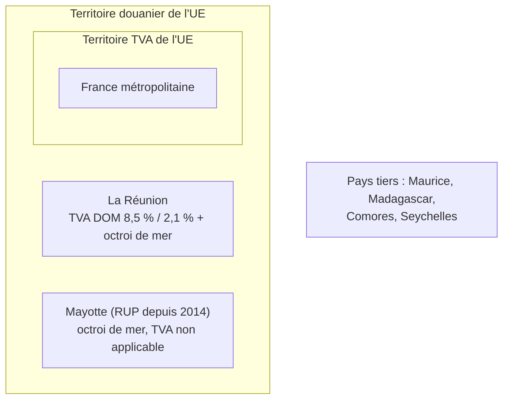
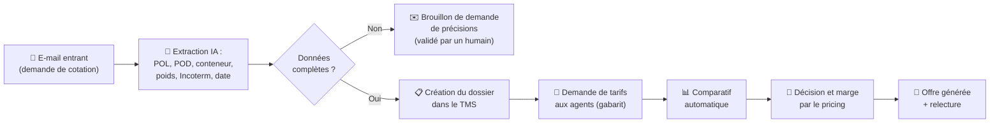

# LIVRABLE A — COURS COMPLET (Partie 2 : Modules 6 à 10)

⬅️ [Partie 1 — Modules 1 à 5](A1-cours-modules-1-a-5.md)

> 🧪 Rappel : tous les tarifs, montants et entreprises sont **fictifs et pédagogiques**. Hypothèse de change utilisée dans tout le cours : **1 USD = 0,92 EUR** 🧪.

---

# MODULE 6 — LA COTATION, LES COÛTS ET LA RENTABILITÉ : « COMMENT UN TRANSITAIRE GAGNE-T-IL DE L'ARGENT ? »

## 6.1 🎣 Accroche

> « Sur un conteneur facturé 3 300 dollars, combien croyez-vous que le transitaire garde ? 1 500 ? 1 000 ? »
>
> Réponse dans notre cas fil rouge : **408 USD de marge brute**, et environ **318 USD** une fois son propre temps de travail déduit. Et il suffit d'une surcharge oubliée de 400 USD pour que le dossier soit **à perte**. *Le transit est un métier de volumes, de précision et de rigueur.*

## 6.2 📖 Le vocabulaire de la cotation

| Poste | Définition | Qui facture à qui | Applicabilité |
|-------|------------|-------------------|---------------|
| **Ocean Freight (O/F)** | Prix du transport port à port par la compagnie | Compagnie → agent/transitaire | Toujours |
| **BAF** (*Bunker Adjustment Factor*) | Ajustement lié au coût du carburant | Compagnie | Selon la compagnie : séparée ou incluse (« all-in ») |
| **Surcharges réglementaires / environnementales** | Ex. surcharges liées aux carburants à faible teneur en soufre, ou aux coûts carbone sur certains trafics | Compagnie | ⚠️ Selon la compagnie, la route et la réglementation applicable : à vérifier sur chaque offre |
| **PSS** (*Peak Season Surcharge*) | Surcharge de haute saison | Compagnie | Ponctuelle, annoncée par la compagnie |
| **THC** (*Terminal Handling Charges*) | Manutention au terminal (origine : OTHC ; destination : DTHC) | Terminal → compagnie → chargeur/destinataire | Selon Incoterm |
| **Documentation fee / B/L fee** | Frais d'émission du B/L | Compagnie ou agent | Généralement à l'origine |
| **Handling fee** | Rémunération de l'agent pour son intervention | Agent → transitaire | Origine et destination |
| **Frais de dossier** | Rémunération administrative du transitaire | Transitaire → client | Politique commerciale |
| **Origin charges** | Ensemble des frais au départ : THC, B/L, scellé, VGM, déclaration export, pré-acheminement | Agent origine → transitaire | Payés par le vendeur en FOB/CFR/CIF… |
| **Destination charges** | DTHC, frais de libération (D/O fee), handling agent, dédouanement, livraison | Agent destination → destinataire | Payés par l'acheteur en FOB/CFR/CIF |
| **Profit Share** | Partage de marge entre transitaire et agent sur un flux commun (ex. 50/50) | Selon l'accord | Accord d'agence |
| **Coûts imprévus** | Stationnement, inspection, D&D, modification de B/L, roll-over | Variable | À cadrer par les **conditions de l'offre** |

### Formules à maîtriser
- **Marge brute (USD)** = Prix de vente HT − Coût d'achat HT
- **Taux de marge** = Marge brute ÷ Coût d'achat × 100
- **Taux de marque** = Marge brute ÷ Prix de vente × 100
- **Marge nette contributive** = Marge brute − coûts internes directs du dossier (temps, outils, frais bancaires)
- **Prix de vente pour un taux de marque cible** = Coût d'achat ÷ (1 − taux de marque)

> ⚠️ Confusion fréquente : un « 15 % de marge » ne signifie pas la même chose selon qu'on parle de taux de marge (sur le coût) ou de taux de marque (sur le prix). **Toujours préciser la base.**

## 6.3 🏭 Illustration — La cotation du dossier fil rouge (1×40'HC Shanghai → Port-Louis, CFR) 🧪

**Hypothèses :**
- Client : Valdor Outdoor (Lyon), vendeur en **CFR Port-Louis** → il paie : frais origine + fret principal. Les frais de destination sont payés par l'acheteur mauricien.
- Achat : fret via l'agent de Shanghai (contrat de l'agent avec la compagnie), frais origine facturés par l'agent.
- Coût interne LBT estimé : 3 h de travail × 30 USD/h chargé = **90 USD** par dossier.

**Étape 1 — Coûts d'achat**

| Ligne | Montant (USD) |
|-------|--------------:|
| Ocean Freight 40'HC | 2 150 |
| BAF | 380 |
| **Sous-total compagnie** | **2 530** |
| THC origine | 165 |
| B/L fee | 65 |
| Scellé | 12 |
| VGM / manutention | 35 |
| Déclaration export Chine | 40 |
| Handling fee agent origine | 45 |
| **Sous-total frais origine** | **362** |
| **TOTAL ACHAT** | **2 892** |

**Étape 2 — Prix de vente**

| Ligne | Achat | Vente | Marge |
|-------|------:|------:|------:|
| Ocean Freight | 2 150 | 2 450 | 300 |
| BAF (refacturée au coût 🤝 pour la transparence) | 380 | 380 | 0 |
| Forfait frais origine | 362 | 410 | 48 |
| Frais de dossier LBT | 0 | 60 | 60 |
| **TOTAL** | **2 892** | **3 300** | **408** |

**Étape 3 — Indicateurs**
- Marge brute = 3 300 − 2 892 = **408 USD**
- Taux de marge = 408 ÷ 2 892 = **14,11 %**
- Taux de marque = 408 ÷ 3 300 = **12,36 %**
- Marge nette contributive = 408 − 90 = **318 USD**
- En euros (hypothèse 0,92) : vente 3 036 EUR ; marge brute 375,36 EUR.

**Étape 4 — Profit share destination 🧪** : l'agent mauricien facture les frais destination à Maurilux et reverse à LBT 50 % de sa marge sur ces frais, soit **40 USD** → contribution totale du dossier : 318 + 40 = **358 USD**.

**Étape 5 — L'offre telle qu'envoyée**

```
LAGON BLEU TRANSIT — OFFRE N° Q-0001 (fictive)
Route : Shanghai (CN) → Port-Louis (MU) — 1×40'HC — Mobilier aluminium, 7,8 t
Incoterm client : CFR Port-Louis, Incoterms® 2020
Transit indicatif : 24 jours (1 transbordement) — non garanti
Ocean freight ........................ USD 2 450 / 40'HC
BAF .................................. USD   380 / 40'HC (selon niveau en vigueur à l'embarquement)
Frais origine (THC, B/L, scellé, VGM, export) USD 410
Frais de dossier ..................... USD    60
TOTAL ................................ USD 3 300
Validité : jusqu'au [date] ; tarifs soumis aux surcharges en vigueur à la date d'embarquement.
EXCLUS : frais destination (DTHC, libération, dédouanement, livraison), droits et taxes,
assurance marchandise, inspections, stationnement, surestaries (demurrage/detention),
modifications documentaires tardives.
Conditions générales : [CG de l'entreprise] — Paiement : 30 jours date de facture.
```

## 6.4 Scénarios

| Scénario | Ce qui change | Vente | Achat | Marge brute | Taux de marque | Marge nette (– 90) |
|----------|---------------|------:|------:|------------:|---------------:|-------------------:|
| **Base** | — | 3 300 | 2 892 | 408 | 12,36 % | 318 |
| **A. Offre compétitive** | Concurrent à 3 150 ; LBT réduit sa marge fret à 150 | 3 150 | 2 892 | 258 | 8,19 % | 168 |
| **B. Marge élevée** | Client urgent, seul transitaire consulté : fret vendu 2 700 | 3 550 | 2 892 | 658 | 18,54 % | 568 |
| **C. Retard maritime (roll-over 10 jours)** | 2 h de gestion en plus (+60) ; stockage terminal origine 150 USD refacturé au coût car la cause est la compagnie et l'offre le prévoit | 3 450 | 3 042 | 408 | 11,83 % | 258 (90 + 60 de coûts internes) |
| **D. Surcharge imprévue (PSS 400)** — offre **avec** clause | PSS refacturée au client | 3 700 | 3 292 | 408 | 11,03 % | 318 |
| **D'. Même PSS — offre « all-in fixe » sans clause** | LBT absorbe | 3 300 | 3 292 | 8 | 0,24 % | **– 82** ❌ |

*(Vérification C : 2 892 + 150 = 3 042 ; 3 300 + 150 = 3 450 ; 408 ÷ 3 450 = 11,83 %. Vérification D : 3 300 + 400 = 3 700 ; 408 ÷ 3 700 = 11,03 %.)*

> 🧠 **Leçon :** *Les clauses de l'offre valent plus que la négociation du prix. Une ligne « soumis aux surcharges en vigueur à l'embarquement » vient de sauver 400 dollars.*

## 6.5 ✍️ Choix professionnel — « 2 900 USD en 24 jours ou 2 650 USD en 37 jours ? »

> Vous êtes responsable Cross-Trade. Une compagnie propose **2 900 USD** avec un transit de **24 jours** ; une autre **2 650 USD** avec **37 jours** annoncés. La marchandise vaut **85 000 USD** 🧪. Que recommandez-vous ?

**Méthode en 4 temps :**
1. **Économie apparente** : 2 900 − 2 650 = **250 USD**.
2. **Coût du temps** : 13 jours de plus × coût du capital immobilisé. Avec un coût du capital de 8 %/an 🧪 : 85 000 × 8 % × 13 ÷ 365 = **242,19 USD**. L'économie nette n'est plus que d'environ **8 USD** !
3. **Risques non chiffrés** : un transit long implique souvent plus de transbordements → plus de risques de retard et d'avarie ; risque de rupture de stock ; saisonnalité (si la marchandise doit être en rayon avant les fêtes de fin d'année, 13 jours peuvent coûter des ventes).
4. **Fiabilité** : un « 24 jours » fiable à 80 % vaut mieux qu'un « 37 jours » fiable à 50 %.

**Recommandation type :** l'option rapide, sauf si la marchandise est peu urgente, de faible valeur et que le client a du stock tampon. **Présenter les deux** au client avec ce raisonnement : c'est lui qui décide, vous l'éclairez. *Vous ne vendez pas un prix, vous vendez une décision.*

## 6.6 Négocier avec les agents étrangers

| Levier | Comment | Exemple de phrase (EN) |
|--------|---------|------------------------|
| **Volume** | Annoncer un volume prévisionnel réaliste, pas gonflé | *"We expect 4–6 × 40'HC per month on this lane over the next quarter."* |
| **Comparabilité** | Imposer une grille identique à tous | *"Please quote using the attached breakdown, line by line."* |
| **Réciprocité** | Leur confier vos flux inverses / leur apporter du business | *"We can nominate you for our Réunion-bound cargo from Shanghai."* |
| **Profit share** | Partager plutôt qu'écraser la marge | *"We propose a 50/50 profit share on destination charges."* |
| **Fiabilité de paiement** | Payer à l'heure = meilleurs prix | *"We settle invoices within 15 days of receipt."* |
| **Transparence sur la concurrence** | Sans divulguer de données confidentielles | *"Your rate is above market for this lane; can you review?"* |

⚠️ **Ne jamais** transmettre à un agent le tarif nominatif d'un concurrent, ni les données d'un client : c'est une faute déontologique et potentiellement contractuelle.

> 🧠 **À retenir :** *Une bonne cotation, c'est : coûts complets + marge assumée + clauses protectrices + calcul vérifiable. Le prix attire, les clauses protègent.*

---

# MODULE 7 — LES RISQUES ET LES SITUATIONS DE CRISE : « QUAND 12 JOURS DE RETARD DEVIENNENT UN PROBLÈME À 20 000 € »

## 7.1 🎣 Accroche

> Un conteneur de jouets à destination de La Réunion arrive 12 jours après la date prévue — juste après le pic des ventes de Noël. Le client estime son manque à gagner à 20 000 € 🧪 et se tourne vers son transitaire. **Le transitaire doit-il payer ?** En principe, non : les délais maritimes annoncés sont **indicatifs**, et la responsabilité du transporteur pour retard est très encadrée (et souvent limitée). Mais le client, lui, s'en souviendra. *Juridiquement protégé, commercialement en danger.*

## 7.2 La grille de résolution

Chaque incident est traité selon : **Situation → Cause → Conséquences → Décisions possibles → Solution recommandée → Prévention.**

### Incident 1 — Retard d'embarquement
- **Situation :** la marchandise de Valdor n'est pas prête à J-3 de l'ETD.
- **Cause :** retard de production.
- **Conséquences :** risque de manquer le navire ; client mauricien inquiet.
- **Décisions :** (a) maintenir le booking et espérer ; (b) décaler au navire suivant ; (c) charger partiellement.
- **Solution recommandée :** décaler **proactivement** le booking (sans frais si annulé avant le délai prévu par la compagnie), informer client et acheteur avec une nouvelle date réaliste.
- **Prévention :** relance J-7 du *cargo ready* avec photos de la marchandise emballée.

### Incident 2 — Cut-off manqué
- **Situation :** VGM non transmise à temps.
- **Cause :** le shipper pensait que l'agent s'en chargeait.
- **Conséquences :** ⚖️ conteneur non chargé (SOLAS) ; stationnement ; roll-over.
- **Solution :** demander à l'agent un « late VGM » si la compagnie l'accepte (pas garanti, parfois payant) ; sinon rebooking.
- **Prévention :** RACI clair : **qui** déclare la VGM, **quand**, **par quel canal**.

### Incident 3 — Transbordement prolongé
- **Situation :** le conteneur attend depuis 9 jours au port de transbordement.
- **Cause :** congestion ou navire de second leg complet ; priorité d'autres cargaisons.
- **Conséquences :** ETA repoussée ; client mécontent.
- **Décisions :** attendre ; demander une **priorisation** à la compagnie ; envisager un autre navire de la même compagnie (ou partenaire de consortium).
- **Solution :** escalade écrite via l'agent auprès du service clientèle/opérations de la compagnie, avec numéro de booking et conteneur ; information du client avec un plan.
- **Prévention :** privilégier les services à transbordement fiable ; seuil d'alerte (ex. 5 jours au hub).

### Incident 4 — Conteneur roulé (*rolled*) sur un autre navire
- **Situation :** le conteneur était à quai, mais n'a pas été chargé.
- **Cause :** *overbooking* de la compagnie, contraintes de poids/stabilité du navire, changement de rotation.
- **Conséquences :** + 7 jours (ou plus).
- **Solution :** obtenir immédiatement la nouvelle affectation, informer le client, demander l'exonération du stockage terminal (cause compagnie).
- **Prévention :** surveiller les « roll-over notices », éviter les compagnies à taux de roll-over élevé en période de pointe.

### Incident 5 — B/L erroné
- **Situation :** le B/L original porte « Port Louis, Mauritius » … mais le nom du consignee est mal orthographié et le poids est faux.
- **Conséquences :** blocage à la douane ou à la banque (crédit documentaire).
- **Solution :** **avant** distribution des originaux : *amendment* auprès de la compagnie. **Après** : récupérer le jeu complet, faire réémettre (frais, délais).
- **Prévention :** validation systématique du **draft B/L** par le shipper ET le transitaire ; check-list de contrôle.

### Incident 6 — Documents reçus trop tard
- **Situation :** les originaux arrivent à Port-Louis 6 jours après le navire.
- **Conséquences :** demurrage.
- **Solution :** proposer un **telex release** si le vendeur accepte (il perd le levier de paiement), ou une Sea Waybill sur les prochains envois.
- **Prévention :** choisir le type de document **au moment de l'offre**, selon la relation de confiance et le mode de paiement.

### Incident 7 — Discordance de facture
- **Situation :** la facture annonce 412 cartons ; la packing list en annonce 410 ; le B/L 412.
- **Conséquences :** suspicion douanière, refus bancaire, contrôle physique.
- **Solution :** obtenir des documents corrigés et cohérents avant le dédouanement ; si contrôle, assister le client avec les explications.
- **Prévention :** rapprochement automatique (Module 10).

### Incident 8 — Hausse du fret
- **Situation :** entre la cotation et le booking, la compagnie augmente le fret de 600 USD (*GRI, General Rate Increase*).
- **Solution :** si l'offre a expiré ou contient une clause de révision : informer le client avec la preuve et proposer des alternatives ; si l'offre était ferme et valable : honorer et absorber, ou négocier avec l'agent.
- **Prévention :** validité courte en marché volatil ; clause « sous réserve d'espace et d'équipement disponibles et des tarifs en vigueur à l'embarquement ».

### Incident 9 — Demurrage et Detention

| | **Demurrage** (surestaries conteneur) | **Detention** (immobilisation du conteneur) |
|---|---|---|
| Où ? | Conteneur **plein au terminal** au-delà de la franchise | Conteneur **hors du terminal** (chez le client) au-delà de la franchise |
| Facturé par | Compagnie (le terminal facture aussi parfois du stockage) | Compagnie |
| Combiné | Certaines compagnies appliquent une franchise combinée « D&D » | |

**Calcul 🧪** : franchise 7 jours ; puis 75 EUR/jour du jour 8 au jour 14 ; 150 EUR/jour au-delà. Conteneur libéré au jour 12 → 5 jours × 75 = **375 EUR**. Libéré au jour 18 → (7 × 75) + (4 × 150) = 525 + 600 = **1 125 EUR**.
- **Prévention :** négocier une franchise étendue au booking ; anticiper documents et paiement des taxes ; informer le client du coût journalier **avant** l'arrivée.

### Incident 10 — Client mécontent
- **Situation :** Maurilux appelle Valdor, furieuse du retard ; Valdor appelle LBT.
- **Solution :** méthode **E.C.A.R.T.** : **É**couter sans interrompre, **C**onstater les faits (pas d'excuse vague), **A**gir (plan concret), **R**endre compte (date du prochain point), **T**irer les leçons (retour d'expérience).

### Incident 11 — Litige entre partenaires commerciaux
- **Situation :** Maurilux refuse de payer Valdor (qualité contestée) ; Valdor demande à LBT de « ne pas libérer la marchandise ».
- **Analyse :** LBT ne peut agir que selon le **document de transport** : si le B/L est original à ordre et détenu par Valdor, la marchandise ne sera pas livrée sans lui. Si une Sea Waybill a été émise au nom de Maurilux, Valdor a perdu ce levier, sous réserve des possibilités limitées de modifier les instructions avant livraison, selon le document et la compagnie.
- **Prévention :** le **choix du document est un choix de risque financier**.

### Incident 12 — Problème de conformité douanière ou de sanctions
- **Situation :** lors du filtrage (*screening*), le nom d'un notify party correspond à une entité figurant sur une liste de sanctions.
- **Conséquences :** ⚖️ interdiction potentielle de fournir le service ; sanctions pénales et administratives.
- **Décisions :** **suspendre** l'opération, vérifier (homonymie ?), escalader au responsable conformité, **ne pas informer le client d'une manière qui l'aiderait à contourner** les règles, se faire conseiller juridiquement, déclarer aux autorités si la réglementation l'exige.
- **Prévention :** filtrage systématique de **toutes** les parties, des navires et des ports, à l'ouverture du dossier et à chaque modification.
- ⚠️ Un transitaire réunionnais est une entreprise française : il est soumis aux **sanctions de l'UE** même si la marchandise ne passe jamais par l'UE (Cross-Trade Chine → Maurice inclus).

## 7.3 Communication professionnelle — modèles

**E-mail au client (retard au transbordement) — FR**
> Objet : Dossier LBT-0001 — 1×40'HC Shanghai/Port-Louis — Retard au transbordement et plan d'action
>
> Bonjour Madame Martin,
>
> Nous vous informons que le conteneur ABCU 123456-7 est arrivé au port de transbordement le 12/03 et n'a pas été chargé sur le navire de second leg prévu, celui-ci étant complet.
>
> **Situation actuelle :** la compagnie a confirmé un chargement sur le navire suivant, départ estimé le 19/03.
> **Nouvelle ETA Port-Louis :** 26/03 (au lieu du 17/03), soit 9 jours de décalage.
> **Nos actions :** nous avons demandé une priorisation et l'exonération des frais de stockage liés à ce report ; nous avons informé l'agent de destination pour réserver le dédouanement dès l'arrivée.
> **Prochain point :** jeudi 14/03 avant 12 h, ou immédiatement en cas de changement.
>
> Nous mesurons la gêne occasionnée pour votre client et restons à votre disposition pour l'informer avec vous.
>
> Bien cordialement,
> [Nom], Service Cross-Trade — Lagon Bleu Transit

**E-mail à l'agent d'origine — EN**
> Subject: URGENT — BKG 7788990 / ABCU1234567 — Stuck at T/S port — Request for priority loading
>
> Dear Lin,
>
> The above container has been at the transhipment port since 12 March and missed the connecting vessel. Our customer has a firm delivery commitment.
> Could you please (1) obtain the carrier's written confirmation of the next connection, (2) request priority loading, and (3) ask for a waiver of any storage charges, as the delay is not caused by the shipper?
> Please revert by 14:00 your time today.
>
> Many thanks for your support,
> [Name] — Cross-Trade Desk, Lagon Bleu Transit

> 🧠 **À retenir :** *Le client pardonne un retard. Il ne pardonne pas d'apprendre le retard tout seul.*

---

# MODULE 8 — DOUANE, FISCALITÉ ET CONFORMITÉ

> ⚖️ Ce module présente des **principes**. La réglementation évolue : chaque point doit être vérifié sur les sources officielles listées au Livrable G, à la date de l'opération. Les situations varient selon le pays, le produit et le régime douanier retenu.

## 8.1 🎣 Accroche — « Made in where? »

> Des panneaux sont fabriqués en Chine, expédiés vers Port-Louis, puis réexpédiés à La Réunion. Un client affirme : « Ils viennent de Maurice, donc ils sont d'origine mauricienne. » **Vrai ou faux ?**
>
> ❌ Faux. Maurice est la **provenance** (pays d'expédition), pas l'**origine**. L'origine dépend du lieu de fabrication ou de **transformation substantielle**, selon les règles d'origine applicables. Un simple transbordement ou stockage ne confère pas l'origine.

## 8.2 Les notions de base

| Notion | Définition | Pourquoi ça compte |
|--------|------------|--------------------|
| **Origine** | « Nationalité économique » de la marchandise : obtenue entièrement ou ayant subi sa dernière transformation substantielle dans un pays (règles non préférentielles ou préférentielles selon les accords) | Droits applicables, préférences tarifaires, mesures anti-dumping, sanctions |
| **Provenance / pays d'expédition** | Pays d'où la marchandise est expédiée vers le pays d'importation | Statistiques, certains contrôles, accords préférentiels (règles de transport direct) |
| **Pays de destination** | Pays où la marchandise est importée / mise à la consommation | Réglementation applicable à l'import |
| **Classement tarifaire** | Code du **Système harmonisé** (SH, 6 chiffres, OMD), complété par la nomenclature nationale (dans l'UE : NC à 8 chiffres et TARIC à 10 chiffres) | Taux de droits, mesures, contrôles |
| **Valeur en douane** | Base des droits ad valorem. Méthode principale : valeur transactionnelle (prix effectivement payé ou à payer), ajustée — selon l'Accord de l'OMC sur l'évaluation en douane | Dans l'UE, inclut les frais de transport et d'assurance **jusqu'au point d'entrée** dans le territoire douanier de l'Union ✅ |
| **Importateur / exportateur déclarés** | Personnes qui figurent sur les déclarations ; elles portent des obligations (et parfois la dette douanière) | Ne pas « prêter » son nom : responsabilité réelle |
| **Représentant en douane** | Agit au nom d'autrui (représentation directe) ou en son nom propre pour le compte d'autrui (représentation indirecte, solidairement redevable) | Choix de représentation = choix de risque |

## 8.3 Contrôles, restrictions et sanctions

- **Restrictions** : produits soumis à licences, normes, certificats sanitaires/phytosanitaires, biens à double usage (dans l'UE : règlement (UE) 2021/821 ✅), produits stratégiques, déchets.
- **Sanctions internationales** : mesures restrictives de l'UE (adoptées par le Conseil ; consultation via la carte des sanctions de l'UE et la liste consolidée), sanctions de l'ONU, et sanctions d'autres États (ex. OFAC aux États-Unis) qui peuvent avoir des effets indirects (banques, compagnies maritimes).
- **Pratique** : filtrage des parties, des navires (pavillon, IMO), des ports, du contenu ; détection des signaux d'alerte : route illogique, demande de Switch B/L inhabituelle, paiement par un tiers non lié, changement de consignee en cours de route.

## 8.4 Les particularités de La Réunion (et de l'océan Indien)

### Trois cercles à ne pas confondre



| Territoire | Union européenne | Territoire douanier de l'UE | Territoire TVA de l'UE | TVA française applicable ? | Octroi de mer |
|-----------|-----------------|-----------------------------|------------------------|---------------------------|---------------|
| France métropolitaine | Oui | Oui | Oui | Oui (taux métropolitains) | Non |
| **La Réunion** | Oui (RUP) | **Oui** ✅ | **Non** (territoire tiers au sens TVA) ✅ | **Oui**, régime propre : taux normal 8,5 %, taux réduit 2,1 % (art. 296 CGI) ✅ | **Oui** (octroi de mer + octroi de mer régional) ✅ |
| **Mayotte** | Oui (RUP depuis le 1er janvier 2014) | Oui | Non | **Non** : TVA provisoirement non applicable ✅ | Oui |
| Maurice, Madagascar | Non | Non | Non | Non (fiscalité nationale propre) | Non |

**Conséquences pratiques :**
- **Chine → La Réunion** : c'est une **importation dans le territoire douanier de l'UE** : droits du tarif douanier commun (TARIC), éventuelles mesures (anti-dumping…), **octroi de mer et octroi de mer régional** (taux fixés par le Conseil régional selon la nomenclature, dans le cadre de la loi n° 2004-639 et de la décision du Conseil n° 940/2014/UE, prolongée/modifiée depuis : vérifier la version en vigueur ✅), **TVA DOM** (8,5 % taux normal).
- **Métropole → La Réunion** : pas de droits de douane (même territoire douanier), mais **formalités** : les échanges sont traités comme des exportations/importations sur le plan fiscal (TVA, octroi de mer) ✅.
- **Réunion → Maurice** : exportation hors du territoire douanier de l'UE.
- ⚠️ La numérotation des articles du CGI relatifs à la TVA fait l'objet d'une recodification progressive dans le Code des impositions sur les biens et services (CIBS) : **vérifier la référence en vigueur** à la date de l'opération.

### Exemple de calcul des taxes à l'import à La Réunion (Cas 2) 🧪
*Taux d'octroi de mer hypothétiques — les vrais taux dépendent du code produit et des délibérations du Conseil régional.*

| Élément | Calcul | Montant (EUR) |
|---------|--------|--------------:|
| Valeur FOB Yantian | 32 000 USD × 0,92 | 29 440,00 |
| Fret jusqu'à Port Réunion | 3 000 USD × 0,92 | 2 760,00 |
| Assurance | forfait 🧪 | 110,00 |
| **Valeur en douane** | | **32 310,00** |
| Droits de douane | taux hypothétique 0 % (à vérifier dans le TARIC selon le code exact) | 0,00 |
| Octroi de mer + OMR | taux cumulé hypothétique 12 % × 32 310 | 3 877,20 |
| Base TVA | valeur en douane + droits + octroi de mer (la base TVA à l'import inclut les droits et taxes autres que la TVA ; frais accessoires éventuels à intégrer selon les règles — à valider avec le déclarant) | 36 187,20 |
| TVA DOM 8,5 % | 36 187,20 × 8,5 % | 3 075,91 |
| **Total droits et taxes** | 0 + 3 877,20 + 3 075,91 | **6 953,11** |

## 8.5 ICS2 — la sûreté avant le chargement

- ✅ **ICS2** (*Import Control System 2*) est le système de l'UE de déclaration préalable de sûreté et de sécurité (**ENS**, *Entry Summary Declaration*) pour les marchandises entrant dans le territoire douanier de l'Union.
- ✅ La **version 3 (Release 3)**, qui couvre le **maritime**, a été déployée à partir du **3 juin 2024** pour les transporteurs maritimes, puis du **4 décembre 2024 au 1er avril 2025** pour les *house filers* (notamment les transitaires NVOCC émettant des House B/L), et à partir du 1er avril 2025 pour la route et le rail (fenêtres de déploiement définies par la Commission et les administrations nationales).
- Pour les conteneurs en maritime « deep sea », l'ENS doit en principe être déposée **au plus tard 24 heures avant le chargement** au port étranger ✅ (règle historique de l'UE pour le conteneur maritime ; d'autres délais existent pour d'autres cas — vérifier le règlement délégué (UE) 2015/2446 et ses modifications).
- **Concerné ?** Chine → **La Réunion** : **oui** (entrée dans le territoire douanier de l'UE). Chine → Maurice ou Madagascar : **non** pour l'UE (sauf cas particuliers d'escale/déchargement dans un port de l'UE : vérifier avec la compagnie).
- **Pratique** : le transitaire qui émet une House B/L vers La Réunion doit s'assurer que les données « house » (vendeur, acheteur, description précise, code SH à 6 chiffres) sont transmises — soit directement par lui, soit via le transporteur selon le schéma retenu. Les descriptions vagues (« general cargo », « parts », « FAK ») sont refusées.

## 8.6 ✍️ Application — Vrai ou faux
1. « La Réunion est dans l'UE, donc il n'y a pas de formalités avec la métropole. » → ❌ Faux : même territoire douanier, mais pas le même territoire TVA ; formalités fiscales et octroi de mer.
2. « Un conteneur Chine → Maurice organisé par un transitaire réunionnais doit être dédouané à La Réunion. » → ❌ Faux : il n'y entre jamais.
3. « Un transitaire réunionnais peut organiser un transport Chine → Maurice pour une entité sanctionnée par l'UE puisque la marchandise ne touche pas l'UE. » → ❌ Faux : les sanctions de l'UE s'appliquent aux personnes et entités de l'UE où qu'elles opèrent.
4. « Mayotte applique la TVA à 8,5 %. » → ❌ Faux : TVA provisoirement non applicable à Mayotte.

> 🧠 **À retenir :** *Union européenne ≠ territoire douanier ≠ territoire TVA. La Réunion : **dedans** pour la douane, **dehors** pour la TVA européenne, avec **sa propre** TVA et l'octroi de mer.*

---

# MODULE 9 — LA DIMENSION COMMERCIALE ET STRATÉGIQUE : « LE CROSS-TRADE, OPPORTUNITÉ COMMERCIALE OU CASSE-TÊTE LOGISTIQUE ? »

## 9.1 🎣 Accroche

> « Le marché local réunionnais compte environ 900 000 habitants et une concurrence nombreuse entre transitaires. Comment grandir ? » → En vendant ce que l'on sait faire **au-delà** de l'île : la connaissance de l'océan Indien, le français et l'anglais, et un réseau fiable en Asie.

## 9.2 Identifier les opportunités

1. **Les clients existants** : quels clients réunionnais ont des filiales ou des clients à Maurice, Madagascar, Mayotte, aux Comores ? (Mayotte : flux souvent liés au territoire français ; Maurice : hub régional ; Madagascar : marché francophone.)
2. **Les fournisseurs européens** de vos clients : ils vendent sans doute aussi dans les îles voisines.
3. **Les agents partenaires** : vos agents chinois reçoivent des demandes vers l'océan Indien — positionnez-vous comme **leur expert régional**.
4. **Les appels d'offres** de projets (infrastructures, ONG, énergie).

## 9.3 Prospection B2B internationale

| Étape | Action | Outil |
|-------|--------|-------|
| Cibler | Secteurs à flux réguliers (matériaux, équipements, mobilier, agroalimentaire sec) | Bases d'entreprises, salons, chambres de commerce |
| Qualifier | Volumes, routes, Incoterms pratiqués, décideur | Appel découverte, questionnaire |
| Proposer | Une **offre de valeur** régionale, pas seulement un prix | Étude de cas, cotation test |
| Convertir | Un **premier dossier test** irréprochable | Suivi renforcé |
| Développer | Revue trimestrielle, extension à d'autres routes | KPI partagés |

⚖️ Prospection par e-mail : respecter le **RGPD** et les règles de prospection B2B applicables.

## 9.4 Construire et sélectionner un réseau d'agents

**Grille de sélection (notation sur 5) 🤝 :**

| Critère | Questions | Poids |
|---------|-----------|------:|
| Solidité financière | Ancienneté, références, garanties, comportement de paiement | 20 % |
| Qualité opérationnelle | Réactivité (délai de réponse), précision des documents | 25 % |
| Conformité | Procédures de filtrage sanctions, licences (ex. NVOCC/agrément local), assurance RC | 20 % |
| Compétitivité tarifaire | Prix et transparence des frais | 20 % |
| Réciprocité et culture | Envoi de flux réciproques, communication en anglais, alignement | 15 % |

- **Accord d'agence** écrit : périmètre, exclusivité ou non, profit share, délais de paiement, non-sollicitation des clients, confidentialité, responsabilité, loi applicable.
- **Réseaux de transitaires indépendants** : ils facilitent la mise en relation et offrent parfois des mécanismes de protection de paiement ; vérifier leurs conditions réelles (une adhésion n'est pas une garantie de qualité).

## 9.5 Accords de Profit Share

**Principe** : deux transitaires partenaires partagent la marge d'un flux qu'ils co-gèrent. Exemple 🧪 : LBT apporte un client ; l'agent de Shanghai facture le fret ; la marge fret (300 USD) est partagée 50/50 → 150 USD chacun, réglés par **« debit/credit note »** mensuelle.

| Avantages | Risques |
|-----------|---------|
| Alignement des intérêts | Litiges sur le calcul (base de la marge ?) |
| Prix plus compétitifs | Opacité si les coûts réels ne sont pas partagés |
| Fidélisation des agents | Retards de règlement des soldes |

**Bonne pratique** : définir **par écrit** la base de calcul (vente – achat **justifié**), la périodicité, la devise, le délai de règlement, le droit d'audit.

## 9.6 Relation client, fidélisation et différenciation

- **Différenciation** : expertise régionale (océan Indien), langue, fuseau (La Réunion est à UTC+4 : chevauchement de journée avec l'Europe **et** la Chine — un atout unique 🤝), suivi proactif, reporting.
- **Fidélisation** : revue d'activité trimestrielle, tableau de bord partagé, gestion exemplaire des incidents, contrats annuels.

## 9.7 Suivi de rentabilité et organisation du service

**KPI financiers** : marge brute par dossier, par client, par route, par agent ; délai moyen d'encaissement (DSO) ; taux d'impayés ; écart marge prévue / réalisée.

| Modèle | Description | Avantages | Inconvénients | Adapté à |
|--------|-------------|-----------|---------------|----------|
| **Internalisé** | Desk Cross-Trade dédié (pricing + opérations + commercial) | Maîtrise, expertise, relation client | Coûts fixes, besoin de volume | Plus de 30-40 dossiers/mois 🧪 |
| **Externalisé** | Les agents gèrent l'opérationnel ; LBT garde la relation commerciale | Coûts variables, démarrage rapide | Dépendance, moindre contrôle qualité | Démarrage, flux ponctuels |
| **Hybride** | Commercial + supervision internes ; exécution par agents sélectionnés | Équilibre contrôle/coûts | Exige des procédures et KPI agents solides | La plupart des transitaires régionaux |

## 9.8 Analyse SWOT — un transitaire réunionnais qui développe le Cross-Trade

| **Forces** | **Faiblesses** |
|-----------|----------------|
| Connaissance fine de l'océan Indien (ports, pratiques, cultures) | Petite taille, volumes limités pour négocier avec les compagnies |
| Francophonie + anglais ; cadre juridique français/européen rassurant | Coûts de structure élevés |
| Fuseau UTC+4 : chevauchement avec l'Europe et l'Asie | Dépendance à quelques agents et compagnies |
| Proximité avec Maurice, Madagascar, Mayotte, Comores, Seychelles | Notoriété internationale faible |
| **Opportunités** | **Menaces** |
| Croissance des échanges régionaux et des flux Asie–Afrique de l'Est | Grands groupes mondiaux et transitaires digitaux |
| Besoins de coordination francophone (Madagascar, Mayotte, Comores) | Intégration verticale des compagnies maritimes (offres logistiques de bout en bout) |
| Digitalisation : productivité accrue d'une petite équipe | Volatilité du fret et des surcharges ; crises géopolitiques et déroutements |
| Demande de conformité (sanctions, ICS2) : prime à l'expertise | Risques de crédit et de change sur des clients étrangers |

**Avantage concurrentiel durable** : ni le prix (copiable), ni le logiciel (achetable), mais **l'expertise régionale + la fiabilité opérationnelle + la confiance du réseau**.

> 🧠 **À retenir :** *En Cross-Trade, on ne vend pas un conteneur : on vend la certitude que quelqu'un, quelque part, s'occupe vraiment de votre marchandise.*

---

# MODULE 10 — DIGITALISATION, IA ET AVENIR DU CROSS-TRADE

## 10.1 🎣 Accroche

> Un coordinateur reçoit environ 150 e-mails par jour 🧪 : demandes de cotation, avis d'arrivée, drafts de B/L, relances. Combien de ces e-mails nécessitent **vraiment** son jugement ? Peut-être un tiers. Le reste ? Du tri, de la copie, de la relance. *C'est exactement là que l'automatisation — et l'IA — changent le métier.*

## 10.2 Ce qui existe déjà vs ce qui nécessite une intégration

| Usage | État | Ce qu'il faut pour que ça marche | Point de vigilance |
|-------|------|----------------------------------|--------------------|
| **TMS / logiciel de transit** (dossiers, facturation, documents) | ✅ Fonctionnalité standard du marché | Paramétrage, données propres | Qualité de saisie |
| **Suivi maritime automatisé** (statuts de conteneur) | ✅ Disponible via portails et API de compagnies ou agrégateurs | Abonnement / API, numéros de booking et de conteneur | Données de qualité variable selon les compagnies |
| **Tableaux de bord ETD/ETA** | ✅ Courant (BI, tableurs connectés) | Données de suivi structurées | ETA « compagnie » ≠ ETA réaliste |
| **Automatisation des relances** (cut-off, documents manquants) | ✅ Réalisable avec des outils de workflow (ex. outils no-code/low-code, scripts) | Règles métier claires, intégration messagerie/TMS | Éviter le spam ; validation humaine sur les cas sensibles |
| **Extraction documentaire** (facture, packing list, B/L → données) | 🟡 Mature pour des formats courants (OCR + IA) | Intégration au TMS, contrôle humain | Erreurs de lecture ; **contrôle 4 yeux** maintenu |
| **IA de tri et de pré-rédaction d'e-mails** | 🟡 Possible aujourd'hui avec des modèles de langage | Connexion à la messagerie, **politique de confidentialité**, journalisation | Données clients : RGPD, secret des affaires ; jamais d'envoi automatique sans validation pour un engagement contractuel |
| **Automatisation des demandes de cotation** (RFQ → grille agents → comparaison) | 🟡 Réalisable avec intégration | Gabarits normalisés, base tarifaire | Tarifs volatils, surcharges oubliées |
| **Analyse des marges** (prévu vs réalisé) | ✅ Avec un TMS et de la BI | Provisions des coûts, rapprochement factures | Factures fournisseurs tardives |
| **ETA prédictive** (IA sur données AIS, historiques) | 🔵 Offres commerciales existantes ; développement interne = projet de données | Historique important, données AIS | Ne pas présenter une prévision comme une certitude |
| **eB/L** | 🟡 En déploiement progressif ; cadre juridique en évolution (loi type CNUDCI 2017 ; engagements de compagnies membres de la DCSA annoncés en 2023 pour généraliser l'eB/L à horizon 2030) | Plateforme acceptée par toutes les parties et les banques | Reconnaissance juridique variable selon les pays |

✅ = existant et courant ; 🟡 = réalisable, nécessite intégration et contrôle ; 🔵 = avancé / projet spécifique.

## 10.3 Exemple de flux automatisé réaliste 🧪



**Principe de supervision humaine** : l'automatisation **prépare**, l'humain **décide et engage** l'entreprise.

## 10.4 Indicateurs de performance (KPI)

| Famille | KPI | Formule | Cible indicative 🧪 |
|---------|-----|---------|------------------|
| Commercial | Taux de transformation des cotations | Dossiers gagnés ÷ cotations envoyées | 25-35 % |
| Commercial | Délai de réponse à une cotation | Heure d'envoi – heure de réception | < 24 h |
| Opérations | Respect des cut-offs | Dossiers sans cut-off manqué ÷ total | > 98 % |
| Opérations | Fiabilité ETA | Arrivées à ± 3 jours de l'ETA initiale ÷ total | Suivi par compagnie |
| Qualité | Taux d'erreur documentaire | B/L amendés après émission ÷ B/L émis | < 2 % |
| Finance | Écart de marge | (Marge réalisée – marge prévue) ÷ marge prévue | ± 5 % |
| Finance | DSO | Créances clients ÷ CA × 365 | < 45 jours |
| Client | Taux d'information proactive | Incidents signalés au client avant sa demande ÷ incidents | 100 % |

## 10.5 Traçabilité et conformité numériques
- **Journalisation** : qui a modifié quoi (draft B/L, consignee) et quand.
- **Filtrage sanctions automatisé** à chaque création ou modification de partie.
- **Archivage** des documents (durées légales de conservation à vérifier selon la nature du document).
- **RGPD** : registre des traitements, minimisation, sécurité, encadrement des sous-traitants (dont les fournisseurs d'IA).

> 🧠 **À retenir :** *Demain, le bon transitaire ne sera pas celui qui tape le plus vite, mais celui qui **automatise le répétitif** et **garde son jugement** pour l'exceptionnel.*

---

# 🎓 CONCLUSION — « Ce que le conteneur ne dit pas »

> *(Le professeur reprend la carte du début : Foshan, Marseille, Antananarivo. Puis Shanghai, Le Port, Port-Louis.)*
>
> « Il y a deux heures, ces points étaient isolés. Maintenant, vous voyez trois fils : un fil d'acier — le conteneur ; un fil de papier — les documents ; un fil d'or — l'argent. Le Cross-Trade, c'est l'art de tenir ces trois fils **depuis un quatrième point** de la carte, que la marchandise ne touchera jamais.
>
> Le jour où vous serez en poste, souvenez-vous de trois phrases :
> 1. **« Où est l'organisateur ? »** — c'est la question qui dit si c'est du Cross-Trade.
> 2. **« Quel est l'Incoterm, et quel document ? »** — c'est la question qui dit qui supporte le risque et qui contrôle la marchandise.
> 3. **« Le client l'a-t-il appris par moi ? »** — c'est la question qui dit si vous le garderez.
>
> Un conteneur ne parle pas. C'est vous qui le faites parler. »

**Quiz éclair de sortie (3 questions, mains levées) :**
1. Chine → Réunion piloté depuis La Réunion : Cross-Trade strict ? → **Non, importation.**
2. En CFR, où passe le risque ? → **À la mise à bord au port d'embarquement.**
3. Le Switch B/L peut-il modifier l'origine ? → **Jamais.**
