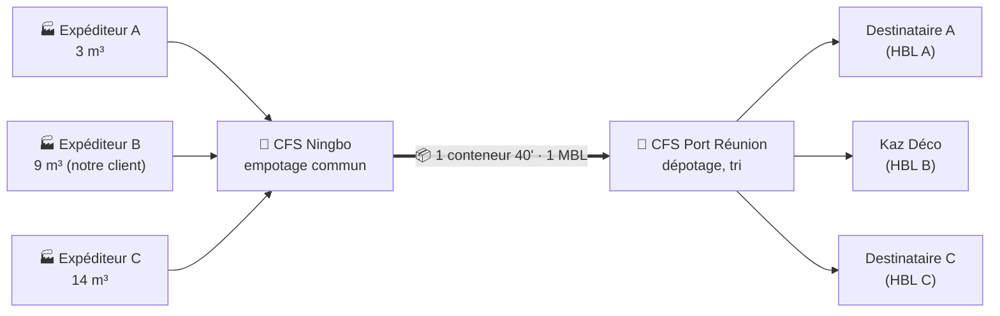
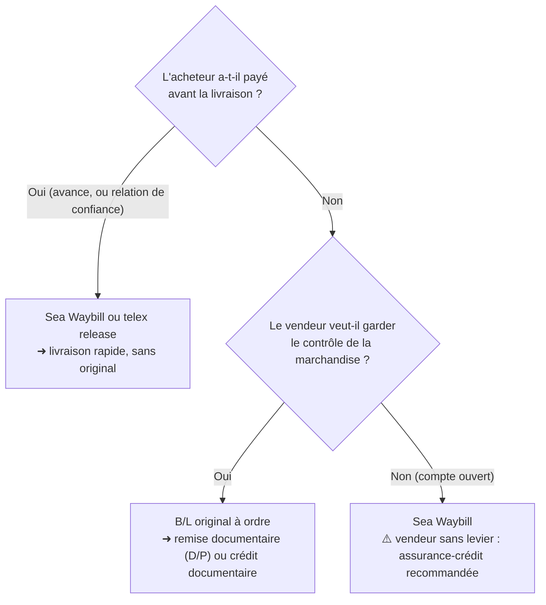
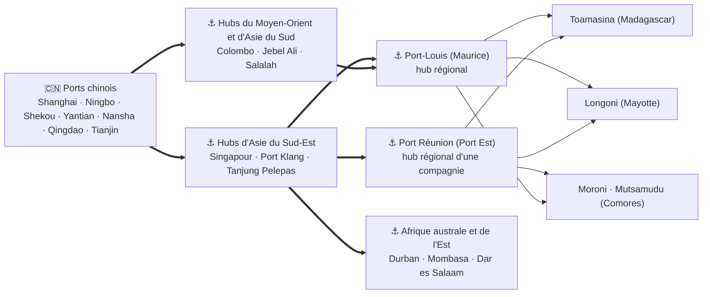

# COURS COMPLET (Partie 3 : Modules 11 à 18 — approfondissements)

⬅️ [Partie 2 — Modules 6 à 10](A2-cours-modules-6-a-10.md)

> 🧪 Rappel : entreprises, tarifs et montants **fictifs et pédagogiques**. Hypothèses de change : **1 USD = 0,92 EUR** ; **1 DTS (droit de tirage spécial) = 1,35 USD** 🧪 (la valeur réelle du DTS est publiée chaque jour par le FMI). Les règles citées ont été vérifiées en novembre 2026 ; elles évoluent : revérifier à chaque opération (sources dans la partie Ressources).

# 🔭 APPROFONDISSEMENTS — MODULES 11 À 18

**Plan de la partie 3**

| Module | Thème | Durée indicative (séance d'approfondissement) |
|--------|-------|-----------------------------------------------|
| 11 | Le groupage maritime (LCL) | 25 min |
| 12 | Assurance, avaries, avarie commune, litiges | 30 min |
| 13 | Conteneurs et marchandises spéciales (IMDG, reefer, hors gabarit) | 25 min |
| 14 | Le paiement international | 30 min |
| 15 | Géographie maritime : hubs, alliances, plannings | 20 min |
| 16 | Environnement : ETS, FuelEU et surcharges | 20 min |
| 17 | Fiches pays : Maurice, Madagascar, Mayotte, Comores | 25 min |
| 18 | Éthique et anti-corruption | 20 min |

Ces modules forment une **deuxième séance** (environ 3 h 15) ou des compléments à distribuer après la Masterclass de base.

---

# MODULE 11 — LE GROUPAGE MARITIME (LCL) : « QUAND LA MARCHANDISE NE REMPLIT PAS UN CONTENEUR »

## 11.1 🎣 Accroche — « Neuf mètres cubes, c'est trop ou pas assez ? »

> Une boutique de décoration de Saint-Paul veut importer **9 m³** de luminaires et de textiles depuis Ningbo. Un conteneur de 20 pieds contient environ 33 m³. Elle va payer… les deux tiers d'un conteneur vide ? Non. Elle va **partager** un conteneur avec d'autres expéditeurs. C'est le **groupage**, ou **LCL** (*Less than Container Load*).

## 11.2 📖 Comment fonctionne le groupage

| Acteur / lieu | Rôle |
|---------------|------|
| **Groupeur** (*consolidator*, souvent un NVOCC) | Achète des conteneurs complets à la compagnie, les remplit avec les marchandises de plusieurs clients, émet un **House B/L par client** |
| **CFS d'origine** (*Container Freight Station*, entrepôt de groupage) | Reçoit les colis, contrôle, mesure, pèse, **empote** le conteneur commun |
| **Conteneur de groupage** | Voyage sous **un seul Master B/L** (groupeur origine → agent groupeur destination) |
| **CFS de destination** | **Dépote** (*stripping*) le conteneur, trie les lots, les met à disposition après dédouanement |
| **Agent de destination du groupeur** | Libère chaque lot contre son HBL et ses frais |



**Ce que le groupage change par rapport au FCL :**
- **Délais plus longs** : réception au CFS avant un *CFS cut-off* (souvent plusieurs jours avant le départ), dépotage à l'arrivée (1 à plusieurs jours).
- **Plus de manipulations** : risques de casse, de perte, de mélange → emballage renforcé, marquage clair de chaque colis.
- **Dépendance aux autres lots** : un lot bloqué en douane, mal déclaré ou dangereux non déclaré peut retarder **tout le conteneur** (contrôle douanier du conteneur entier).
- **Une seule facture de transport, plusieurs lignes** : le prix se calcule au **poids/volume**.

## 11.3 La tarification W/M (*Weight or Measure*) et la tonne de fret

**Règle :** le fret est calculé sur la **plus grande** des deux valeurs : volume en m³ **ou** poids en tonnes (1 000 kg). Cette unité s'appelle la **tonne de fret** (*Revenue Ton*, **RT** ou *freight ton*).

> **RT = max (volume en m³ ; poids en tonnes)**

| Lot 🧪 | Volume | Poids | RT facturées | Pourquoi |
|--------|-------:|------:|-------------:|----------|
| Luminaires et textiles (Kaz Déco) | 9,0 m³ | 2 800 kg | **9,0** | Marchandise légère : on paie le volume |
| Carrelage | 4,0 m³ | 6 000 kg | **6,0** | Marchandise lourde : on paie le poids |
| Pièces détachées | 1,2 m³ | 450 kg | **1,2**… ou le **minimum** (souvent 1 RT, parfois plus) | Minimum de facturation |

⚠️ Le volume se calcule sur les **dimensions hors tout des colis** (palettes comprises), arrondies selon les règles du groupeur. Une palette de 120 × 80 cm haute de 1,60 m = 1,2 × 0,8 × 1,6 = **1,536 m³**, même si elle n'est pas pleine.

## 11.4 Les frais propres au groupage

| Poste | Où | Unité habituelle |
|-------|----|------------------|
| Fret LCL | Port à port | par RT (minimum 1 RT) |
| Frais CFS d'origine (réception, manutention, empotage) | Origine | par RT |
| Frais de documentation / HBL | Origine | par expédition |
| Frais CFS de destination (dépotage, manutention) | Destination | par RT |
| Frais de libération (D/O) | Destination | par expédition |
| Magasinage au CFS au-delà de la franchise | Destination | par RT et par jour |
| Surcharges (BAF, etc.) | Selon le groupeur | par RT |

## 11.5 🏭 Cas chiffré — LCL Ningbo → Port Réunion (Kaz Déco, 9 m³ / 2 800 kg) 🧪

**Hypothèses (fictives) :**
- Fret LCL : 60 USD/RT ; frais CFS origine : 20 USD/RT ; documentation : 40 USD par expédition.
- Frais CFS destination : 35 EUR/RT ; D/O : 60 EUR par expédition.
- Conversion des frais en EUR vers USD : 1 EUR = 1 ÷ 0,92 = 1,087 USD.

**Coût variable par RT** = 60 + 20 + (35 ÷ 0,92) = 80 + 38,04 = **118,04 USD/RT**
**Coût fixe par expédition** = 40 + (60 ÷ 0,92) = 40 + 65,22 = **105,22 USD**

**Coût LCL pour 9 RT** = 105,22 + 9 × 118,04 = 105,22 + 1 062,36 = **1 167,58 USD** (≈ 1 074 EUR)

**Comparaison avec un 20' complet (FCL) jusqu'à la disponibilité à Port Réunion 🧪 :**
fret 1 900 USD + frais origine 300 USD + DTHC et D/O destination 340 EUR (= 369,57 USD) = **2 569,57 USD**.

## 11.6 La règle de choix : à partir de combien de m³ passer en FCL ?

**Seuil de bascule** = volume où les deux coûts sont égaux :
105,22 + 118,04 × V = 2 569,57 → V = 2 464,35 ÷ 118,04 = **20,9 m³**

```
Coût (USD)
 2 570 ┤──────────────────────────────●───── FCL 20' (forfait)
       │                         ╱
 2 000 ┤                    ╱  LCL
       │               ╱
 1 168 ┤──────────●   ← Kaz Déco : 9 m³
       │     ╱
   105 ┤╱
       └────┬────┬────┬────┬────┬──── m³
            5    9   15   21   25
                          ↑ seuil ≈ 21 m³
```

**Avec ces hypothèses**, le FCL devient moins cher à partir d'environ **21 m³**. Dans la pratique, beaucoup de professionnels basculent plus tôt (souvent dès **13 à 15 m³**) car le FCL apporte aussi :
- moins de manipulations (moins de casse),
- un délai plus court (pas de CFS),
- pas de dépendance aux autres lots,
- la possibilité d'empoter à l'usine.

À l'inverse, la livraison d'un FCL jusqu'à l'entrepôt du client coûte plus cher (transport d'un conteneur entier et retour du vide) qu'un enlèvement de quelques palettes au CFS. **Le bon calcul compare toujours des coûts « porte à porte ».**

> 🧠 **À retenir :** *En groupage, on paie le plus grand du poids ou du volume. Le FCL devient intéressant bien avant d'être « plein » : on compare les coûts complets, le délai et le risque, pas seulement le fret.*

## 11.7 ✍️ Application
1. Un lot fait 5,5 m³ et 7 200 kg. Combien de RT ? → **7,2 RT** (le poids l'emporte).
2. Avec les tarifs ci-dessus, combien coûte ce lot en LCL ? → 105,22 + 7,2 × 118,04 = 105,22 + 849,89 = **955,11 USD**.

---

# MODULE 12 — ASSURANCE, AVARIES ET LITIGES : « LE JOUR OÙ LA MARCHANDISE ARRIVE ABÎMÉE »

## 12.1 🎣 Accroche — « Le navire a pris feu… et votre conteneur est intact »

> Un incendie se déclare dans une cale. Pour sauver le navire, l'équipage noie une partie de la cargaison et le navire est remorqué jusqu'à un port de refuge. Votre conteneur de mobilier, lui, n'a rien. Pourtant, à l'arrivée, l'agent vous annonce : **« Pas de livraison tant que votre client n'a pas versé une garantie d'avarie commune. »** Bienvenue dans l'une des plus anciennes règles du droit maritime.

## 12.2 📖 L'assurance marchandise : les clauses ICC (A), (B) et (C)

Les **Institute Cargo Clauses (ICC)** sont des clauses types d'assurance marchandise, dans leur version de **2009** (Lloyd's Market Association / International Underwriting Association). En France, il existe aussi des polices françaises (imprimés « tous risques » et « FAP sauf ») ; la logique est proche.

| Événement | ICC (C) — couverture minimale | ICC (B) — intermédiaire | ICC (A) — « tous risques » |
|-----------|:----:|:----:|:----:|
| Incendie, explosion | ✅ | ✅ | ✅ |
| Échouement, naufrage, chavirement du navire | ✅ | ✅ | ✅ |
| Collision du navire | ✅ | ✅ | ✅ |
| Déchargement dans un port de refuge | ✅ | ✅ | ✅ |
| Sacrifice d'avarie commune, jet à la mer | ✅ | ✅ | ✅ |
| Tremblement de terre, éruption, foudre | ❌ | ✅ | ✅ |
| Enlèvement par une lame (*washing overboard*) | ❌ | ✅ | ✅ |
| Entrée d'eau de mer dans le conteneur ou la cale | ❌ | ✅ | ✅ |
| Perte totale d'un colis tombé pendant le chargement / déchargement | ❌ | ✅ | ✅ |
| Vol, casse, manquants, mouille d'eau douce, manutention brutale | ❌ | ❌ | ✅ |

**Exclusions communes aux trois clauses** (sauf extension spécifique) : emballage insuffisant ou inadapté, **vice propre** de la marchandise, freinte de route (perte normale de poids ou de volume), **retard**, insolvabilité de l'armateur, faute intentionnelle de l'assuré, et — sauf clauses spéciales (*Institute War Clauses*, *Institute Strikes Clauses*) — guerre et grèves.

**Valeur assurée habituelle** : valeur CIF + 10 % (c'est le minimum des règles CIF et CIP). **Prime** 🧪 : un taux appliqué à cette valeur (ex. 0,25 %).

> 🧠 *En CIF, la règle n'impose que l'ICC (C). Pour des meubles, des luminaires ou de l'électronique, le vrai risque est la casse et le vol : sans ICC (A), ils ne sont pas couverts.*

## 12.3 La responsabilité du transporteur et ses limites

Le transporteur maritime est **présumé responsable** des pertes et avaries survenues entre la prise en charge et la livraison… mais il bénéficie de **cas exceptés** (ex. faute nautique, incendie sans faute, périls de la mer, vice propre, emballage insuffisant) et surtout d'une **limitation de responsabilité**.

**Règles de La Haye-Visby** (Convention de Bruxelles de 1924, modifiée en 1968 et 1979), applicables à de nombreux trafics :
> **Limite = la plus élevée de : 666,67 DTS par colis ou unité, ou 2 DTS par kilo de poids brut** perdu ou endommagé (sauf valeur déclarée au connaissement).

⚠️ **Le piège du « colis »** : si le B/L indique « 1 × 40'HC said to contain 412 cartons », chaque **carton** énuméré compte comme un colis. S'il indique seulement « 1 × 40'HC said to contain furniture », le **conteneur** peut être considéré comme un seul colis.

**Calcul 🧪** — 40 cartons détruits, 760 kg, valeur 8 200 USD :

| Mention au B/L | Limite par colis | Limite au kilo | Limite retenue (la plus haute) | En USD (1 DTS = 1,35) | Indemnité maximale |
|----------------|-----------------:|---------------:|-------------------------------:|----------------------:|-------------------:|
| 412 cartons énumérés | 40 × 666,67 = 26 666,80 DTS | 760 × 2 = 1 520 DTS | 26 666,80 DTS | 36 000,18 USD | **8 200 USD** (le préjudice réel, inférieur à la limite) |
| Conteneur seul, sans nombre de colis | 1 × 666,67 = 666,67 DTS (s'il n'y a qu'un « colis ») | 1 520 DTS | 1 520 DTS | 2 052,00 USD | **2 052 USD** |

*(Calculs : 26 666,80 × 1,35 = 36 000,18 ; 1 520 × 1,35 = 2 052,00.)*

> 🧠 *Faire figurer le **nombre de colis** sur le B/L peut multiplier l'indemnisation par quatre. Et même dans le meilleur cas, l'indemnisation est plafonnée : c'est pour ça que l'assurance marchandise existe.*

**Autres régimes :** règles de Hambourg (1978) dans certains pays ; règles de Rotterdam (2008) signées mais **non entrées en vigueur** à la date de rédaction. Le régime applicable dépend du contrat, des ports et des États concernés.

## 12.4 Réserves à la livraison et délais pour réclamer

**La procédure en 6 gestes :**
1. **Constater avant de signer** : état du conteneur et du scellé (numéro identique au B/L ?), photos avant et pendant le dépotage.
2. **Réserves écrites, précises et motivées** sur le bon de livraison (« 12 cartons écrasés, côté porte, contenu cassé » — pas « sous réserve de déballage », qui n'a guère de valeur).
3. **Délais** : selon La Haye-Visby, avis écrit des pertes ou dommages **au moment de la livraison**, ou **dans les 3 jours** si les dommages ne sont pas apparents. Faute de quoi, la livraison est présumée conforme (sauf preuve contraire).
4. **Lettre de réserves / protestation** au transporteur (et au transitaire), par écrit, rapidement.
5. **Expertise contradictoire** : prévenir l'assureur, qui mandate un commissaire d'avaries ; inviter transporteur et transitaire à y assister. **Ne pas détruire** la marchandise avant l'expertise.
6. **Action en justice** : contre le transporteur maritime, en principe **dans un délai d'un an** à compter de la livraison (La Haye-Visby ; droit français : Code des transports). L'assureur qui a indemnisé exerce ensuite le **recours** (subrogation).

| Qui | Délai indicatif (à vérifier selon le régime applicable) |
|-----|--------------------------------------------------------|
| Réserves pour dommages apparents | À la livraison |
| Réserves pour dommages non apparents | 3 jours (La Haye-Visby) |
| Action contre le transporteur maritime | 1 an |
| Action contre le commissionnaire de transport (droit français) | **1 an** (art. L133-6 du Code de commerce) |
| Déclaration de sinistre à l'assureur | Selon la police (souvent quelques jours) |

## 12.5 L'avarie commune (*General Average*)

**Principe** : quand un sacrifice ou une dépense **extraordinaire** est faite volontairement pour sauver l'expédition commune (navire + cargaisons + fret) d'un péril, **tous les intérêts** contribuent à la perte, **proportionnellement à leur valeur**, qu'ils aient été endommagés ou non. Les modalités sont fixées par les **Règles d'York et d'Anvers** (version 2016 ou antérieure selon le B/L).

**Calcul 🧪 :**
- Avarie commune déclarée : **5 000 000 USD** (cargaison jetée, remorquage, frais au port de refuge).
- Valeurs contributives : navire 40 M + cargaisons 60 M + fret 2 M = **102 000 000 USD**.
- **Taux de contribution** = 5 ÷ 102 = **4,90 %**.
- Conteneur de Maurilux, valeur 85 000 USD → contribution = 85 000 × 5 ÷ 102 = **4 166,67 USD**.

**En pratique :**
- L'armateur nomme un **dispacheur** (*average adjuster*) qui établit la répartition (cela peut prendre des années).
- Pour obtenir la livraison, chaque réceptionnaire doit fournir un **compromis d'avarie commune** (*average bond*) et une **garantie** : si la marchandise est assurée, **l'assureur émet la garantie** ; si elle **ne l'est pas**, il faut souvent verser un **dépôt en espèces** (parfois un pourcentage élevé de la valeur) avant la livraison.
- Le transitaire doit **alerter immédiatement** ses clients concernés et leur demander leurs coordonnées d'assurance.

> 🧠 *L'avarie commune est la meilleure démonstration de l'utilité de l'assurance : même une marchandise intacte peut coûter de l'argent à son propriétaire.*

## 12.6 Le transitaire : prescription, privilège et droit de rétention (droit français)

- **Prescription d'un an** pour les actions contre le commissionnaire de transport (art. L133-6 du Code de commerce) — un délai court, qui protège le transitaire et oblige le client à agir vite.
- **Privilège du commissionnaire** (art. L132-2 du Code de commerce) : il dispose d'un privilège sur la valeur des marchandises qu'il détient, pour ses créances liées au transport (et, sous conditions, à des opérations antérieures avec le même client).
- **Droit de rétention** : il peut **retenir** la marchandise jusqu'au paiement de ce qui lui est dû au titre de l'opération.
- ⚠️ À utiliser avec discernement : retenir la marchandise d'un client génère des frais (stationnement, D&D), des tensions commerciales et peut être contesté. Conditions générales et conseil juridique d'abord.

## 12.7 ✍️ Application
Un client a acheté en CIF avec une assurance ICC (C). Son conteneur arrive avec 30 cartons volés et le scellé changé. Est-il couvert ? → **Non** par l'assurance (le vol n'est couvert qu'en ICC (A)). Il doit faire des **réserves immédiates** (scellé différent), réclamer au transporteur (responsabilité limitée, cas exceptés possibles). **Leçon :** négocier l'ICC (A) dès la vente.

---

# MODULE 13 — CONTENEURS ET MARCHANDISES SPÉCIALES : « TOUT NE RENTRE PAS DANS UNE BOÎTE STANDARD »

## 13.1 🎣 Accroche
> Un client veut expédier un transformateur électrique de 3,10 m de haut, des batteries lithium et 20 tonnes de poulet surgelé. Trois marchandises, trois conteneurs différents, trois procédures. **Laquelle est la plus dangereuse pour votre dossier ?** Souvent… celle qu'on oublie de déclarer.

## 13.2 Le tableau des conteneurs (valeurs indicatives)

> ⚠️ Les dimensions et charges utiles **varient selon le constructeur et la compagnie**. Toujours vérifier la fiche technique de l'équipement et les **limites routières** locales (poids total roulant) avant d'accepter un dossier.

| Type | Dimensions intérieures indicatives (L × l × H, m) | Volume indicatif | Charge utile indicative | Usage typique |
|------|--------------------------------------------------|-----------------:|------------------------:|---------------|
| **20' Dry (DV)** | 5,90 × 2,35 × 2,39 | ≈ 33 m³ | ≈ 25 à 28 t | Marchandises lourdes et denses (carrelage, ciment, boissons) |
| **40' Dry (DV)** | 12,03 × 2,35 × 2,39 | ≈ 67 m³ | ≈ 26 à 27 t | Marchandises générales |
| **40' High Cube (HC)** | 12,03 × 2,35 × 2,69 | ≈ 76 m³ | ≈ 26 à 27 t | Marchandises volumineuses et légères (meubles, textiles) |
| **20' Reefer** | 5,44 × 2,29 × 2,27 | ≈ 28 m³ | ≈ 27 t | Produits frais ou surgelés, petits volumes |
| **40' HC Reefer** | 11,58 × 2,29 × 2,50 | ≈ 67 m³ | ≈ 29 t | Surgelés, viande, produits laitiers, fruits |
| **20' / 40' Open Top** | Comme un dry, toit bâché amovible | ≈ 32 / 66 m³ | ≈ 28 / 26 t | Chargement par le haut à la grue, colis hauts |
| **20' / 40' Flat Rack** | Plancher + parois d'extrémité (rabattables) | — | ≈ 30 / 40 t | Colis hors gabarit : machines, engins, structures |

**Volume réellement utilisable** : on remplit rarement 100 % du volume. Ordres de grandeur en pratique : 20' ≈ 25 à 28 m³ ; 40' ≈ 55 à 60 m³ ; 40'HC ≈ 65 à 68 m³ (selon les colis et les palettes).

**Rappel VGM** : la masse brute vérifiée (marchandise + calage + tare du conteneur) ne doit jamais dépasser la **masse brute maximale** inscrite sur la plaque CSC du conteneur.

## 13.3 Les marchandises dangereuses (code IMDG)

✅ Le **code IMDG** (*International Maritime Dangerous Goods Code*) de l'OMI, rendu obligatoire par la convention SOLAS, régit le transport maritime des marchandises dangereuses. **L'amendement 42-24 est obligatoire depuis le 1er janvier 2026** ; il crée notamment de nouveaux numéros ONU pour les véhicules à batteries lithium (UN 3556, UN 3557) et classe les batteries sodium-ion en classe 9.

**Les 9 classes** : 1 explosifs · 2 gaz · 3 liquides inflammables · 4 solides inflammables · 5 matières comburantes et peroxydes · 6 matières toxiques et infectieuses · 7 radioactives · 8 corrosives · 9 matières et objets dangereux divers (dont batteries lithium).

**Ce que le transitaire doit obtenir AVANT le booking :**

| Élément | Pourquoi |
|---------|----------|
| **Fiche de données de sécurité (FDS / SDS)** à jour (section 14 : transport) | Identifier la classification |
| **Numéro ONU, désignation officielle de transport, classe, groupe d'emballage**, point d'éclair si applicable | Données obligatoires de la déclaration |
| **Emballages homologués ONU**, étiquettes et marques sur les colis | Conformité IMDG |
| **Déclaration de marchandises dangereuses** (*Dangerous Goods Declaration*, souvent le formulaire multimodal) signée par l'expéditeur | Obligation de l'expéditeur |
| **Certificat d'empotage** du conteneur (*Container Packing Certificate*) et plaques-étiquettes (*placards*) | Obligation à l'empotage |
| **Accord préalable de la compagnie** (DG approval) | Chaque compagnie et chaque port de transbordement peut **refuser** certaines classes |

**Contraintes de booking** : délais d'approbation plus longs, restrictions selon les navires, les ports de transbordement et le port de destination, **surcharges DG**, séparation obligatoire avec d'autres marchandises (*segregation*), parfois interdiction en groupage.

⚠️ **Le danger n°1 : la fausse déclaration.** Des marchandises dangereuses non déclarées (batteries, produits chimiques, aérosols, parfums, peintures) sont une cause reconnue d'incendies à bord. Les compagnies appliquent des **pénalités de fausse déclaration** élevées, et l'expéditeur engage sa responsabilité civile et pénale.

> 🧠 *Question réflexe à chaque cotation : « Y a-t-il des batteries, des liquides, des aérosols ou des produits chimiques ? » Une seule question peut éviter un incendie.*

## 13.4 Le froid : les conteneurs reefer

L'océan Indien importe beaucoup de produits **surgelés et frais** (viandes, produits laitiers, fruits et légumes) : La Réunion et Mayotte en particulier.

| Point de contrôle | Détail |
|-------------------|--------|
| **Consigne de température** | Écrite dans le booking **et** sur le B/L (ex. –18 °C) ; attention aux unités (°C / °F) |
| **Ventilation et humidité** | Pour les fruits et légumes (produits « vivants ») |
| **Pré-refroidissement** de la marchandise | Un reefer **maintient** la température, il ne refroidit pas une marchandise chaude |
| **PTI** (*Pre-Trip Inspection*) | Contrôle de l'unité avant empotage |
| **Branchement** | Au terminal, à bord, et pendant les transports routiers (groupe électrogène / *genset*) ; frais de branchement et de surveillance |
| **Enregistrements de température** | En cas de litige, téléchargement des données de l'unité |
| **Certificats sanitaires** | Selon les produits et la destination (contrôles vétérinaires et phytosanitaires) |
| **Free time réduit** | Les reefers coûtent plus cher en stationnement : anticiper le dédouanement |

## 13.5 Les colis hors gabarit (OOG — *Out of Gauge*)

Un colis est **hors gabarit** s'il dépasse les dimensions intérieures d'un conteneur standard (en hauteur, largeur ou longueur).
- Solutions : **open top** (hors hauteur), **flat rack** (hors largeur ou hauteur), ou **transport conventionnel / break bulk** (le colis est chargé directement en cale ou en pontée, sans conteneur).
- Exigences : plans cotés avec centre de gravité et points d'élingage, **saisissage** (*lashing*) certifié, approbation de la compagnie et des terminaux (y compris au transbordement), surcoûts (perte d'emplacements à bord), transport routier exceptionnel à destination.

## 13.6 ✍️ Application
Pour chaque marchandise, proposez un équipement : (a) 24 m³ de carrelage de 19 t ; (b) 70 m³ de canapés de 6 t ; (c) une machine de 2,60 m de haut ; (d) 22 t de poulet surgelé ; (e) 5 m³ de trottinettes électriques.
→ (a) **20' DV** (le poids limite, pas le volume) ; (b) **40'HC** ; (c) **open top** (ou flat rack) ; (d) **40'HC reefer** à –18 °C ; (e) **marchandises dangereuses** (batteries lithium) : déclaration IMDG, accord compagnie, éventuellement refus en groupage.

---

# MODULE 14 — LE PAIEMENT INTERNATIONAL : « CHOISIR UN PAIEMENT, C'EST CHOISIR UN DOCUMENT »

## 14.1 🎣 Accroche
> Un exportateur chinois expédie 85 000 dollars de mobilier contre « paiement à 60 jours ». La marchandise est livrée, l'acheteur disparaît. Un autre exportateur demande un crédit documentaire, présente des documents avec une faute de frappe… et la banque refuse de payer. **Lequel a fait la pire erreur ?** Les deux ont oublié que le paiement se prépare **avant** l'expédition.

## 14.2 Les modes de paiement, du plus risqué au plus sûr pour le vendeur

| Mode | Fonctionnement | Risque pour le vendeur | Risque pour l'acheteur | Document de transport adapté |
|------|----------------|------------------------|------------------------|------------------------------|
| **Compte ouvert** (*open account* : virement après livraison) | L'acheteur paie à échéance | 🔴 Très élevé | 🟢 Faible | Sea Waybill ou telex release |
| **Remise documentaire — documents contre acceptation (D/A)** | La banque remet les documents contre l'acceptation d'une traite (paiement à terme) | 🟠 Élevé (l'acheteur peut ne pas payer à l'échéance) | 🟢 Faible | B/L original à ordre |
| **Remise documentaire — documents contre paiement (D/P)** | La banque remet les documents **contre paiement** | 🟡 Moyen (l'acheteur peut refuser les documents : la marchandise reste au port) | 🟡 Moyen | **B/L original à ordre** (sinon la remise n'a aucun sens) |
| **Crédit documentaire (L/C)** | Une banque **s'engage** à payer contre documents **conformes** | 🟢 Faible (si les documents sont conformes ; encore plus faible s'il est **confirmé** par une banque du pays du vendeur) | 🟡 Moyen (il paie sur documents, pas sur marchandise) | **Jeu complet de B/L originaux** « on board », à ordre de la banque |
| **Paiement d'avance** (*cash in advance*) | L'acheteur paie avant l'expédition | 🟢 Nul | 🔴 Très élevé | Sea Waybill possible |

**Règles ICC applicables** : remise documentaire → **URC 522** ; crédit documentaire → **UCP 600** (et ISBP 821 pour l'examen) ; garanties sur demande → **URDG 758** ; lettres de crédit stand-by → **ISP98** (ou UCP 600).

### Les garanties bancaires
- **Garantie de paiement / stand-by** : la banque paie si l'acheteur ne paie pas (le vendeur peut alors travailler en compte ouvert sécurisé).
- **Garantie de restitution d'acompte** : protège l'acheteur qui a versé un acompte.
- **Garantie de bonne exécution** : protège l'acheteur si le vendeur ne livre pas conformément.

## 14.3 « Choix du paiement = choix du document »



> 🧠 *Une Sea Waybill émise pour un paiement à 60 jours, c'est donner les clés de la maison avant d'avoir reçu le loyer.*

## 14.4 Le crédit documentaire en pratique

**Les acteurs** : donneur d'ordre (acheteur) → **banque émettrice** → **banque notificatrice** (et éventuellement **confirmante**) → **bénéficiaire** (vendeur).

**Les dates clés** (à transformer en contraintes opérationnelles pour le transitaire) :
- **Date limite d'expédition** (*latest shipment date*) → la date « on board » du B/L ne doit pas la dépasser.
- **Délai de présentation** : à défaut d'indication, **21 jours calendaires après la date d'expédition** (UCP 600, art. 14 c), et toujours avant la **date de validité**.
- **Date de validité** (*expiry date*) et lieu de présentation.

### Les réserves bancaires (*discrepancies*) les plus fréquentes
1. Présentation **tardive** (après 21 jours ou après la validité).
2. B/L **non « on board »** ou date d'embarquement postérieure à la date limite.
3. B/L **avec réserves** (*claused*) : « 3 cartons damaged ».
4. Consignee ou notify **différents** de ceux exigés ; **endossement manquant**.
5. Jeu d'originaux **incomplet** (« 3/3 » exigé, 2 présentés).
6. **Discordances** entre documents : description de la marchandise, poids, nombre de colis, ports.
7. Description de la marchandise sur la **facture** non conforme au crédit (la facture doit correspondre à la description du crédit).
8. Certificat d'assurance **daté après** l'expédition, montant insuffisant (< 110 %), mauvais risques couverts, mauvaise devise.
9. Incoterm ou port de chargement / déchargement différents du crédit.
10. Documents manquants (certificat d'origine, liste de colisage) ou non signés quand la signature est exigée.

**Conséquence** : la banque peut refuser de payer ; le vendeur dépend alors de l'acheteur pour **lever les réserves** — il a perdu la sécurité du crédit.

**Le rôle du transitaire** : relire le crédit **avant** les Shipping Instructions, faire valider le draft B/L par rapport au texte du crédit, surveiller la date limite d'expédition, envoyer les originaux à temps.

## 14.5 Crédit transférable et crédit adossé (négoce)

| | **Crédit transférable** (UCP 600, art. 38) | **Crédit adossé** (*back-to-back*) |
|---|---|---|
| Principe | Le bénéficiaire (le trader) **transfère** tout ou partie du crédit à son fournisseur (second bénéficiaire) | Le trader utilise le crédit reçu comme **garantie** pour faire ouvrir un **second crédit**, distinct, au profit de son fournisseur |
| Condition | Le crédit doit être expressément **« transferable »** | Accord de la banque du trader (qui prend un risque) |
| Confidentialité | Le trader **substitue sa facture** à celle du fournisseur (et peut remplacer certains documents) pour protéger sa marge | Deux crédits séparés : bonne séparation des documents |
| Risque | Délais très serrés pour la substitution des documents | Les deux crédits doivent être parfaitement **alignés** (dates, documents) |

**Exemple (Cas 3)** : Tana ouvre un crédit transférable de 250 000 EUR au profit d'Hexa ; Hexa transfère 205 000 USD (contre-valeur) à Brightway ; à l'expédition, Hexa substitue sa facture à 250 000 EUR à celle de Brightway et encaisse la différence. Le fournisseur est payé par le système bancaire sans que Hexa avance de trésorerie.

## 14.6 ✍️ Application
Pour chaque situation, quel paiement et quel document recommandez-vous ?
(a) Première vente à un nouveau client malgache, 120 000 USD. (b) Filiale à 100 % à Maurice. (c) Client réunionnais fidèle depuis 10 ans, très bon payeur.
→ (a) **Crédit documentaire confirmé**, jeu complet de **B/L originaux à ordre**. (b) **Compte ouvert** + **Sea Waybill**. (c) **Compte ouvert ou D/P** selon le montant ; **telex release** ou Sea Waybill si compte ouvert, éventuellement avec **assurance-crédit**.

---

# MODULE 15 — GÉOGRAPHIE MARITIME : HUBS, ALLIANCES ET PLANNINGS

## 15.1 🎣 Accroche
> Pourquoi un conteneur Shanghai → Port-Louis passe-t-il parfois par… La Réunion, ou par un port d'Asie du Sud-Est, voire du Moyen-Orient ? Parce que les grandes lignes ne desservent pas directement tous les ports : elles fonctionnent en **réseau « hub and spoke »**, comme les compagnies aériennes.

## 15.2 Les hubs vers l'océan Indien


*Schéma indicatif : les rotations réelles changent selon les compagnies et les saisons. Toujours vérifier le service exact.*

**Faits vérifiés :**
- **Port-Louis** s'est imposé comme le **premier lieu de transbordement** de l'océan Indien (selon une note de la Direction générale du Trésor portant sur les données 2019).
- **Port Réunion** a été choisi en **2015** par **CMA CGM** comme hub de transbordement du groupe dans l'océan Indien ; c'est l'un des principaux ports à conteneurs français.
- Les ports **de Madagascar, de Mayotte et des Comores** sont souvent desservis par des **feeders** (navires plus petits) depuis ces hubs. À **Moroni**, la faible profondeur à quai (5,5 m) impose des opérations par **barges** pour les plus grands navires.

## 15.3 Les alliances de compagnies (situation 2026 — à revérifier)

| Alliance / réseau | Membres | Remarque |
|-------------------|---------|----------|
| **Gemini Cooperation** | Maersk, Hapag-Lloyd | Lancée le 1er février 2025, réseau en hub-and-spoke |
| **Premier Alliance** | ONE, HMM, Yang Ming | Successeur de THE Alliance (2025) |
| **Ocean Alliance** | CMA CGM, COSCO, OOCL, Evergreen | Prolongée jusqu'en 2032 |
| **MSC** | Indépendante | A quitté la 2M (dissoute fin janvier 2025) |

**Pourquoi c'est utile au transitaire :** les membres d'une même alliance **partagent des navires** : un booking chez la compagnie A peut voyager sur un navire de la compagnie B ; les retards et les *blank sailings* (départs annulés) touchent souvent toute l'alliance. Les alliances concernent surtout les grandes routes Est-Ouest ; les **services régionaux** de l'océan Indien relèvent souvent de services propres à chaque compagnie.

## 15.4 Lire un planning de navire

**Exemple fictif 🧪 — service « IOX » (Asie – océan Indien)**

| Navire / voyage | Shanghai ETD | Ningbo ETD | Singapour ETA/ETD | Port-Louis ETA | Port Réunion ETA | CY cut-off Shanghai | SI cut-off |
|-----------------|--------------|------------|-------------------|----------------|------------------|---------------------|------------|
| CORAL HORIZON 047W | 03/03 | 05/03 | 11/03 – 12/03 | 22/03 | 24/03 | 01/03 12:00 | 28/02 17:00 |
| BLUE LAGOON 112W | 10/03 | **OMIT** | 17/03 – 18/03 | 28/03 | 30/03 | 08/03 12:00 | 07/03 17:00 |
| — | **BLANK SAILING** semaine 12 | | | | | | |

**Vocabulaire à maîtriser :** *service / rotation* (liste ordonnée des ports) · *voyage* (numéro du passage, avec sens W/E) · **ETB** (*Estimated Time of Berthing* : accostage) · **OMIT** (escale supprimée) · **blank sailing** (départ annulé) · *phase-in / phase-out* (navire qui entre ou sort du service) · *direct call* vs *transhipment*.

**Questions de lecture :**
1. Transit Shanghai → Port-Louis sur CORAL HORIZON ? → du 03/03 au 22/03 = **19 jours**.
2. Votre marchandise est à Ningbo pour le 10/03 : quel navire ? → BLUE LAGOON **n'escale pas** à Ningbo (OMIT) : il faut soit livrer à Shanghai, soit attendre le navire suivant (et la semaine 12 est annulée !).

## 15.5 Les risques géographiques
- **Saison cyclonique** dans le sud-ouest de l'océan Indien (en général de novembre à avril) : fermetures de ports, retards, déroutements.
- **Crises géopolitiques et déroutements** : depuis fin 2023, de nombreux services Asie–Europe contournent l'Afrique par le cap de Bonne-Espérance plutôt que d'emprunter la mer Rouge, selon l'évolution de la situation ; cela modifie les rotations et la disponibilité des navires et des conteneurs, y compris dans la région.
- **Congestion portuaire** et **déséquilibres de conteneurs vides** (excès de vides dans certains ports, pénurie ailleurs) : la presse malgache a par exemple fait état en 2025 d'un stock important de conteneurs vides au port de Toamasina.

> 🧠 *Un planning n'est pas une promesse : c'est une intention. Le bon transitaire lit les escales supprimées, les blank sailings et la saison avant de donner une date.*

---

# MODULE 16 — ENVIRONNEMENT : ETS, FUELEU ET SURCHARGES

## 16.1 🎣 Accroche
> Depuis 2024, une nouvelle ligne apparaît sur certaines factures de fret : « EU ETS surcharge ». Elle n'existait pas il y a trois ans. **Qui la paie, pourquoi, et combien ?** Et surtout : votre conteneur Chine → La Réunion est-il concerné ?

## 16.2 Le système d'échange de quotas de l'UE (EU ETS) appliqué au maritime

✅ **Principe** (directive 2003/87/CE modifiée par la directive (UE) 2023/959) : depuis le **1er janvier 2024**, les compagnies maritimes exploitant des navires de **5 000 tonneaux de jauge brute et plus** doivent **restituer des quotas d'émission** pour leurs émissions de CO₂ (puis d'autres gaz) :
- **100 %** des émissions des voyages **entre deux ports de l'UE** et à quai dans l'UE ;
- **50 %** des émissions des voyages **entre un port de l'UE et un port hors UE**.

✅ **Montée en charge** : quotas à restituer pour **40 %** des émissions déclarées de 2024, **70 %** de celles de 2025, **100 %** à partir de celles de 2026.

**Et La Réunion ?**
- Les ports de La Réunion sont des ports de l'UE (région ultrapériphérique). Un voyage **Chine → La Réunion** relève donc en principe de la règle des **50 %**.
- ✅ **Dérogation temporaire** : jusqu'au **31 décembre 2030**, les compagnies ne sont pas tenues de restituer de quotas pour les voyages **entre un port d'une région ultrapériphérique et un port du même État membre** (ex. La Réunion ↔ métropole, ou entre régions ultrapériphériques françaises), ainsi que pour les voyages internes à une région ultrapériphérique.
- ⚠️ **À surveiller** : en 2026, une révision de l'ETS est en discussion ; les armateurs européens demandent de rendre cette dérogation **permanente** et de l'étendre à tous les voyages vers et depuis les régions ultrapériphériques. Certaines sources évoquent une prolongation : **ne rien affirmer avant publication au Journal officiel de l'UE**.

## 16.3 FuelEU Maritime

✅ **Règlement (UE) 2023/1805**, applicable depuis le **1er janvier 2025** : il impose une **réduction progressive de l'intensité en gaz à effet de serre** de l'énergie utilisée à bord (navires de 5 000 GT et plus), par paliers de 5 ans : **– 2 % en 2025**, puis davantage jusqu'à **– 80 % en 2050** (par rapport à une valeur de référence de 91,16 gCO₂e/MJ).
- Champ : 100 % de l'énergie des voyages intra-UE, 50 % pour les voyages entrant ou sortant de l'UE.
- Les **régions ultrapériphériques** bénéficient d'un traitement particulier et **limité dans le temps** (vérifier les dates exactes dans le texte du règlement).
- Les compagnies en déficit paient une **pénalité** ou utilisent des mécanismes de mise en commun ; le coût peut être répercuté dans des surcharges.

**Au niveau mondial (OMI)** : indicateurs d'efficacité énergétique des navires existants (EEXI) et d'intensité carbone (CII) en vigueur depuis 2023 ; un cadre mondial de réduction des émissions est en négociation à l'OMI (état d'avancement à vérifier).

## 16.4 L'effet sur les cotations

| Point | Bonne pratique |
|-------|----------------|
| **Surcharges ETS / FuelEU** | Chaque compagnie fixe la sienne (par EVP ou par conteneur, par route), souvent **révisée trimestriellement**. La reprendre **ligne à ligne**, sur justificatif |
| **Validité** | Indiquer « surcharges environnementales selon niveau en vigueur à la date d'embarquement » |
| **Transparence client** | Expliquer pourquoi la ligne existe et pourquoi elle varie selon la route |
| **Comparaison d'offres** | Comparer des offres **« all-in »** : une offre moins chère peut simplement exclure la surcharge |
| **Bilan carbone** | Certains clients demandent les émissions de leurs expéditions (calculs selon des méthodes normalisées, ex. ISO 14083) : un service à valeur ajoutée |

**Exemple de cotation 🧪** : surcharge ETS hypothétique de 25 EUR/EVP sur Chine → La Réunion. Un 40'HC = 2 EVP → **50 EUR** par conteneur, à ajouter comme ligne distincte.

> 🧠 *L'environnement est devenu une ligne de prix. Le transitaire qui l'explique clairement inspire confiance ; celui qui l'oublie perd sa marge.*

---

# MODULE 17 — FICHES PAYS : MAURICE, MADAGASCAR, MAYOTTE, COMORES (ET RAPPEL LA RÉUNION)

> ⚠️ Ces fiches donnent des **repères vérifiés à la date de rédaction** et des **points d'attention**. Les exigences documentaires (certificats, déclarations préalables, licences, contrôles de change) **évoluent** : les confirmer **pour chaque dossier** auprès de l'agent local et de l'administration douanière du pays.

## 17.1 🇲🇺 Maurice

| Rubrique | Repères |
|----------|---------|
| Statut | État indépendant, **pays tiers** pour l'UE |
| Port principal | **Port-Louis** : principal hub de transbordement de l'océan Indien ; autorité : Mauritius Ports Authority ; terminal à conteneurs exploité par Cargo Handling Corporation Ltd |
| Administration douanière | **Mauritius Revenue Authority (MRA) – Customs** (mra.mu), dédouanement électronique avec guichet unique |
| Monnaie et langues | Roupie mauricienne (MUR) ; anglais (administration), français, créole |
| Accords commerciaux | SADC, COMESA, **APE intérimaire UE – Afrique orientale et australe (ESA)** |
| Points d'attention | Hub de transbordement (bien distinguer **provenance** et **origine**) ; TVA locale (taux standard de 15 % à vérifier) ; forte concurrence entre transitaires |

## 17.2 🇲🇬 Madagascar

| Rubrique | Repères |
|----------|---------|
| Statut | État indépendant, **pays tiers** pour l'UE |
| Port principal | **Toamasina (Tamatave)** : autorité portuaire SPAT ; terminal à conteneurs exploité par **MICTSL** (filiale d'ICTSI), qui traite environ 90 % des conteneurs du pays, concession prolongée jusqu'en 2040 ; travaux d'extension en cours. Autres ports : Mahajanga, Ehoala (Fort-Dauphin), Toliara |
| Administration douanière | **Direction générale des douanes** (douanes.gov.mg), procédures informatisées |
| Monnaie et langues | Ariary (MGA) ; malgache, français |
| Accords commerciaux | SADC, COMESA, **APE intérimaire UE – ESA** |
| Points d'attention | **Congestion** et stock important de conteneurs vides signalés en 2025 ; règles de change et de **domiciliation bancaire** des importations à vérifier avec la banque de l'importateur ; éventuelles formalités préalables à l'embarquement : **à confirmer** avant le départ ; délais d'acheminement vers Antananarivo (route ou rail) |

## 17.3 🇾🇹 Mayotte

| Rubrique | Repères |
|----------|---------|
| Statut | Département français, **région ultrapériphérique de l'UE depuis le 1er janvier 2014** : **territoire douanier de l'UE**, **hors territoire TVA** |
| Port principal | **Port de Longoni** (Grande-Terre) |
| Administration douanière | **Douane française** (douane.gouv.fr) |
| Fiscalité | **Octroi de mer** et octroi de mer régional ; **TVA non applicable** (provisoirement) |
| Monnaie et langues | Euro ; français, shimaoré, kibushi |
| Points d'attention | Capacités portuaires et logistiques limitées ; besoins de **reconstruction** importants après le cyclone **Chido** (décembre 2024) ; flux souvent via **La Réunion** ou d'autres hubs ; ICS2 applicable (entrée dans le territoire douanier de l'UE) |

## 17.4 🇰🇲 Comores

| Rubrique | Repères |
|----------|---------|
| Statut | État indépendant, **pays tiers** pour l'UE |
| Ports | **Moroni** (Grande Comore) : terminal à conteneurs exploité par **Moroni Terminal** (groupe AGL) ; **profondeur à quai d'environ 5,5 m** → les plus grands navires sont traités **par barges** ; **Mutsamudu** (Anjouan) ; autorité : Autorité portuaire des Comores (APC) |
| Administration douanière | **Douane comorienne** (douane.gov.km), système **SYDONIA** et **guichet unique** mis en place depuis 2018 |
| Monnaie et langues | Franc comorien (KMF), arrimé à l'euro ; comorien, français, arabe |
| Points d'attention | Délais et coûts de manutention liés aux barges ; contrôles renforcés sur certains produits (notamment alimentaires) ; **vigilance documentaire** (des cas de fraude par réutilisation de déclarations ont été signalés au port de Moroni) |

## 17.5 🇷🇪 Rappel — La Réunion
Territoire douanier de l'UE, hors territoire TVA de l'UE ; TVA DOM 8,5 % / 2,1 % ; octroi de mer + octroi de mer régional ; **Port Réunion (Port Est)**, hub régional d'une compagnie ; ICS2 applicable ; dérogation ETS pour les voyages vers la métropole jusqu'au 31/12/2030 (texte en vigueur).

## 17.6 Le point « origine » pour l'océan Indien
Des marchandises **originaires** de Maurice ou de Madagascar peuvent bénéficier, à l'importation dans l'UE (**dont La Réunion et Mayotte**), de préférences tarifaires au titre de l'**APE intérimaire UE – ESA**, sur présentation d'une **preuve d'origine** valable (selon les règles du protocole d'origine). ⚠️ La préférence porte sur les **droits de douane**, pas sur l'**octroi de mer** ni la TVA. Et un produit **chinois transbordé** à Port-Louis **reste chinois**.

## 17.7 ✍️ Application
Un client veut envoyer 1×20' de matériaux de Ningbo à Moroni « le plus vite possible ». Quels trois points vérifiez-vous en priorité ? → (1) le **service** et le hub de transbordement (Port-Louis ? Port Réunion ?) et la fréquence des feeders ; (2) les **contraintes portuaires** (barges, délais, coûts) et la capacité de l'agent local ; (3) les **exigences douanières** comoriennes pour ce produit (documents, contrôles) et le mode de paiement.

---

# MODULE 18 — ÉTHIQUE ET ANTI-CORRUPTION : « REFUSER SANS BLOQUER LE DOSSIER »

## 18.1 🎣 Accroche
> Le conteneur d'un client attend depuis six jours au port. Un intermédiaire local fait savoir qu'« avec 200 dollars en liquide, le dossier passe demain ». Le client, excédé, vous dit : « Payez, je vous rembourse. » **Que faites-vous ?** La réponse juridique est simple. La réponse opérationnelle, elle, demande du savoir-faire.

## 18.2 📖 Ce que dit le droit
- **Paiement de facilitation** : petite somme versée à un agent public pour **accélérer** une formalité de routine à laquelle on a droit (dédouanement, inspection, autorisation de sortie).
- ⚖️ **En droit français, c'est de la corruption.** La corruption d'un agent public étranger est un délit (art. 435-3 du Code pénal) et **il n'existe aucune exception** pour les paiements de facilitation. Elle vise l'entreprise comme ses salariés, et l'intermédiaire (agent, transitaire) qui verse la somme.
- ⚖️ **Loi Sapin II** (loi n° 2016-1691 du 9 décembre 2016) : les entreprises françaises d'au moins **500 salariés** et **100 millions d'euros** de chiffre d'affaires (ou appartenant à un tel groupe) doivent mettre en place un **programme anticorruption** : cartographie des risques, code de conduite, **évaluation des tiers** (clients, fournisseurs, intermédiaires), contrôles comptables, formation, dispositif d'alerte. L'**Agence française anticorruption (AFA)** contrôle et publie des recommandations utiles à **toutes** les entreprises, même plus petites.
- 🌍 Autres lois à portée internationale : le **UK Bribery Act** (aucune exception pour la facilitation) ; le **FCPA** américain (exception étroite pour les « actions gouvernementales de routine », mais de nombreuses entreprises l'interdisent dans leur politique interne). Les partenaires étrangers peuvent y être soumis.
- 🛟 **Exception de contrainte** : un paiement fait sous la **menace pour la sécurité ou la santé** d'une personne n'est pas traité comme un acte de corruption volontaire, mais il doit être **documenté et signalé** immédiatement en interne.

## 18.3 Les signaux d'alerte
- Demande de paiement **en espèces**, sans facture ou sur un compte personnel.
- « **Frais spéciaux** », « frais d'urgence » ou « commission » non prévus et non justifiés.
- Un agent qui refuse de détailler ses frais ou qui exige une **avance importante** sans pièce justificative.
- Un intermédiaire **recommandé par un fonctionnaire**.
- Des honoraires **disproportionnés** par rapport au service.
- Une demande de **sous-facturation** ou de fausse description de la marchandise (pour réduire les droits) : c'est aussi de la fraude douanière.

## 18.4 Comment refuser sans bloquer le dossier — la méthode R.E.F.U.S.

| Étape | Action | Exemple de phrase |
|-------|--------|-------------------|
| **R**ester courtois | Ne pas accuser, ne pas menacer | « Je comprends que la situation est compliquée. » |
| **É**noncer la règle | S'appuyer sur la politique de l'entreprise et la loi | « Notre politique et la loi française nous interdisent tout paiement non officiel. » |
| **F**ormaliser | Demander la base officielle | « Pouvez-vous m'indiquer le texte ou le barème officiel de ces frais ? Nous les réglerons contre reçu officiel. » |
| **U**tiliser les voies officielles | Procédures accélérées **officielles** (avec reçu), rendez-vous avec la hiérarchie du service, réclamation écrite | « Existe-t-il une procédure officielle d'urgence ? » |
| **S**ignaler et tracer | Informer la hiérarchie / la conformité, documenter (date, personne, montant), s'appuyer si besoin sur les chambres de commerce, les services économiques de l'ambassade, les réseaux sectoriels (ex. Maritime Anti-Corruption Network, MACN) | — |

**Et le client qui dit « payez, je vous rembourse » ?**
> « Je ne peux pas le faire, ni pour vous ni par votre intermédiaire : ce serait de la corruption, et c'est vous comme nous qui serions exposés. En revanche, voici ce que je fais dès maintenant : [réclamation officielle, escalade, alternative logistique]. Je vous tiens informé ce soir. »

**Ce que coûte le refus** : quelques jours de retard, parfois des frais de stationnement. **Ce que coûte l'acceptation** : poursuites pénales, amendes, exclusion des marchés publics, perte des clients et des banques, et… une demande deux fois plus élevée la fois suivante.

## 18.5 La prévention au quotidien
- **Évaluer les agents** (questionnaire anticorruption, références, clauses contractuelles d'audit et de résiliation).
- **Exiger des factures détaillées** et des reçus officiels pour toute taxe ou redevance.
- **Politique cadeaux et invitations** (seuils, registre).
- **Former** les équipes opérationnelles, qui sont en première ligne.
- **Dispositif d'alerte** interne (et protection des lanceurs d'alerte, renforcée en France par la loi du 21 mars 2022).
- **Intégrer le risque dans le prix et le délai** : un pays réputé difficile demande des délais et une franchise plus larges, pas des « enveloppes ».

> 🧠 **À retenir :** *Un dossier bloqué se débloque avec de la méthode et du temps. Un paiement illégal, lui, ne se « débloque » jamais : il vous suit.*

---
# 🎓 CONCLUSION — « Ce que le conteneur ne dit pas »

> *(Mise en scène : reprendre la carte du début : Foshan, Marseille, Antananarivo. Puis Shanghai, Le Port, Port-Louis.)*
>
> « Il y a deux heures, ces points étaient isolés. Maintenant, vous voyez trois fils : un fil d'acier — le conteneur ; un fil de papier — les documents ; un fil d'or — l'argent. Le Cross-Trade, c'est l'art de tenir ces trois fils **depuis un quatrième point** de la carte, que la marchandise ne touchera jamais.
>
> Le jour où vous serez en poste, souvenez-vous de trois phrases :
> 1. **« Où est l'organisateur ? »** — c'est la question qui dit si c'est du Cross-Trade.
> 2. **« Quel est l'Incoterm, et quel document ? »** — c'est la question qui dit qui supporte le risque et qui contrôle la marchandise.
> 3. **« Le client l'a-t-il appris par moi ? »** — c'est la question qui dit si vous le garderez.
>
> Un conteneur ne parle pas. C'est vous qui le faites parler. »

**Quiz éclair de sortie (3 questions, mains levées) :**
1. Chine → Réunion piloté depuis La Réunion : Cross-Trade strict ? → **Non, importation.**
2. En CFR, où passe le risque ? → **À la mise à bord au port d'embarquement.**
3. Le Switch B/L peut-il modifier l'origine ? → **Jamais.**

