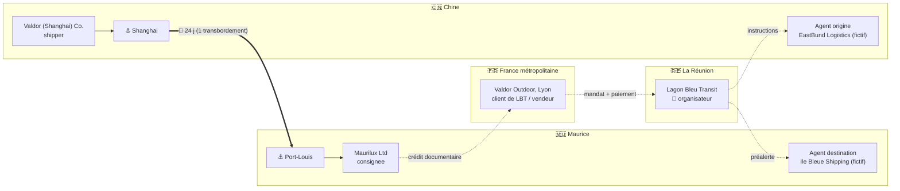
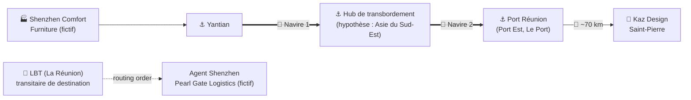
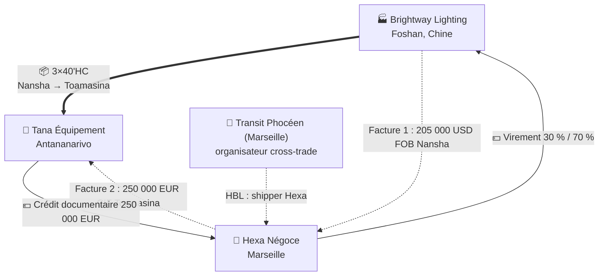

# LIVRABLE C — TROIS ÉTUDES DE CAS IMMERSIVES

> 🧪 **Toutes les données sont fictives et pédagogiques** (entreprises, personnes, navires, numéros, tarifs, montants). Hypothèse de change : **1 USD = 0,92 EUR**. Les règles juridiques citées sont des principes à vérifier sur les sources du Livrable G.

**Mode d'emploi pour l'enseignant :** chaque cas se joue en groupes de 3 à 5 étudiants. Distribuer d'abord l'histoire, la carte, les acteurs et les données (30 min de travail), puis les trois problèmes un par un (« injects » de crise toutes les 10 minutes). Le corrigé est distribué après la restitution.

---

## CAS 1 — CROSS-TRADE INTERNATIONAL : « Le conteneur que Le Port ne verra jamais »
### 1×40'HC Shanghai → Port-Louis, piloté depuis La Réunion

### 1. L'histoire de départ
Mardi, 7 h 03. Julie, coordinatrice au service Cross-Trade de **Lagon Bleu Transit (LBT)**, au Port, ouvre un e-mail de **Valdor Outdoor** (Lyon), client historique de LBT pour ses envois vers La Réunion. Valdor vient de signer avec **Maurilux Ltd**, une chaîne mauricienne de jardineries, un contrat de **85 000 USD** de mobilier d'extérieur en aluminium, fabriqué et stocké par sa filiale **Valdor (Shanghai) Co., Ltd.** Incoterm : **CFR Port-Louis, Incoterms® 2020**. Paiement : **crédit documentaire** ouvert par la banque de Maurilux. Valdor veut « un seul interlocuteur francophone qui connaît Maurice ». La marchandise ne passera jamais par La Réunion.

### 2. Carte des flux



### 3. Acteurs et rôles

| Acteur | Rôle | Pays |
|--------|------|------|
| Valdor Outdoor | Vendeur, client de LBT, paie origine + fret (CFR) | France |
| Valdor (Shanghai) Co. | Filiale, **shipper** (prépare, empote) | Chine |
| Maurilux Ltd | Acheteur, consignee/notify, paie destination + droits | Maurice |
| Banque Australe (fictive) | Banque émettrice du crédit documentaire | Maurice |
| LBT | Organisateur du transport (commissionnaire) | La Réunion |
| EastBund Logistics (fictif) | Agent origine : booking, export, documents | Chine |
| Compagnie maritime (fictive) « Coral Line » | Transporteur, émet le B/L | — |
| Ile Bleue Shipping (fictif) | Agent destination (choisi par Maurilux sur recommandation de LBT) | Maurice |

### 4. Calendrier opérationnel (J = réception de la demande)

| Jour | Étape | Responsable |
|------|-------|-------------|
| J | Demande de cotation, qualification | LBT |
| J+1 | Offre Q-0001 envoyée (3 300 USD) | LBT |
| J+2 | Acceptation écrite + copie du crédit documentaire | Valdor |
| J+3 | Booking confirmé, ETD J+14 (navire CORAL HORIZON 047W) | EastBund |
| J+10 | Empotage, photos, VGM | Valdor Shanghai / EastBund |
| J+11 | SI cut-off ; draft B/L contrôlé | EastBund / LBT |
| J+12 | CY cut-off ; VGM cut-off | EastBund |
| J+14 | ETD Shanghai | Coral Line |
| J+16 | Préalerte à Ile Bleue Shipping et à Maurilux | LBT |
| J+38 | ETA Port-Louis | Coral Line |
| J+45 | Clôture prévue (factures achat reçues, encaissement) | LBT |

**Condition du crédit documentaire 🧪 :** date limite d'expédition (*latest shipment date*) = **J+16** ; présentation des documents sous 21 jours après la date d'expédition ; B/L « clean on board », **« made out to order of Banque Australe »**, notify Maurilux.

### 5. Données chiffrées
Reprises du Module 6 : achat **2 892 USD**, vente **3 300 USD**, marge brute **408 USD** (taux de marque 12,36 %), coût interne 90 USD, profit share destination 40 USD.

### 6. Documents fictifs

**Extrait de facture commerciale (Valdor Outdoor → Maurilux)**
```
COMMERCIAL INVOICE No. VO-2026-118 (fictitious)
Seller: VALDOR OUTDOOR SAS, Lyon, France     Buyer: MAURILUX LTD, Port Louis, Mauritius
Terms: CFR PORT LOUIS, INCOTERMS® 2020        Payment: Irrevocable L/C No. BA-LC-5521 (fictitious)
Goods: Aluminium outdoor tables and chairs — 412 cartons — Origin: China
Total: USD 85,000.00     Gross weight: 7,820 kg     Volume: 66 m³
Shipment from Shanghai to Port Louis — Latest shipment date: [J+16]
```

**Préalerte (gabarit LBT)**
```
PRE-ALERT — LBT-SHA-PLU-0001
To: Ile Bleue Shipping / cc: Maurilux Ltd
MBL: COLN SHA 7788990 | HBL: n/a (carrier B/L issued directly) | Booking: 7788990
Container/Seal: ABCU1234567 / 0098765 | 1x40'HC | 412 CTNS | 7,820 KG | 66 CBM
Vessel/Voy: CORAL HORIZON 047W | ATD Shanghai: [J+14] | ETA Port Louis: [J+38] (T/S at hub)
Freight: PREPAID (CFR) | Destination charges: COLLECT from consignee
Release: against original B/L endorsed by Banque Australe
Attached: copy B/L, invoice, packing list, certificate of origin
```

### 7. Trois problèmes à résoudre

**Problème 1 — Le consignee incompatible (J+11)**
Le draft B/L reçu de la compagnie indique « Consignee : MAURILUX LTD ». Le crédit documentaire exige « to order of Banque Australe ».
*Décisions possibles :* (a) laisser tel quel, la banque « comprendra » ; (b) corriger le draft avant émission ; (c) demander à Maurilux d'amender le crédit.

**Problème 2 — Le roll-over (J+14)**
La compagnie annonce que le conteneur est roulé sur le navire suivant, départ **J+21**. La date limite d'expédition du crédit est **J+16**.
*Décisions possibles :* (a) attendre J+21 et présenter des documents non conformes ; (b) demander d'urgence un amendement du crédit (via Maurilux) ; (c) chercher un autre navire partant avant J+16, même plus cher (une autre compagnie propose J+15 pour + 250 USD, mais il faudrait sortir le conteneur du terminal et le re-livrer).

**Problème 3 — La facture surprise (J+40)**
EastBund facture 362 USD de frais origine + une ligne « Emergency Bunker Surcharge 150 USD » non mentionnée dans sa cotation.
*Décisions possibles :* (a) payer et refacturer à Valdor ; (b) payer et absorber ; (c) contester.

### 8. Corrigé

**P1 → Solution (b), immédiatement.** Le B/L doit être **strictement conforme** au crédit documentaire (principe de conformité stricte des règles et usances uniformes UCP 600 de l'ICC). LBT demande à EastBund de corriger les SI **avant** l'émission : « Consignee: TO ORDER OF BANQUE AUSTRALE — Notify: MAURILUX LTD ». Coût : nul avant émission. Après émission : réémission payante, risque de retard de présentation. *Leçon : lire le crédit documentaire **avant** de transmettre les SI.*

**P2 → Solution (b) en priorité, (c) en plan B.**
- Appeler Valdor dans l'heure ; Valdor demande à Maurilux de solliciter auprès de sa banque un **amendement** de la date limite d'expédition (et de validité). Délai réaliste : 1 à 3 jours ouvrés.
- En parallèle, LBT fait évaluer le plan B : coût de la sortie du terminal + re-livraison + nouveau booking (+ 250 USD fret + frais de terminal estimés 120 USD 🧪). Le plan B ne s'active que si l'amendement est refusé.
- ⚠️ L'option (a) est la pire : des documents non conformes donnent à la banque le droit de refuser — le vendeur dépend alors du bon vouloir de l'acheteur pour lever les réserves.
- Pour LBT : coût interne + 2 h (60 USD). Le stockage au terminal, s'il en est facturé, est demandé en exonération (cause compagnie).

**P3 → Solution (c), puis (a) si justifié.**
- Vérifier la cotation de l'agent : si l'EBS n'y figurait pas et que l'offre était ferme pour la période, la contester par écrit.
- Si la surcharge a été **officiellement** annoncée par la compagnie après la cotation, applicable à la date d'embarquement, et que l'offre LBT contenait la clause « soumis aux surcharges en vigueur à l'embarquement », la refacturer à Valdor **avec justificatif**.
- Sinon, LBT l'absorbe : marge brute 408 − 150 = 258 USD.

**Rentabilité finale (hypothèse : surcharge justifiée et refacturée) :**
| | USD |
|---|---:|
| Vente initiale + EBS refacturée | 3 300 + 150 = 3 450 |
| Achat + EBS | 2 892 + 150 = 3 042 |
| Marge brute | 408 |
| Coûts internes (3 h + 2 h) | 150 |
| Profit share destination | + 40 |
| **Contribution du dossier** | **298** |

### 9. Leçons professionnelles
1. En Cross-Trade, **le crédit documentaire pilote le transport** : la date limite d'expédition est une contrainte opérationnelle, pas un détail bancaire.
2. **Information proactive** : Valdor a su le roll-over par LBT 30 minutes après l'annonce.
3. **Les clauses** de l'offre et des accords avec les agents protègent la marge.
4. LBT n'a jamais touché la marchandise : sa valeur ajoutée est **la coordination et le contrôle documentaire**.

---

## CAS 2 — IMPORT ASIE → LA RÉUNION : « Les canapés du salon de la maison »
### 1×40'HC Yantian → Port Réunion (Port Est)

### 1. L'histoire de départ
**Kaz Design Mobilier SARL** (fictive), magasin de meubles à Saint-Pierre, a commandé pour **32 000 USD FOB Yantian** de canapés, tables et buffets à **Shenzhen Comfort Furniture** (fictive). Les meubles doivent arriver **avant un salon de l'habitat** organisé à Saint-Pierre 🧪, où Kaz Design a réservé un stand et lancé une campagne publicitaire. Le gérant, M. Payet, confie le dossier à LBT : « Je veux mon conteneur dans mon dépôt le 20, pas un jour de plus. »

### 2. Carte des flux



### 3. Acteurs et rôles

| Acteur | Rôle |
|--------|------|
| Kaz Design Mobilier | Importateur, acheteur FOB, client de LBT, redevable des droits et taxes |
| Shenzhen Comfort Furniture | Vendeur, shipper, fait l'export chinois et paie les frais jusqu'à bord (FOB) |
| Pearl Gate Logistics (fictif) | Agent de LBT à l'origine : booking, coordination, documents |
| LBT | Transitaire de destination : organise tout le transport, dédouane à La Réunion (représentation en douane), livre |
| Compagnie maritime (fictive) | Transport et transbordement ; dépose l'ENS ICS2 (selon schéma de dépôt) |
| Douane (La Réunion) | Contrôle, perception droits, octroi de mer, TVA |

**Pourquoi ce n'est pas du Cross-Trade strict :** l'organisateur (LBT) est sur le **territoire de destination**. C'est une **importation pilotée à destination**, avec un agent à l'origine. Les compétences mobilisées (agent chinois, anglais, USD, routing order) sont pourtant identiques à celles d'un desk Cross-Trade — d'où l'appellation interne parfois utilisée.

| | Cas 1 (Cross-Trade strict) | Cas 2 (Import) |
|---|---|---|
| Organisateur hors origine et destination ? | Oui | **Non** |
| Dédouanement par LBT ? | Non (agent mauricien) | **Oui** |
| ICS2 / ENS UE | Non concerné | **Concerné** |
| Taxes locales gérées par LBT | Non | **Oui** (octroi de mer, TVA DOM) — en débours |
| Client facturé | Étranger, USD | Local, EUR |

### 4. Calendrier

| Jour | Prévu | Réel |
|------|-------|------|
| J | Ordre de transport, routing order | J |
| J+5 | Booking, ETD Yantian J+12 | ✔ |
| J+12 | Départ Yantian | ✔ J+12 |
| J+18 | Arrivée au hub, départ J+20 sur navire 2 | Arrivée J+18… **non chargé** |
| J+20 | Départ du hub | **J+29** (+9 jours) |
| J+33 | ETA Port Réunion | **J+42** |
| J+35 | Livraison Saint-Pierre (salon J+38) | ? |

### 5. Données chiffrées

**Taxes à l'import (rappel Module 8, taux hypothétiques)** : valeur en douane 32 310,00 EUR ; droits 0 % ; octroi de mer + OMR 12 % = 3 877,20 EUR ; TVA 8,5 % = 3 075,91 EUR ; **total 6 953,11 EUR** (avancés par LBT en débours si le client le demande).

**Cotation LBT (EUR)**

| Ligne | Achat | Vente |
|-------|------:|------:|
| Fret maritime Yantian → Port Réunion (3 000 USD achat / 3 250 USD vente) | 2 760,00 | 2 990,00 |
| Handling fee agent origine | 46,00 | 60,00 |
| DTHC Port Réunion | 280,00 | 280,00 |
| Frais de libération (D/O) | 60,00 | 60,00 |
| Frais ENS/ICS2 compagnie | 25,00 | 35,00 |
| Transport Le Port → Saint-Pierre | 450,00 | 520,00 |
| Dédouanement (prestation LBT) | — | 150,00 |
| Frais de dossier | — | 60,00 |
| Commission d'avance de fonds (1 % des débours de 6 953,11) | — | 69,53 |
| **Total** | **3 621,00** | **4 224,53** |

- Marge brute = 4 224,53 − 3 621,00 = **603,53 EUR** ; taux de marque = **14,29 %** ; taux de marge = 603,53 ÷ 3 621 = **16,67 %**.
- Débours refacturés à l'identique (hors marge) : **6 953,11 EUR**.
- ⚠️ **Risque de trésorerie** : LBT avance 6 953,11 EUR, soit **11,5 fois sa marge** (6 953,11 ÷ 603,53 ≈ 11,52). Un impayé de taxes annule la rentabilité de plus de dix dossiers similaires.

### 6. Documents fictifs

**Routing order à l'agent (EN)**
```
ROUTING ORDER — LBT-YTN-REU-0002
Shipper: SHENZHEN COMFORT FURNITURE CO., LTD (fictitious) — Contact: Ms. Chen
Consignee: KAZ DESIGN MOBILIER SARL, Saint-Pierre, La Réunion (fictitious)
Terms: FOB YANTIAN — Freight COLLECT via LBT — 1x40'HC
Cargo: Upholstered sofas, wooden tables, sideboards — approx. 380 pcs / 6,900 kg / 68 cbm
HS codes (6 digits) REQUIRED for ICS2: 9401.61 / 9403.60 (to be confirmed by shipper)
Cargo ready: [J+8] — Required ETA: before [J+35]
ICS2: precise goods description and 6-digit HS mandatory — no generic description ("FURNITURE PARTS", "GOODS")
Please send: booking confirmation, loading photos, VGM, draft B/L for approval
```

### 7. Trois problèmes à résoudre

**Problème 1 — La description refusée (J+9).** Le shipper envoie des SI avec la description « GOODS AS PER INVOICE ». La compagnie signale que les données ENS ne peuvent être acceptées.

**Problème 2 — Le transbordement de 9 jours (J+20).** Le conteneur n'est pas chargé au hub. Nouvelle ETA : J+42, **après** le salon (J+38). M. Payet appelle, furieux : « Vous m'aviez promis le 20 ! »

**Problème 3 — Les taxes et le demurrage (J+42).** Le conteneur arrive. Kaz Design, dont la trésorerie a souffert du salon raté, demande à LBT d'avancer les 6 953,11 EUR de taxes et de livrer « tout de suite ». Franchise de 7 jours, puis 75 EUR/jour (jours 8 à 14) et 150 EUR/jour au-delà.

### 8. Corrigé

**P1.** Bloquer et corriger **avant** le chargement : la description doit être précise (« UPHOLSTERED SOFAS WITH WOODEN FRAME, WOODEN DINING TABLES, WOODEN SIDEBOARDS ») avec les codes SH à 6 chiffres. Sans ENS valide, le conteneur risque de ne pas être chargé (« do not load ») ou d'être retenu. *Leçon : ICS2 a déplacé le contrôle documentaire **avant le départ**.*

**P2 — Intervention commerciale (le cœur du cas).**
1. **Reconnaître les faits, recadrer l'engagement** : la date communiquée était une ETA indicative (vérifier ce qui a été écrit !). Si LBT a « promis » une date ferme par écrit, sa position est fragile.
2. **Agir** : escalade auprès de la compagnie pour chargement prioritaire ; vérifier s'il existe un navire plus rapide depuis le hub (autre service de la même compagnie).
3. **Proposer des solutions pour le salon** :
   - **Fret aérien partiel** de quelques pièces d'exposition (sous réserve que le fournisseur dispose d'unités supplémentaires) : estimation à faire chiffrer (400 kg × tarif aérien hypothétique de 5,50 EUR/kg = 2 200 EUR + frais) — coûteux, mais peut sauver le salon. Décision au client.
   - **Dédouanement anticipé** : préparer la déclaration avant l'arrivée (la réglementation de l'UE permet le dépôt d'une déclaration avant la présentation des marchandises), réserver le transport et l'enlèvement dès la mise à disposition → gagner 1 à 2 jours.
   - Exposer sur le stand des visuels et prendre des **commandes sur catalogue**, avec livraison garantie à J+45.
4. **Rendre compte** chaque jour jusqu'à l'arrivée.
5. **Geste commercial** proportionné (ex. frais de dossier offerts) — **sans reconnaissance de responsabilité** non fondée.

**P3.**
- **Ne pas avancer** 6 953,11 EUR sans garantie : vérifier la ligne de crédit client, demander un paiement préalable ou un acompte. La décision relève de la direction financière.
- Calculer et **annoncer** le coût de l'attente : libération au jour 10 → 3 jours × 75 = **225 EUR** ; au jour 16 → 7 × 75 + 2 × 150 = **825 EUR**.
- Solution type : Kaz Design paie les taxes en deux virements sous 48 h ; LBT dédouane immédiatement ; livraison jour 10 ; demurrage 225 EUR refacturé.

### 9. Leçons professionnelles
1. Une importation n'est pas du Cross-Trade strict, même si les compétences se ressemblent.
2. **Ne jamais vendre une ETA comme une date garantie.**
3. Les **débours** (taxes) représentent un risque financier bien supérieur à la marge.
4. ICS2 impose une **qualité de données** dès l'origine : la description « au rabais » bloque le départ.

---

## CAS 3 — OPÉRATION TRIANGULAIRE COMPLEXE : « 250 000 € qui ne touchent jamais le sol français »
### 3×40'HC Nansha → Toamasina — négociant français

### 1. L'histoire de départ
(Le scénario d'ouverture du cours.) **Hexa Négoce SAS** (Marseille) achète à **Brightway Lighting** (Foshan) et revend à **Tana Équipement SARL** (Antananarivo) 3×40'HC de luminaires LED professionnels. Hexa confie le transport à son transitaire marseillais, **Transit Phocéen** (fictif) : pour lui, c'est un **Cross-Trade** (organisateur en France, flux Chine → Madagascar). Pour Hexa, c'est un **commerce triangulaire**. Claire, directrice commerciale d'Hexa, pose une condition : « Tana ne doit jamais connaître Brightway ni notre prix d'achat. »

### 2. Carte des flux



### 3. Les deux contrats et leurs Incoterms

| | Contrat 1 (achat) | Contrat 2 (vente) |
|---|---|---|
| Parties | Brightway → Hexa | Hexa → Tana |
| Incoterm | **FOB Nansha, Incoterms® 2020** | **CIF Toamasina, Incoterms® 2020** |
| Prix | 205 000 USD | 250 000 EUR |
| Paiement | 30 % à la commande, 70 % contre copie du B/L (virement) | Crédit documentaire irrévocable, payable à vue |
| Transfert des risques | À bord à Nansha | À bord à Nansha |
| Qui paie le fret principal ? | Hexa (acheteur FOB) | Hexa (vendeur CIF) |
| Assurance | Pas d'obligation | Hexa : obligatoire, 110 %, minimum ICC (C) ; le crédit exige ici ICC (A) |

**Pourquoi c'est cohérent :** le risque passe au même point (à bord à Nansha) dans les deux contrats → Hexa ne porte **aucun risque transport** propre ; il maîtrise le fret et l'assurance car il les paie dans les deux sens. Hexa contrôle donc le transport — condition de la confidentialité.

### 4. Calendrier

| Jour | Étape |
|------|-------|
| J | Signature avec Tana ; Tana demande l'ouverture du crédit documentaire |
| J+3 | Commande à Brightway ; acompte 30 % (61 500 USD) |
| J+10 | Crédit documentaire notifié à Hexa : expédition au plus tard J+45, validité J+66 |
| J+35 | Marchandise prête ; booking via Transit Phocéen et son agent à Guangzhou |
| J+40 | Départ Nansha (prévu) |
| J+42 | Paiement du solde de 70 % à Brightway (143 500 USD) contre copie du B/L |
| J+45 | Présentation des documents à la banque |
| J+65 | Arrivée Toamasina (indicatif, avec transbordement) |

### 5. Données chiffrées — rentabilité du négociant

| Poste | Calcul | EUR |
|-------|--------|----:|
| Chiffre d'affaires | Facture Hexa → Tana | 250 000,00 |
| Achat marchandises | 205 000 USD × 0,92 | − 188 600,00 |
| Fret maritime 3×40'HC | 3 × 3 100 USD = 9 300 USD × 0,92 | − 8 556,00 |
| Assurance | 250 000 × 110 % × 0,20 % 🧪 | − 550,00 |
| Frais bancaires (crédit documentaire, virements) | forfait 🧪 | − 1 200,00 |
| Frais du transitaire (documentation, HBL, gestion) | forfait 🧪 | − 900,00 |
| **Marge du négociant** | | **50 194,00** |
| Taux de marque | 50 194 ÷ 250 000 | **20,08 %** |

**Sensibilité au change :** si l'USD s'apprécie de 5 % (1 USD = 0,966 EUR) avant le paiement de l'achat : achat = 198 030 EUR (+ 9 430 EUR) → marge = **40 764 EUR** (16,31 %). *D'où l'intérêt d'une couverture (achat à terme de USD).* (Pour simplifier, le fret est laissé au taux initial.)

**Besoin de trésorerie :** Hexa paie 205 000 USD à Brightway **avant** d'être payé par la banque de Tana → besoin de financement d'environ 188 600 EUR sur 1 à 2 mois (escompte, crédit de préfinancement, ou alternative : **crédit documentaire transférable** ou **adossé** (*back-to-back*), qui utilisent le crédit de Tana pour garantir Brightway).

### 6. Analyse juridique, fiscale et documentaire (principes)
- **Douane UE :** aucune formalité — la marchandise n'entre jamais dans le territoire douanier de l'Union.
- **Chine :** déclaration d'export par Brightway (FOB).
- **Madagascar :** importation par Tana ; la valeur en douane reposera en principe sur la facture de la vente pour l'exportation vers Madagascar (Hexa → Tana) ; documents et éventuelles formalités préalables à vérifier auprès de l'agent local et de l'administration malgache.
- **TVA française :** la livraison par Hexa de biens qui se trouvent en Chine au moment du départ de l'expédition n'est en principe **pas localisée en France** (lieu de départ de l'expédition, art. 258 I a CGI) ✅ ; les obligations comptables et déclaratives d'Hexa restent à valider avec son expert-comptable.
- **Sanctions :** Hexa (entreprise de l'UE) et Transit Phocéen filtrent Brightway, Tana, les banques, le navire et les ports.

### 7. Documents (montage confidentiel légitime)

| Document | Qui l'émet | Ce que voit Tana |
|----------|-----------|------------------|
| MBL (compagnie) | Compagnie | ❌ Rien : MBL entre l'agent de Guangzhou et l'agent de Toamasina |
| **HBL** (Transit Phocéen en NVOCC) | Transit Phocéen | ✅ Shipper : **Hexa Négoce SAS** ; Consignee : « to order of [banque de Tana] » ; Notify : Tana |
| Facture Brightway → Hexa | Brightway | ❌ Jamais transmise à Tana |
| Facture Hexa → Tana | Hexa | ✅ |
| Packing list | Brightway, sur **papier neutre** ou établie par Hexa à partir des données réelles | ✅ (sans mention de Brightway ni prix) |
| Certificat d'origine | Organisme habilité en Chine | ✅ Mentionne l'**origine Chine** et en général l'**exportateur** : la confidentialité a ses limites |
| Certificat d'assurance | Assureur d'Hexa | ✅ |

### 8. Trois problèmes à résoudre

**Problème 1 — La banque et le HBL.** Le crédit documentaire exige un « B/L » ; la banque de Tana acceptera-t-elle un **House B/L** émis par Transit Phocéen ?

**Problème 2 — L'enveloppe dans le conteneur.** L'agent de Guangzhou signale que Brightway a l'habitude de glisser **sa facture et sa packing list à en-tête** dans le conteneur.

**Problème 3 — Le retard de production.** À J+38, Brightway annonce 10 jours de retard : départ J+50, **après** la date limite d'expédition du crédit (J+45). Brightway propose aussi : « Pour gagner du temps, on peut vous faire un Switch B/L avec un port de chargement différent pour coller au crédit. »

### 9. Corrigé

**P1.** Selon les UCP 600 (art. 20), un connaissement est acceptable s'il indique le **nom du transporteur** et est signé par le transporteur, le capitaine, ou un agent identifié agissant pour leur compte. Un HBL émis par un NVOCC **signant en qualité de transporteur** (« as carrier ») est généralement acceptable, **sauf si le crédit l'exclut** (certains crédits stipulent « House B/L not acceptable »). → Vérifier le texte du crédit **avant** ; sinon, demander un amendement, ou prévoir un MBL avec Hexa comme shipper (Hexa contracte bien le transport et peut légitimement y figurer comme chargeur si la compagnie l'accepte).

**P2.** Instruction écrite à Brightway et à l'agent : **aucun document commercial dans le conteneur**, marquage des colis neutre (sans nom du fabricant, sauf obligation réglementaire d'étiquetage ou de marquage qui, elle, doit être respectée). Contrôle par photos d'empotage. Clause contractuelle de non-contournement et de confidentialité (NCNDA) dans le contrat Brightway–Hexa.

**P3.**
- **Refuser catégoriquement** le Switch B/L avec un faux port de chargement : c'est une **falsification** du document de transport, constitutive de fraude documentaire (et de fraude au crédit documentaire). Elle exposerait Hexa, le transitaire et la compagnie à des poursuites, et l'assurance pourrait refuser sa garantie.
- **Solution légale :** Hexa informe immédiatement Tana et lui demande de solliciter un **amendement** du crédit (nouvelle date limite d'expédition J+52, validité J+73). Hexa peut proposer une compensation commerciale (remise, prise en charge des frais d'amendement), et répercuter les pénalités de retard prévues au contrat Brightway–Hexa.
- Alternative si le crédit l'autorise (« partial shipments allowed ») : expédier 2 conteneurs prêts avant J+45 et le 3e ensuite.

### 10. Leçons professionnelles
1. **Commerce triangulaire et Cross-Trade sont deux dimensions** : contractuelle pour Hexa, transport pour Transit Phocéen.
2. Aligner les **points de transfert des risques** des deux contrats protège le négociant.
3. La confidentialité se construit **en amont** (Incoterms qui donnent le contrôle du transport, HBL, documents neutres, clauses), pas par des manipulations a posteriori.
4. **Ligne rouge absolue** : on peut changer le nom du chargeur si c'est exact ; on ne change **jamais** les faits (marchandise, origine, ports, dates).
5. La marge du négociant (≈ 20 %) dépend fortement du **change** et du **financement**.
